# Wolfgang #51 에셋 재설계 — 기존 참고자료 재사용, 식사 콘셉트 폐기

상태: **재설계 방향 승인. 운영 이미지·태그·DB·Lock·#50 미변경.** 승인 r2 본문 / Text Lock / Appearance Lock은 그대로다. 이미 병합된 #1633은 열거나 수정하지 않는다. 외부 반입 기능은 배포된 보조 경로로 유지하되, 자동 이미지 제작 목표를 사용자 재업로드로 넘기지 않는다.

식사 폐기와 감정 컷의 서류 반복을 줄이는 방향을 승인했다. 운영 태그는 아직 바꾸지 않는다. 현재 픽셀과 다른 감정을 이름만 바꿔 붙이지 않는다.

## 1. 기존 참고자료 복원

### 1.1 찾은 자료 — Cluster B 번들 (생성 후보의 실제 바이트)

경로: `public/official-supply/style-seeds/romance-fantasy-cluster-b-v1/`. 출처 커밋 `c343b1c5` (PR #1133). 사용자 원본을 STYLE ONLY로 재포장한 묶음이다. 원본 파일명 `user-ref-N.webp`는 저장소에 한 번도 없다.

| userRef | 파일 | 역할 (manifest) | 생성 기본 | 픽셀에서 읽히는 스타일 정보 |
|---|---|---|---|---|
| 7 | `primary/b7-black-gold-uniform.webp` | male_black_gold_sharp | **예** (Image 2 기본 STYLE 루트) | 흑·금 군복, 노란 눈, 흰 배경, 큰 면 단위 선과 셀 명암. 모피 거의 없음 |
| 13 | `primary/b13-black-red-fur.webp` | male_black_red_accent | **예** (대표 전용 companion) | 흑·적 군복, 빨간 눈, 검은 모피. 큰 깃털 덩어리·잉크 외곽·2~3단 명암 |
| 5 | `primary/b5-red-dress-female.webp` | female_gold_embroidery | **예** (대표 전용 companion) | 적·금 자수 드레스, 직물 면 분리. 남성 정체성 아님 |
| 3 | `primary/b3-blue-window-full.webp` | cool_light_full_body | 아니오 (catalog) | 창가 전신, 차가운 청광, 흑·금 군복 |
| 17 | `primary/b17-sword-flowers.webp` | graphic_red_mood | 아니오 (catalog) | 그래픽 적색 분위기 |
| 6 | `holdout/b6-black-gold-smirk.webp` | holdout | 아니오 | 흑·금, 얕은 미소. v3 `p1`과 **바이트 동일** |
| 10 | `holdout/b10-moon-scene.webp` | holdout | 아니오 | 달밤 장면 |
| 11 | `holdout/b11-purple-armor.webp` | holdout | 아니오 | 보라·은 갑옷. v3 `p4`와 **바이트 동일** |
| 14 | `holdout/b14-red-eyes-profile.webp` | holdout | 아니오 | 적안 측면 |

SHA 교차 확인 (같은 업로드가 두 번들에 다른 이름으로 들어감):

| Cluster B | user-owned v1 | SHA-256 |
|---|---|---|
| `b6-black-gold-smirk.webp` | `p1-face-rendering.webp` | `25e0c98e…cf5b9fb3` |
| `b5-red-dress-female.webp` | `p2-costume-material-female.webp` | `fdab6b92…32e4998` |
| `b11-purple-armor.webp` | `p4-face-armor-metal.webp` | `18a6216e…f4c42eff` |

### 1.2 찾은 자료 — 이전 user-owned v1 (Cluster A에 가깝다고 표시된 8장)

경로: `public/official-supply/style-seeds/romance-fantasy-user-owned-v1/`. 커밋 `6a8fcece`. UUID `sourceFile`이 남아 있어 원본 업로드 흔적은 이 번들만 보존한다.

| id | 파일 | sourceFile | 번들 기록 이유 | 생성 기본 |
|---|---|---|---|---|
| P1 | `primary/p1-face-rendering.webp` | `ca7d036e-…567.webp` | 얼굴 렌더 | 예 (v3 기본 3장) |
| P2 | `primary/p2-costume-material-female.webp` | `111f5776-…ebf.webp` | 여성 직물·자수 | 예 |
| P3 | `primary/p3-lighting-composition.webp` | `52dcbe81-…601.webp` | 림라이트·구도 | 예 |
| P4 | `catalog/p4-face-armor-metal.webp` | `0443606d-…7b4.webp` | 금속 catalog | 아니오 |
| P5 | `catalog/p5-face-skin-hair.webp` | `351d05d3-…bb5d.webp` | 피부·머리 catalog | 아니오 |
| H1–H3 | holdout 3장 | UUID 3개 | 각도·이벤트 holdout | 아니오 |

Cluster B 생성 가드는 이 v3 경로를 Cluster B 요청에 넣지 않는다 (`CLUSTER_A_LEGACY_STYLE_REF_PATH_MARKERS`). 검토용으로는 읽는다. 같은 바이트가 Cluster B 이름(b6/b5/b11)으로 이미 들어가 있으면 그쪽을 쓴다.

### 1.3 못 찾은 자료

저장소·git 전 역사·리뷰 에셋·`/opt/cursor/artifacts`에 **이미지 파일이 없다.** manifest 문자열만 있다. 사용자에게 다시 올리라고 요구하지 않는다. 아래는 빠진 번호이지, 지금 재업로드 목록이 아니다.

| ID | manifest 분류 | 파일 | 의미 |
|---|---|---|---|
| user-ref-1, 2 | `comparisonOnly` | 없음 | 비교 전용으로 생성에서 제외했다고만 기록 |
| user-ref-4, 12, 15 | `exposureBias` | 없음 | 노출 편향으로 제외 |
| user-ref-8, 9 | `otherFamilyReview` | 없음 | 다른 그림체 계열 검토 |
| user-ref-18 | `seasonalNovelty` | 없음 | 계절·이벤트 신규성 |
| user-ref-16 | **언급 없음** | 없음 | 18번 번호 체계에 16이 원래 있었는지는 저장소로 증명 불가 |

원본이 18장이었다면, 커밋된 바이트는 **9장(Cluster B) + v3 전용 5장(p3, p5, h1–h3)** 이고 제외 8장은 카테고리만 남았다. 전체 원본 세트는 복원하지 못했다.

### 1.4 검토 묶음과 생성 요청 묶음

한 요청에 찾은 자료를 전부 넣지 않는다. 코드 한도 `OFFICIAL_STYLE_GENERATION_REF_MAX = 3`.

| 용도 | 넣는 자료 | 넣지 않는 자료 |
|---|---|---|
| 사람 검토 (이번 문서) | 찾은 Cluster B 9장 + v3 잔여 5장 + 운영 14장 | 없는 파일 |
| 대표 생성 요청 | **b7 → b13 → b5** 만 | catalog b3/b17, holdout 4장, v3 레거시 경로, 없는 user-ref |
| 나머지 13장 생성 요청 | Image 1 = 승인 대표 IDENTITY, Image 2 = **b7만** | b13/b5는 variation에 안 감. 실패한 음식 후보는 참조 금지 |
| 나중에 한 축만 바꿀 때 | 대표가 실패한 뒤에만 catalog(b3 조명 또는 b17 무드)를 3장 자리 중 하나와 교체 | 4장 이상 동시 투입 |

b7/b13/b5가 3장으로 고른 근거는 역할이 겹치지 않게 짠 것이다.

- **b7**: 선·얼굴·금장 셀. 모피가 없어 흑철 갑옷 면 처리의 기준.
- **b13**: 검은 모피 덩어리와 잉크 외곽. Appearance Lock의 늑대 모피를 그릴 때 필요한 축.
- **b5**: 자수·직물 면 분리. 성별·의상 정체성은 복사 금지.

이 세 장이 “전체 자료 중 가장 예쁜 세 장”이 아니라, 3장 한도에 맞춘 기능 분할이다. 나머지 찾은 장은 검수용이다.

## 2. 운영 14장의 실제 픽셀 (2026-10-17 GET)

URL 패턴: `https://hav.chat/uploads/official-pilot-rf-v4-02__{slot}-a1.webp`. 로그인 없이 200. #1633 이후 SHA `9a92db1` 배포본과 동일 파일이다. 제목이 아니라 화면으로 판독했다.

문서·증거 대조가 반복되는 칸: **emo1, emo3, emo5, scene1, scene2** (두 장 서류). sig1은 지도, sig2는 책상 위 기록. 감정 6칸 중 3칸이 서류다.

미소가 실제로 보이는 칸: **없음.** sig4 `personTag`와 emo6 계획 태그는 미소지만, 입꼬리가 올라간 컷이 없다.

| 슬롯 | 현재 태그 | 화면에서 실제로 읽히는 것 |
|---|---|---|
| rep | 흑철 늑대공 | 흰 배경 상반신, 검을 잡은 정면, **무표정**. 모피는 b13보다 잔 결이 촘촘함 |
| sig1 | 철혈의 지휘관 | 지휘실, 장갑 손으로 지도를 짚음. 표정은 차가움 |
| sig2 | 흉터의 맹세 | 턱을 괴고 옆을 봄. 흉터를 만지거나 문서를 덮는 동작은 없음 |
| sig3 | 봉인고의 열쇠 | 상자 위 열쇠. 동작은 읽힘 |
| sig4 | 절제된 온기 | 옆얼굴 클로즈업 + 수프 그릇. **미소 없음. 건넴 없음.** 모피 잔 질감 |
| emo1 | 기록의 모순 | 봉인 편지 두 장. 무표정 |
| emo2 | 분노의 억제 | 주먹을 책상에 내린 클로즈업. 분노는 약하게 읽힘 |
| emo3 | 증거 앞의 판단 | 서류 두 장 + 전술판. 아래를 봄 |
| emo4 | 뜻밖의 동요 | 성벽에서 턱을 괴고 풍경을 봄. **당황 없음** |
| emo5 | 경계의 완화 | 펼친 서류를 내려다봄. 경계 완화로 안 읽힘 |
| emo6 | 귀환의 안도 | 성벽에 앉아 열쇠를 든 채 옆을 봄. **미소 없음** |
| scene1 | 위조된 명령서의 밤 | 집무실, 황실 문장 vs 늑대 인장 서류 두 장 |
| scene2 | 봉인된 장부의 빈칸 | 도서관, 서류 두 장 |
| scene3 | 황실의 마지막 압박 | 유리온실, 한 손에 검·한 손은 탁자. 단호함은 약함 |

## 3. sig4 식사 콘셉트 폐기

기존 음식 장면과 b7/b13 불합격 후보는 더 고치지 않는다. 수프를 더 잘 밀게 만드는 방향은 닫는다.

대체 장면은 일상 RP에서 자주 쓰이고, 소품 전달 없이도 감정이 보이게 한다.

- **표정:** 입꼬리만 살짝 올린 옅은 미소. 이를 보이지 않는다. 눈은 상대(카메라)를 본다.
- **행동:** 갑옷은 그대로. 창가 돌벤치에 앉아 상체를 상대 쪽으로 돌린다. 양손은 허벅지 위. 그릇·열쇠·서류를 들지 않는다.
- **구도:** 기존 shot owner 유지 — `right_three_quarter` / `low_angle` / `knee_or_full` / `environment`. 얼굴이 잘리지 않는 무릎~전신.
- **단독:** 유저·연인 실루엣 없음.

다른 슬롯과 겹침:

| 후보와 겹칠 수 있는 칸 | 구분 |
|---|---|
| emo6 현재 픽셀 (성벽 착석) | 그쪽은 옆모습·열쇠·미소 없음. 새 sig4는 **상대를 보고 웃는** 휴식 |
| emo6 새 계획 (`안도`) | 상대의 무사를 확인한 뒤 긴장이 풀리는 감정 컷. sig4는 창가에서 상대를 보며 옅게 웃는 휴식 |
| emo4 현재 픽셀 (턱 괴고 풍경) | 상대를 보지 않음. 새 sig4는 카메라 쪽 |
| sig2 (턱 괴고 생각) | 책상·사고. 새 sig4는 손 비움·온기 |
| emo2 (주먹) | 반대 감정 |

shot 판의 잔여 라벨: 합성 결과 `poseFamily=prop`, `expressionFamily=tense`가 아직 음식 판에서 돌고 있다. 이 메타데이터는 제출·재기록한 `primaryPrompt`에 들어가지 않는다. Expression/Pose 줄이 감정·동작을 소유한다. 이번 단계는 이 이유로 `shotPlan`을 바꾸지 않는다.

## 4. 슬롯별 현재 → 문제 → 새 장면·태그

태그는 자동 선택용이다. 작품 제목을 쓰지 않는다. 감정 칸은 감정, 행동·상황 칸은 짧은 행동·상황. `normalizeCreatorAssetTag` 32자. `personTag`만 `ASSET_PERSON_TAGS`에 묶는다. 일반 제작자 수동 태그는 그대로다 (`createCharacterFromForm` / `normalizeCreatorAssetTag`).

현재 이미지가 새 태그와 다르면 이름만 바꾸지 않는다. 그 칸은 재생성 대상이다.

| 슬롯 | 현재 장면 · 태그 | 문제 | 새 장면 · 태그 | 재생성 |
|---|---|---|---|---|
| rep | 정면 검 파지 · `흑철 늑대공` | 작품 제목. 픽셀은 무표정. 잔 질감 IDENTITY 위험 | 같은 카드 구도 유지. 태그 `기본 초상` (대표 고유 태그. RP 감정 태그와 분리). 현재 무표정 픽셀에 `편안함`/`안도`를 붙이지 않음 | 스타일 게이트 후 |
| sig1 | 지도를 짚음 · `철혈의 지휘관` | 제목 | 장면 유지. 태그 `지도를 짚음` (`personTag` 진지함) | 태그 교체만으로 가능. 그림체는 대표 이후 |
| sig2 | 턱을 괴고 생각 · `흉터의 맹세` | 제목. 흉터 동작 없음. 서류실 반복 | 현재 픽셀에 맞춰 `턱을 괴고 생각` (`personTag` 의심). 흉터 연출은 넣지 않음 | 태그 우선 |
| sig3 | 열쇠로 상자 확인 · `봉인고의 열쇠` | 제목 | 장면 유지. 태그 `열쇠를 확인함` (`personTag` 진지함) | 태그 우선 |
| sig4 | 수프 클로즈업 · `절제된 온기` | 폐기한 식사. 미소 없음 | **창가에서 상대를 보며 옅게 웃는 휴식** (§3). 태그 `옅은 미소` (`personTag` 미소) | 필수. 음식 후보 참조 금지 |
| emo1 | 편지 두 장 · `기록의 모순` | 제목. 서류 반복. 일반 대화 부적합 | 상대를 보며 눈썹만 좁힌 **의심**. 서류 없음. 태그 `의심` | 필수 |
| emo2 | 주먹을 내림 · `분노의 억제` | 제목에 가깝고 분노가 약함 | 턱을 다문 억제된 **분노**, 서류 없음. 태그 `분노` | 표정 강화 시 재생성 |
| emo3 | 서류 대조 · `증거 앞의 판단` | 제목. scene1/2와 동일 행동 | 상대 말을 듣는 **진지함**. 손 비움. 태그 `진지함` | 필수 |
| emo4 | 풍경을 봄 · `뜻밖의 동요` | 제목. 당황 없음 | 시선을 피했다가 다시 보는 **당황**. 태그 `당황` | 필수 |
| emo5 | 서류 응시 · `경계의 완화` | 제목. 또 서류. 현재 픽셀은 편안함이 아님 | 소품 없이 어깨와 눈가의 긴장이 풀린 **편안함**. 서류·검·열쇠 없음. 태그 `편안함`. 현재 서류 컷에 이 이름을 붙이지 않음 | 필수 |
| emo6 | 성벽 착석 · `귀환의 안도` | 제목. 미소 없음. 현재 픽셀은 안도가 아님 | 상대의 무사를 확인한 뒤 긴장이 풀리는 **안도**. 태그 `안도`. 현재 성벽·열쇠 컷을 `안도`나 `미소`로 부르지 않음 | 필수 |
| scene1 | 인장 다른 서류 · `위조된 명령서의 밤` | 제목. 사건 장면으로는 유효 | 장면 유지. 태그 `문서를 대조함` (`personTag` 의심) | 태그 우선 |
| scene2 | 도서관 서류 · `봉인된 장부의 빈칸` | 제목. 서류이지만 장소가 다름 | 장면 유지. 태그 `기록을 맞춤` (`personTag` 진지함) | 태그 우선 |
| scene3 | 유리온실 · `황실의 마지막 압박` | 제목. 압박 표정은 약함 | 장소 유지, 표정은 단호한 **긴장**. 태그 `긴장` | 표정 약하면 재생성 |

서류 조사는 scene1·scene2·(선택) sig1에만 남긴다. 감정 6칸은 일반 대화 태그(`의심` `분노` `진지함` `당황` `편안함` `안도`)로 연다. 대표 태그 `기본 초상`은 이 감정 목록에 넣지 않는다.

## 5. 생성 입력 확인 — 실험 합성과 승인 r2 컴파일러

제출했던 `sig4-rest-compose.json`에는 `MATURE MALE VISUAL AGE LOCK`이 없었다. 원인은 새 전역 문구 누락이 아니라 실험용 draft 입력이었다.

| 입력 | gender | age | genres | audience | `buildMatureMaleVisualAgePrompt` |
|---|---|---|---|---|---|
| `/tmp/compose-sig4-redesign.ts` 스텁 | male | 34 | `romance_fantasy` | `all` | null |
| 정식 compiler `loadCompiledOfficialCharacterSource("pilot-rf-02")` | male | 34 | `로맨스 판타지` | `female` | `MATURE_MALE_VISUAL_AGE_RULE` |
| 승인 r2 `loadApprovedWolfgangV4Source()` | male | 34 | `로맨스 판타지` | `female` | 동일 |

`isMatureMaleRofanRomanceTarget`은 한국어 장르 슬러그 `로맨스 판타지`와 `audience !== "male"`을 요구한다. 영어 `romance_fantasy`와 `audience: "all"`은 가드를 끈다. r2 원고·장르·Lock은 바꾸지 않았다. 새 전역 문장을 추가하지 않았다.

compiler draft와 승인 r2 draft로 다시 합성한 sig4 `primaryPrompt`는 바이트가 같다 (`compose-input-diff.json`). 고친 입력의 최종 prompt는 `sig4-rest-compose.json`이다. 이전 스텁 제출본은 `sig4-rest-compose.experimental-stub.json`으로 옮겼다. shot의 `poseFamily=prop` / `expressionFamily=tense`는 메타데이터로만 남고, 재기록한 `primaryPrompt`에는 없다. 이 이유로 shot 시스템을 수정하지 않는다.

대표 후보 합성도 같은 정식 compiler draft를 `composeOfficialSlotGeneration`에 넣었다. 증거: `rep-style-only-compose.json`. STYLE ONLY 참조는 b7→b13→b5. 운영 대표와 음식 후보는 참조 목록에 없다. `MATURE MALE VISUAL AGE LOCK`이 들어 있다.

## 6. sig4 최종 생성 prompt

유료 POST 없이 기존 owner로 합성했다. 증거: `assets/wolfgang-asset-redesign/sig4-rest-compose.json`.

슬롯 입력:

- `tag`: `옅은 미소`
- `personTag`: `미소`
- `expression`: `긴장을 풀고 상대를 바라보며 입꼬리만 살짝 올린 옅은 미소. 이를 보이지 않는다.`
- `pose`: `갑옷을 벗지 않은 채 창가 돌벤치에 앉아 상체를 상대(카메라) 쪽으로 돌린다. 양손은 허벅지 위에 올려 두고 소품을 건네지 않는다. 어깨는 살짝 내려가 있고, 얼굴·눈·옅은 미소가 한눈에 보인다. 유저는 그리지 않는다.`
- `location` / `situation`: 서명 슬롯이라 prompt에 들어가지 않는다. 장면은 expression/pose가 담당한다.

참조 (현행 variation owner):

1. IDENTITY — `https://hav.chat/uploads/official-pilot-rf-v4-02__rep-a1.webp`
2. STYLE — `https://hav.chat/official-supply/style-seeds/romance-fantasy-cluster-b-v1/primary/b7-black-gold-uniform.webp`

실패한 sig4·b7 음식 후보·b13 음식 후보는 참조 목록에 없다.

합성 primary prompt 전문은 위 JSON의 `primaryPrompt`다. 핵심 한 블록만 여기에 적는다.

```
Create one horizontal 3:2 roleplay illustration (1536x1024). ...
SHOT RESPONSIBILITY (sig4/signature): head turned right three-quarter view; low-angle camera ... knee-up or full-body ... identifiable environment ...
REFERENCE IMAGES: Image 1 is IDENTITY ONLY. Image 2 is STYLE ONLY. ...
MATURE MALE VISUAL AGE LOCK — Keep an adult man in his 30s visibly mature ...
Expression: 긴장을 풀고 상대를 바라보며 입꼬리만 살짝 올린 옅은 미소. 이를 보이지 않는다.
Pose: 갑옷을 벗지 않은 채 창가 돌벤치에 앉아 상체를 상대(카메라) 쪽으로 돌린다. 양손은 허벅지 위에 올려 두고 소품을 건네지 않는다. 어깨는 살짝 내려가 있고, 얼굴·눈·옅은 미소가 한눈에 보인다. 유저는 그리지 않는다.
FOREGROUND CAST: exactly one foreground person — the named character only.
```

Appearance Lock·Cluster B DNA·안전 문구는 기존 조립기를 그대로 탄다. 고친 것은 실험 draft의 genres/audience 입력뿐이다. quality/model/참조 루트와 r2 Lock은 그대로다.

## 7. 대표 잔 질감이 IDENTITY로 따라올 가능성

“잔 질감”은 유리 재질이 아니라, 운영 대표 모피·금속에 있는 **외곽 없는 잔 결·다중 반사**를 말한다.

확인된 사실:

- 운영 대표 `/uploads/official-pilot-rf-v4-02__rep-a1.webp` SHA `a66c49d4…3a45f1`은 b13 seed보다 모피 잔 결이 많다. 이전 기록과 이번 육안이 같다.
- 나머지 13장은 모두 이 대표를 Image 1 IDENTITY로 썼다. 14장 모두 같은 촘촘한 모피·크롬 반사가 반복된다.
- sig4를 b7 STYLE만 바꿔도, b13 STYLE만 바꿔도 음식 후보는 seed 그림체에 못 미쳤다. 공통항은 **같은 대표 IDENTITY**다.

판단:

- 잔 질감이 IDENTITY를 통해 따라올 **가능성은 높다.** 대표 후보를 한 장 뽑아 그림체를 비교하는 실험은 열 수 있다. 그 한 장이 나아 보여도 IDENTITY 질감이 원인이었다고 확정하지 않는다.
- 그래서 13장을 지금 운영 대표로 다시 그리면 같은 결이 재유입될 위험이 있다. 자동 제작을 사용자 외부 한 장 업로드로 우회하지 않는다. #1633 반입은 보조일 뿐 그림체 복구 경로가 아니다.
- 다음 생성 순서는 **대표를 Cluster B 3장(b7+b13+b5) STYLE ONLY로 다시 뽑는 것**이 먼저다. 그 대표가 검수를 통과한 뒤에만 나머지 칸의 IDENTITY로 쓴다.
- 현재 대표를 IDENTITY로 둔 채 variation STYLE만 바꾸는 실험은 이미 두 번 실패했다. 같은 방향의 세 번째 강화는 하지 않는다.

## 8. 유지 / 하지 않은 것

유지: 승인 r2 본문, Text Lock, Appearance Lock, #50, 운영 14 URL·태그·앵커, 로어북, 공개 상태, 소유권, 알림, 유료 RP, 일반 제작자 수동 태그, 배포된 #1633 반입 코드.

하지 않음: 운영 apply, 14태그 백필, 음식 후보 적용, 나머지 13장 생성, #1633 재오픈, 사용자 재업로드 요청, 원고·장르·Lock 재작성, shot 시스템 수정, 새 전역 prompt 문장 추가.

대표 후보 한 장은 기존 `composeOfficialSlotGeneration` owner와 격리 환경에서만 뽑았다. 검수 전에는 운영 대표를 바꾸지 않는다. 나머지 13장은 생성하지 않았다.

## 9. 격리 대표 후보 1장 (실험)

기존 owner: `composeOfficialSlotGeneration` + `prepareOfficialImageReferences` + `callOpenAiImageEdit`. fallback/retry/vision 없음. POST 1회.

| 항목 | 값 |
|---|---|
| 실행 환경 모델 | `gpt-image-2.5-sunburst` (Railway `chat-ai` production `OPENAI_IMAGE_MODEL`) |
| profile | 1024x1536 · medium · n=1 · compression 88 |
| 참조 | b7 + b13 + b5 STYLE ONLY. 운영 대표·음식 후보 없음 |
| b7 SHA | `fc4047ac…d3168` |
| b13 SHA | `f9d01ebc…d4ae6` |
| b5 SHA | `fdab6b92…e4998` |
| 전송 prompt SHA | `08b3634f…946a21` (`rep-style-only-compose.json`) |
| request ID | `req_8abe53c02b0a43adb963341c93359baf` |
| 비용 | 0.056524 USD (상한 0.08) |
| 이전 누적 | 0.13891452 USD |
| 이번 포함 누적 | **0.19543852 USD** |
| 원본 바이트 | `rep-candidate-raw.webp` 289838 B, SHA `23da8467…cb8a85`. inspect 전 보존. inspect 후에도 동일 |


### 그림체 충실도 (STYLE)

근거는 seed와 원본 크기 크롭이다. 새 후보는 운영 대표보다 머리카락 덩어리가 크고, 모피는 b13처럼 깃털 면이 보이며, 흉갑 반사는 운영 대표의 다중 크롬 띠보다 면이 단순하다. 다만 b13의 잉크 외곽·2~3단 명암에는 아직 못 미친다. 모피 잔 결이 완전히 사라진 것은 아니다.

이 한 장이 나아 보여도, IDENTITY 질감이 원인이었다고 확정하지 않는다. 이번 요청은 운영 대표를 참조에서 뺐을 뿐이고, prompt·모델·quality도 함께 쓰였다.

### 캐릭터 외형 일치 (Appearance Lock)

새 후보는 남성 30대 인상, 회청색 눈, 흑회색 울프컷, 창백한 피부, 왼쪽 턱 아래 흉터, 넓은 어깨, 흑철 갑옷, 검은 모피, 반지·장갑·검을 유지한다. b7의 금장 군복, b13의 적안, b5의 여성 드레스는 복사되지 않았다.

운영 대표·앵커·14장·태그는 그대로다. 이 후보를 검수하기 전에는 나머지 13장을 생성하지 않는다.

§9의 “2~3단 명암” 비교는 b13과의 당시 육안 기록이다. 그림체 합격 기준은 §10으로 바꾼다. 선·장식·명암 단계를 일괄로 줄이는 것을 정답으로 두지 않는다.

## 10. 재첨부 11장과 그림체 평가 기준

2026-10-17 첨부 11장을 열어 크기와 SHA-256을 기록했다. 목록: `assets/wolfgang-asset-redesign/reattach-2026-10-17/manifest.json`. 1~8번은 이번 비교의 평가 기준이다. 생성 참조는 바꾸지 않는다. 9~11번은 볼프강 참조에 넣지 않는다. 9~11번에서 당시 전송 프롬프트나 API 설정을 추정해 사실로 적지 않는다.

| # | 저장 파일 | SHA-256 | 크기 | 역할 |
|---|---|---|---|---|
| 1 | `01-eval_style.webp` | `19d5694a…505054` | 1024x1536 | 평가 기준. v1 `p5-face-skin-hair.webp`와 바이트 동일 |
| 2 | `02-eval_style.webp` | `c055069b…dbd0b0` | 1024x1536 | 평가 기준. 기존 seed와 SHA 불일치 |
| 3 | `03-eval_style.webp` | `7814a395…aab699` | 1024x1536 | 평가 기준. 흑·적 모피 군복. b13과 SHA 불일치 |
| 4 | `04-eval_style.webp` | `3c032658…2441a8` | 1024x1536 | 평가 기준. 같은 군복의 다른 각도 |
| 5 | `05-eval_style.webp` | `89b4d662…2cda4d` | 1020x1536 | 평가 기준. v1 `p3-lighting-composition.webp`와 바이트 동일 |
| 6 | `06-eval_style.webp` | `ae51cb8a…256f4f` | 1020x1536 | 평가 기준. 흰 머리·금장 |
| 7 | `07-eval_style.webp` | `a1679056…481c5d` | 1024x1536 | 평가 기준. 흑발·금안·미소 |
| 8 | `08-eval_style.webp` | `587b71ba…75159b` | 1024x1536 | 평가 기준. 청·금 재킷 |
| 9 | `09-user_stated_2_0_source.png` | `d9b1ccd2…45022b7` | 832x1216 | 사용자가 2.0 원본이라고 한 파일. 사용자 파일명 `daf5931a-b453-4e53-adc3-c5c018dc0509.png` |
| 10 | `10-user_stated_style_retention_result.webp` | `f7febcd5…8489ad` | 800x1200 | 그림체 유지 성공 비교. 사용자 파일명 `ai-ld-current-turn-45e89a27-5146-43bc-9d1c-a91ba0f59819.webp` |
| 11 | `11-user_stated_style_retention_result.webp` | `ec53daac…9652cd` | 800x1200 | 그림체 유지 성공 비교. 사용자 파일명 `ai-ld-current-turn-7561aec6-94c9-46d6-8f6d-bd262528fdff.webp` |

첨부 경로는 Cursor가 저장한 이름이다. 9~11의 원래 파일명은 사용자가 적은 값이다. 바이트로 원래 파일명을 증명하지는 않는다.

합격으로 보는 축은 다음이다.

- 선의 굵기와 끊김이 원본 1~8과 같은 쪽으로 가는지.
- 머리·모피의 큰 덩어리와, 그 안의 가닥·윤광이 같이 있는지. 덩어리만 남기거나 잔 결만 있는 경우를 따로 본다.
- 피부, 천, 모피, 금속의 하이라이트가 재질마다 다른지.
- 얼굴 묘사 밀도와 의상 묘사 밀도의 관계.
- 흑철 갑옷을 참고의 금색으로 바꾸지 않았는지. 금장 참고를 의상 색의 정답으로 쓰지 않는다.

일괄적인 선 감소, 장식 감소, 2~3단 명암 제한은 정답이 아니다.

## 11. A/B/C 조건

A는 §9 후보 `23da8467…cb8a85`다. 재생성하지 않는다. 전송 prompt SHA `08b3634f…946a21`.

B는 모델만 `gpt-image-2`. C는 `gpt-image-2.5-sunburst`를 유지하고, 실험 요청 문자열에서만 중복 스타일 지시와 structured style DNA를 한 문장으로 바꾼다. 운영 compiler는 수정하지 않는다. 축약 전문과 diff는 `rep-abc-prompt-a.txt`, `rep-abc-prompt-c.txt`, `rep-abc-prompt.diff`.

A가 보낸 전처리 바이트는 저장되지 않았다. 같은 `prepareOfficialImageReferences`로 다시 만든 바이트를 B와 C가 공유한다. A의 실제 전처리 바이트와 같다는 주장은 하지 않는다. 소스 파일 SHA, 순서, prompt, size `1024x1536`, quality `medium`, n=1, webp compression 88은 A 기록과 같다.

모델 지원: `gpt-image-2`와 `gpt-image-2.5-sunburst`는 `CHAT_IMAGE_GENERATION_KNOWN_MODEL_IDS`에 있고, `isLucianSig4ProofSupportedImageModel`도 둘 다 통과했다. 비용식은 `calculateGptImage2CostUsd` 하나다. 모델별 별도 단가는 코드에 없다. 호출 전 예상은 A의 관측 0.056524 USD를 기준으로 호출당 약 0.07 USD, 2회 약 0.14 USD, 상한 0.16 USD였다.

### 11.1 실제 호출

POST는 2회다. fallback, 재시도, vision은 없다. 성공 응답의 원본 바이트를 검사보다 먼저 저장했다. 검사 결과는 원본과 SHA가 같다. 운영 대표·앵커·14장·태그·r2·Lock·#50은 바꾸지 않았다.

| 조건 | 모델 | prompt SHA | request | 비용 USD | 출력 SHA | 크기 |
|---|---|---|---|---|---|---|
| A | `gpt-image-2.5-sunburst` | `08b3634f…946a21` | `req_8abe53c02b0a43adb963341c93359baf` | 0.056524 | `23da8467…cb8a85` | 1024x1536 |
| B | `gpt-image-2` | `08b3634f…946a21` | `req_706630cddfa846d5bbb21d63f875e8af` | 0.087244 | `33c23f5a…322f67` | 1024x1536 |
| C | `gpt-image-2.5-sunburst` | `34e86626…ef9238` | `req_777a75255a514ae081374ead310d73a6` | 0.054064 | `2d8116b0…ae0406` | 1024x1536 |

B+C 합계는 0.141308 USD다. 상한 0.16 USD 안이다. 첫 비용 게이트는 B의 0.087244 USD를 다음 호출 예측에 써서 C를 건너뛸 뻔했다. C는 sunburst라 A의 관측과 0.07 USD 상한을 기준으로 다시 허용했고, B는 다시 호출하지 않았다.

B와 C가 공유한 전처리 바이트:

| 순서 | 소스 SHA | 전처리 SHA | 전처리 바이트 |
|---|---|---|---|
| b7 | `fc4047ac…0d3168` | `ba5f3896…7b5b89` | 250552 |
| b13 | `f9d01ebc…ed4ae6` | `f13d1f15…e13592` | 215350 |
| b5 | `fdab6b92…2e4998` | `80e0ab0c…c2efbf` | 213464 |

같은 준비 함수를 두 번 돌려 해시가 같았다. 이 바이트를 B와 C가 같이 썼다. A가 실제로 보낸 전처리 바이트는 남아 있지 않으므로, A와 B를 바이트까지 같은 조건이라고 하지 않는다. 소스 파일, 순서, prompt, 1024x1536, medium, n=1, webp 88은 A 기록과 같다.

A 대 B는 모델 비교다. A 대 C는 실험 prompt 비교다. B 대 C는 모델과 prompt가 함께 바뀌므로 한 원인으로 읽지 않는다. 재첨부 1~8은 평가에만 썼고 요청 참조에는 넣지 않았다.

비교 시트는 같은 픽셀 창이다. 얼굴 `282,180,460x460`, 머리 `312,0,400x400`, 모피 `0,500,400x400`, 금속 `312,760,400x400`. 세 장 모두 1024x1536이라 창을 다시 맞추거나 배율을 따로 키우지 않았다. 전체 시트만 세 장을 같은 0.5 배로 줄였다.

### 11.2 한 장씩의 육안 기록

정답으로 두지 않는 것: 선을 일괄로 줄이기, 장식을 일괄로 줄이기, 명암을 2~3단으로 제한하기, 흑철을 참고의 금색으로 바꾸기.

- 선: A와 C는 얼굴·머리 외곽이 끊기지 않고 굵다. B는 같은 창에서 선이 명암에 섞이고 더 가늘다.
- 머리: 세 장 모두 큰 덩어리와 안의 가닥이 같이 있다. A와 C는 굵은 윤광 띠가 있고, B는 잔 가닥과 부드러운 번짐이 더 많다.
- 모피: A와 C는 깃털 덩어리와 내부 선이 같이 보인다. B는 같은 왼쪽 어깨 창에서 덩어리는 있으나 결이 더 부드럽다.
- 금속: 세 장 모두 어두운 판 위에 은색 하이라이트가 있고, 금색 군복으로 바뀌지 않았다. 무광 흑철만 있는 장면도 아니다. 피부 하이라이트와 금속 하이라이트는 재질이 다르다.
- 얼굴과 의상: A와 C는 얼굴 선과 갑옷 장식이 같이 읽힌다. B는 얼굴이 더 매끈하고 의상 장식은 남아 있다.
- 외형: 세 장 모두 성인 남성, 흑회색 머리, 검은 모피, 어두운 갑옷, 장갑, 반지, 검이다. 적안·금색 군복·여성 드레스는 복사되지 않았다. 같은 얼굴 창에서 턱 흉터는 A에서 읽히고, B와 C에서는 그만큼 읽히지 않는다. B의 눈은 A보다 푸른 기가 강하다.

이 기록은 조건당 한 장의 탐색이다. 모델 전체의 우열이나, 스타일 DNA 한 블록이 원인이라는 결론으로 쓰지 않는다. 이번 B 한 장은 1~8의 선 굵기와 덩어리·내부 묘사 관계에서 A·C보다 멀리 보인다. 그래도 2.0을 이후 검수에서 다시 쓸 길은 닫지 않는다. 운영 대표로 올리거나 나머지 13장을 생성하는 단계는 아니다.

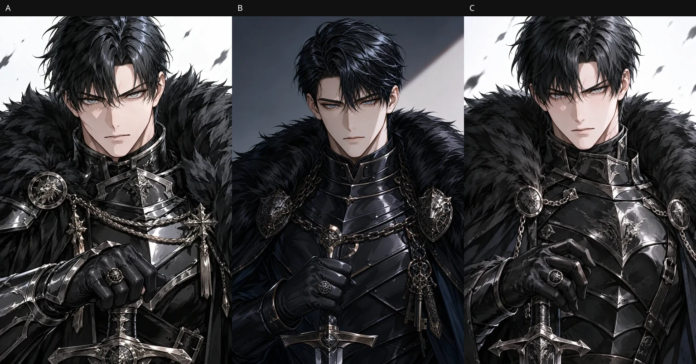

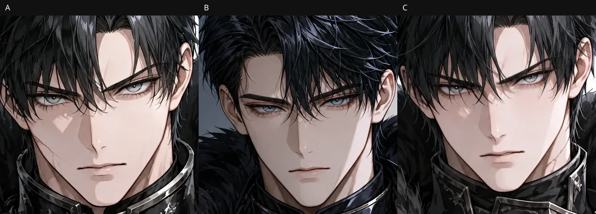

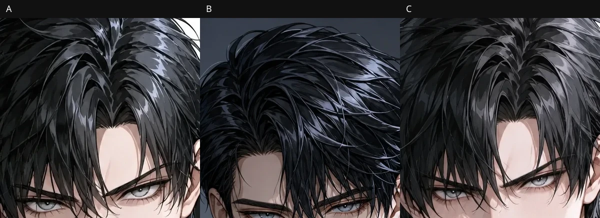

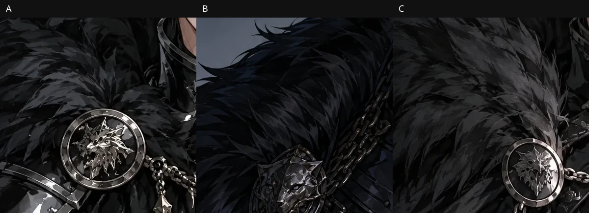

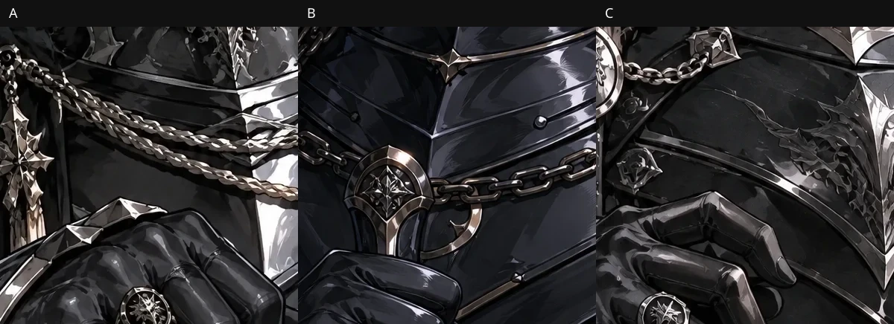

## 12. 조건 D

D는 `gpt-image-2`에 C의 전송문을 그대로 쓴다. prompt SHA `34e866261b217a5a54f84f0cb1a052c7a26be378d292b8c45cc590d856ef9238`. 참조는 B·C가 쓴 `rep-abc-prepared/b7.webp`, `b13.webp`, `b5.webp`를 같은 순서·같은 바이트로 쓴다. 전처리 SHA는 b7 `ba5f3896…7b5b89`, b13 `f13d1f15…e13592`, b5 `80e0ab0c…c2efbf`. 출력은 1024x1536, medium, n=1, webp 88, opaque. 흉터 강조, 의상 수정, 참조 교체는 이 요청에 넣지 않는다.

이 실험의 한도는 POST 1회, 0.10 USD다. 같은 모델인 B의 관측 비용은 0.087244 USD이고, D의 문장은 그보다 짧다. 이미지 입력은 같다. 예상은 0.10 USD 안이다. 비용식은 기존 `calculateGptImage2CostUsd`다. 운영 compiler는 바꾸지 않는다.

비교 축은 B 대 D가 같은 모델·같은 참조의 prompt 차이고, C 대 D가 같은 prompt·같은 참조의 모델 차이다. A는 과거 결과로 둔다. A의 전처리 바이트가 복원된 것은 아니다.

### 12.1 실제 호출

POST 1회. fallback, 재시도, vision은 없다. 원본 바이트를 검사보다 먼저 저장했고, 검사 SHA가 원본과 같다. 비용 0.084784 USD. 상한 0.10 USD 안이다.

| 항목 | 값 |
|---|---|
| 모델 | `gpt-image-2` |
| prompt SHA | `34e866261b217a5a54f84f0cb1a052c7a26be378d292b8c45cc590d856ef9238` |
| 참조 순서 | b7, b13, b5 |
| 전처리 SHA | `ba5f3896…7b5b89`, `f13d1f15…e13592`, `80e0ab0c…c2efbf` |
| request | `req_ab82e37d250b46af853ec5f224378a97` |
| 원본 SHA | `5e338c0aa0b5a05d351162ba9ddfa8f158067de3d4bb7273149b8ec183b373a5` |
| 크기 | 1024x1536 webp |
| 비용 | 0.084784 USD |

기존 A/B/C 고정 좌표 시트는 그대로다. B/C/D 추가 크롭은 같은 창을 원본 1:1로 잘랐다. 전체 시트만 각 패널 0.5 배다.

| 시트 | 창 | 배율 | 부위 |
|---|---|---|---|
| 얼굴 | `282,180,460x460` | 1:1 | 얼굴 |
| 머리 | `312,0,400x400` | 1:1 | 머리 |
| 모피 | `80,560,220x180` | 1:1 | 모피 덩어리. 금속·피부 제외 |
| 흉갑 | `390,700,280x200` | 1:1 | 흉갑 평면. 장갑·피부 제외 |
| 턱 | 화면 왼쪽 `282,430,230x210` / 화면 오른쪽 `512,430,230x210` | 1:1 | 정면 기준 인물 오른쪽 / 인물 왼쪽 |

굵은 선, 적은 디테일, 강한 광택은 합격 기준으로 쓰지 않는다.

- B 대 D: 모델과 참조가 같다. 둘 다 선이 명암에 섞인다. D는 머리 가닥과 모피 끝이 더 분리되고, 흉갑의 흰 하이라이트가 더 넓다. 이 prompt 교체가 이번 한 장을 재첨부 1~8의 선·덩어리 관계로 옮기지는 않았다.
- C 대 D: prompt와 참조가 같다. C는 머리와 모피의 덩어리 외곽이 더 또렷하다. D는 같은 창에서 가닥과 광택이 더 많다. 모델 전체의 우열로 쓰지 않는다.
- 눈: B는 채도가 높은 청색이다. C와 D는 그보다 옅은 회청이다.
- 나이: 세 얼굴 모두 주름 없는 피부다. C의 눈매가 더 날카롭고, B와 D는 그보다 어린 인상이다. 한 장으로 34세를 확정하지 않는다.
- 흉터: 정면 기준 인물 오른쪽 턱 창에서는 B·C·D 모두 선이 읽히지 않는다. 인물 왼쪽 턱 창에서 C는 턱에서 칼라로 내려오는 가는 선이 있고, D는 턱과 칼라 경계의 짧은 선이 있다. B는 같은 창을 단독으로 보면 짧은 밝은 선이 있고, 세 장을 붙인 시트에서는 그만큼 읽히지 않는다. Lock의 위치는 인물 왼쪽 턱 아래의 가는 흉터다.
- 갑옷은 세 장 모두 어두운 판 위의 은색 하이라이트다. 금색으로 바뀌지 않았다. D의 넓은 광택은 그 자체로 합격이나 탈락이 아니다.

이 한 장은 재첨부 1~8 옆에 둘 그림체에 미치지 못한다. 같은 조건의 재추첨은 하지 않는다.

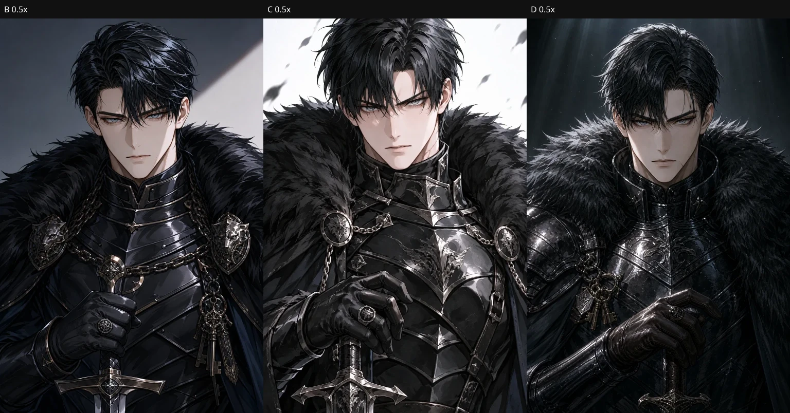

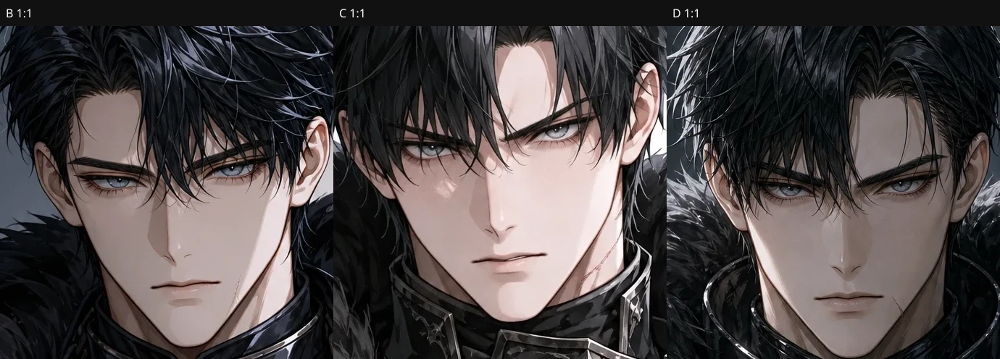

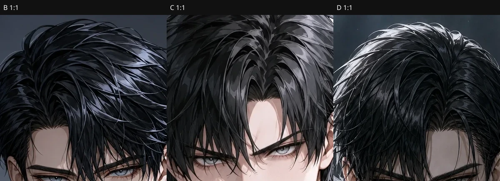

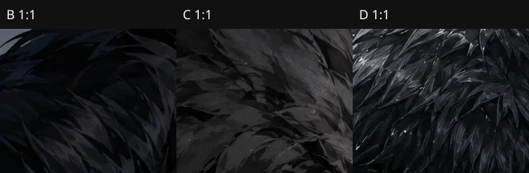

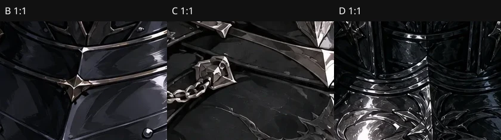

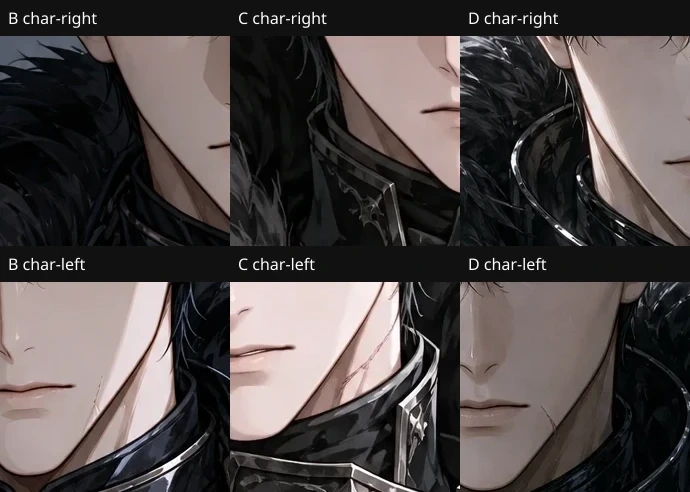

## 13. 편집 입력안

이 절의 입력은 재첨부 원본 한 장을 편집해 그림체를 유지하고 인물만 승인 Appearance Lock으로 바꾸는 방식이다. 그 입력으로 호출한 결과는 13.1이다.

기준 이미지는 `reattach-2026-10-17/03-eval_style.webp`, SHA `7814a3950742201a5a0d9fff3b38b9ad3d706b93d52b6d3b603221c3d5aab699`다. 정면 상반신에 큰 모피 덩어리, 내부 선, 피부와 분리된 금속 하이라이트가 같이 있다. 적안과 적·금 군복 색은 복사 대상이 아니다. 9~11번, b7·b13·b5, 운영 대표, A~D 출력은 이 입력에 넣지 않는다.

입력안을 고쳤다. 모델은 `gpt-image-2`다. 새 정면 구도와 검 손잡이 포즈 문장은 뺐다. 원본의 캔버스, 크롭, 카메라, 머리 각도, 시선, 포즈, 배경을 유지한다. 화면 밖의 손·반지·열쇠·검을 보여 주려고 프레임을 넓히지 않는다. 소지품 문장은 Appearance Lock 안에 그대로 둔다. 흉터의 왼쪽은 인물 자신의 왼쪽이라고 실험 문장에만 적는다. Lock 원문과 hash `1c3ccd13…24dcc3`은 바꾸지 않았다. 공통 스타일 DNA와 새 광택·조명 규칙은 넣지 않았다.

전송문 SHA `e24378f1…3de46e`. 이전 안 SHA `a0236c6f…5af570`. diff는 `rep-edit-input-prompt.diff`. 전처리 SHA `8d3b42d1…1a90fa`, 183858바이트. `prepareOfficialImageReferences`는 업로드·플랫폼 seed URL만 받으므로, 로컬 검토 파일에는 그 함수와 같은 sharp 단계(rotate, 1536 이내 확대 없음, webp quality 90 effort 4)를 적용했다.

### 13.1 편집 후보 E

POST 1회. fallback, 재시도, vision은 없다. 원본 바이트를 검사보다 먼저 저장했고 SHA가 같다. 비용 0.058213 USD. 상한 0.10 USD 안이다. 같은 조건 재추첨은 하지 않는다. 대표·앵커로 승인하지 않는다.

| 항목 | 값 |
|---|---|
| 모델 | `gpt-image-2` |
| request | `req_97784cb608234364b6c3caf8c92706f6` |
| 출력 SHA | `49cc70ce…77ec7c` |
| 크기 | 1024x1536 |

비교 창은 원본과 E에 같다. 얼굴 `280,160,460x460`, 머리 `300,0,420x360`, 모피 `10,520,180x180`, 갑옷 `340,700,340x260`. 이 네 창은 1:1이다. 전체 시트만 0.5 배다.

그림체: 캔버스, 흰 배경, 머리 각도, 시선, 모피의 큰 덩어리 위치는 같은 창에 남는다. 모피의 깃털 결도 남는다. 머리의 굵은 광택 띠는 줄고 가닥이 더 잘게 나뉜다. 갑옷 창은 원본의 평면 색덩어리에서 금속 판의 흠집과 반사로 바뀐다. 선과 피부 음영도 원본보다 부드럽다. 구도는 유지되고, 채색 방식은 일부만 유지된다.

외형: 적안, 적·금 군복, 보석, 금색 십자 문장은 빠진다. 눈은 회청이고 갑옷은 어두운 판금이다. 검은 머리와 검은 모피는 남는다. 인물 왼쪽 뺨에서 턱으로 가는 짧은 선이 있다. 이 높이는 명시된 승인 위치(인물 왼쪽 턱 아래)와 다른 항목이다. 가슴의 늑대 부조는 승인 외형에 없는 추가 장식이다. 명시적 금지 근거 없이 Lock 위반으로 단정하지 않는다. 손·반지·검은 프레임 밖에 그대로다. 가려진 소지품이나 흉터를 보이게 하려고 위치·구도를 바꾸지 않는다. 이전 A~D가 어긋난 단일 원인을 이 결과로 확정하지 않는다.

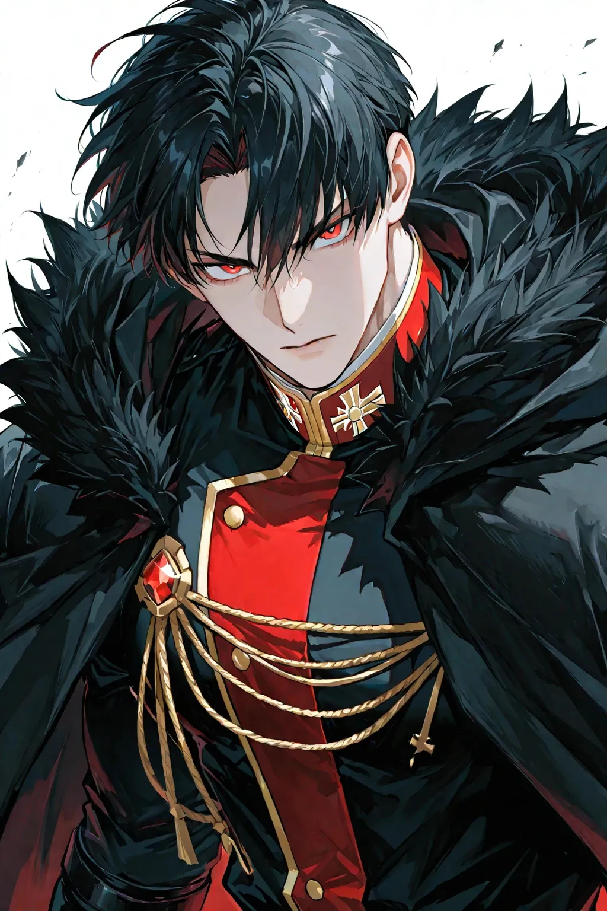

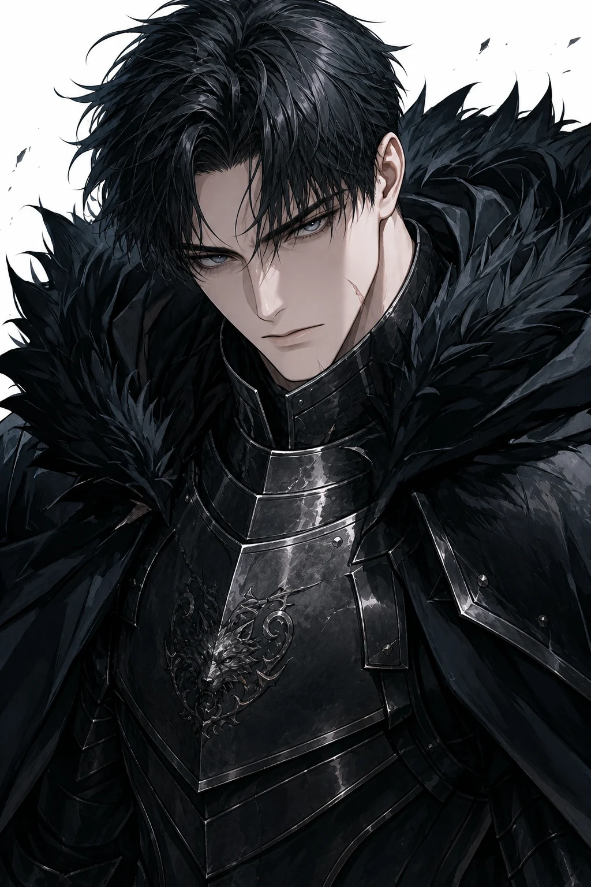

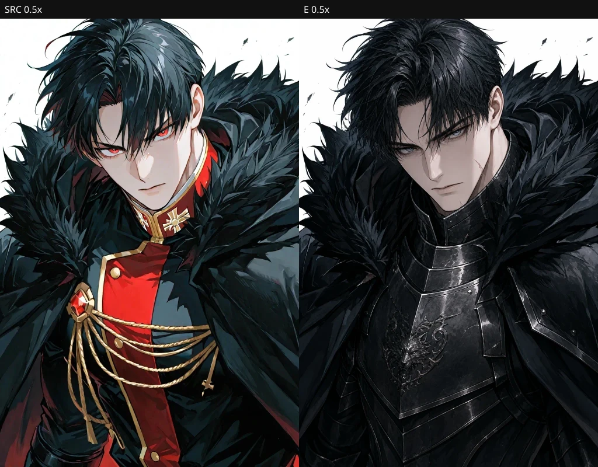

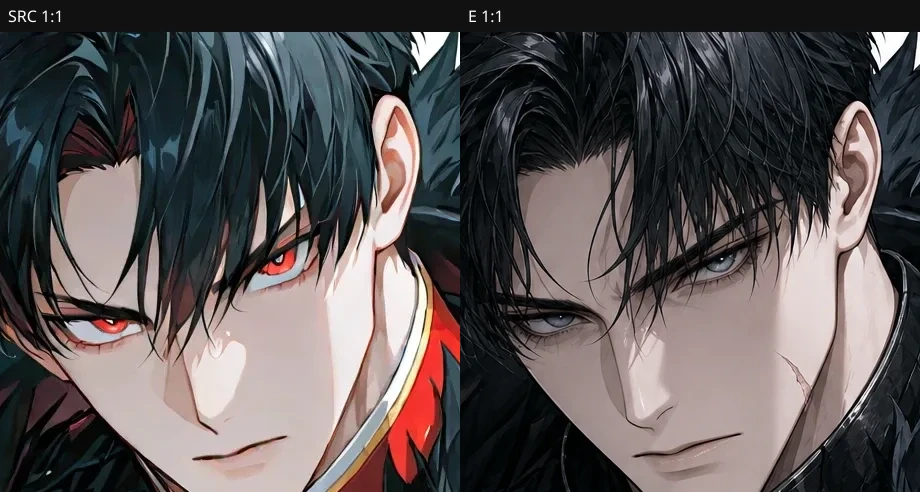

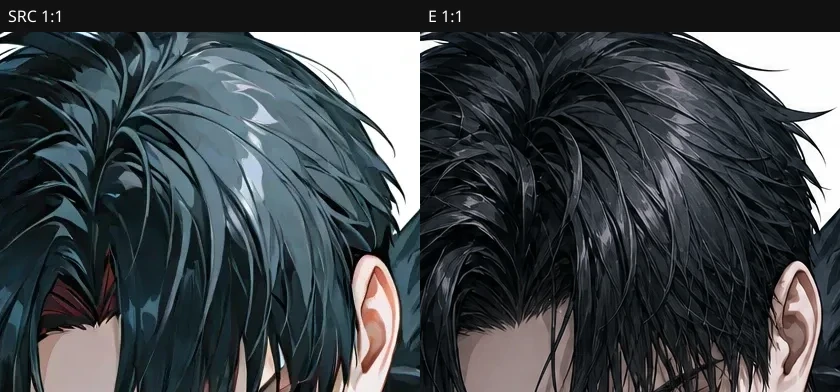

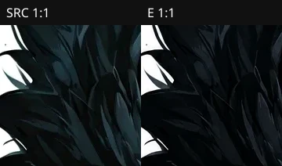

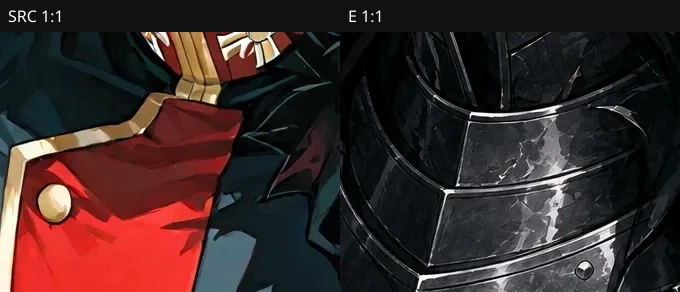

## 14. 편집 후보 F

전송문은 E와 같다. SHA `e24378f1f1b5de20ca7ff21f54f206aa73e21776b4350938b2f81e58883de46e`. 참조는 E가 보낸 `rep-e-prepared/source.webp` 한 장이다. SHA `8d3b42d117198038a2608fa5e3b8eaf366416efa530aab120222c4a6171a90fa`, 183858바이트. 저장된 바이트를 다시 인코딩하지 않는다. 모델만 `gpt-image-2.5-sunburst`다. 흉터 수정문, 문양 금지문, 새 스타일·광택 규칙은 넣지 않는다.

한도는 POST 1회, 0.08 USD. fallback, 재시도, vision은 없다. `callOpenAiImageEdit`와 원본 선보존을 재사용한다.

### 14.1 결과

POST 1회. 원본 바이트를 검사보다 먼저 저장했고 SHA가 같다. 비용 0.027393 USD. 상한 0.08 USD 안이다. 같은 조건 재추첨과 새 유료 실험은 하지 않는다. 대표·앵커로 승인하지 않는다. E/F 한 장씩을 모델 전체의 우열이나 A~D 실패의 단일 원인으로 확정하지 않는다.

| 항목 | 값 |
|---|---|
| 모델 | `gpt-image-2.5-sunburst` |
| request | `req_77188f324f0845b388c50a5b856161a8` |
| 출력 SHA | `a95f9aca…0f8032` |
| 크기 | 1024x1536 |

비교 창은 원본·E·F에 같다. 얼굴 `280,160,460x460`, 머리 `300,0,420x360`, 모피 `10,520,180x180`, 갑옷 `340,700,340x260`. 이 네 창은 1:1이다. 전체 시트만 0.5 배다.

머리: 큰 덩어리의 위치는 같은 창에 남는다. 원본의 넓은 윤광 띠는 E와 F 모두에서 가는 가닥 하이라이트로 줄어든다.

모피: 큰 형태와 깃털 결의 내부 관계는 같은 창에 남는다. F의 가장자리는 원본보다 부드럽다.

얼굴·갑옷의 선화·채색: 원본 얼굴은 또렷한 선과 평면 피부다. E와 F는 선과 피부가 더 부드럽다. 원본 군복의 천과 새 갑옷의 금속이라는 소재 차이 자체는 실패가 아니다. 실패는 새 갑옷이 원본의 넓은 색면이 아니라 은색 엣지와 작은 장식으로 그려진 점이다. F의 갑옷은 E보다 은색 테와 리벳이 많다.

외형: 적안과 적·금 군복은 빠진다. 눈은 회청이고 갑옷은 어두운 판금이다. 검은 머리와 검은 모피는 남는다. F의 얼굴 창에서 인물 왼쪽 턱 아래의 가는 선은 분명하지 않다. 이 항목은 승인 위치와의 차이로 적는다. 구도를 바꿔 흉터나 소지품을 보이게 하지 않는다. F의 늑대 걸쇠·펜던트·체인은 승인 외형에 없는 추가 장식이다. 명시적 금지 근거 없이 Lock 위반으로 단정하지 않는다. 손·반지·검은 프레임 밖에 있다.

### 14.2 현재 방식에서 남는 것과 빠지는 것

남는다: 흰 배경의 상반신 크롭, 손과 검이 화면 밖인 구도, 모피의 큰 덩어리와 깃털 결, 적안·적금의 제거, 회청 눈, 흑철 판금과 검은 머리·모피의 방향.

빠진다: 머리의 넓은 윤광 띠, 원본 얼굴의 선 굵기와 평면 채색, 새 갑옷을 원본과 같은 넓은 색면으로 그리는 일, 승인 위치의 턱 아래 흉터를 안정적으로 그리는 일. 가슴·옷깃의 추가 장식은 이번 입력에 금지문이 없다.

이 편집 경로의 한 장 E와 한 장 F로 모델 우열을 닫지 않는다. 같은 조건 재추첨과 새 유료 실험은 여기서 멈춘다.

### 14.3 이미지 대조 정정

14.1의 제작자 관찰은 그대로 둔다. 그중 “원본의 넓은 윤광 띠는 E와 F 모두에서 가는 가닥 하이라이트로 줄어든다”와 14.2의 “빠진다: 머리의 넓은 윤광 띠”는 머리 1:1 창과 맞지 않아 정정한다.

머리 창 `300,0,420x360`: 원본은 넓은 윤광 띠다. E는 그 띠가 가는 가닥으로 나뉜다. F는 넓은 윤광 띠가 원본 쪽에 더 가깝다. 가닥이 조금 더 나뉘지만 E와 같은 정도로 줄었다고 적지 않는다.

얼굴 창과 모피 창도 같은 방향이다. F의 얼굴 선·명암 경계와 모피 깃의 분리는 E보다 원본에 가깝다. 원본과 같은 평면 색면이라고 적지는 않는다.

### 14.4 GPT 재검수

GPT 판단은 제작자 관찰과 별도로 적는다. F는 E보다 원본의 넓은 머리 윤광 띠, 얼굴의 선·명암, 모피 표현에 가깝다.

F는 그림체 채택 검토 후보다. 대표·앵커 승인이나 운영 QA 통과로 기록하지 않는다.

### 14.5 그림체와 분리한 항목

원본 인물과의 얼굴 유사성: 머리 각도, 시선, 얼굴의 큰 배치는 원본 3번과 가깝다. 눈은 적안에서 회청으로 바뀌었다. 이 유사성은 그림체 채택과 다른 항목이다.

승인 흉터 위치: E의 짧은 선은 인물 왼쪽 뺨에서 턱으로 가고, 명시된 턱 아래와 높이가 다르다. F의 같은 얼굴 창에서는 턱 아래의 가는 선이 분명하지 않다. 보이게 하려고 구도를 바꾸지 않는다.

추가 장식: E의 가슴 늑대 부조, F의 늑대 걸쇠·펜던트·체인은 승인 외형에 없는 추가 장식이다. 명시적 금지 근거 없이 Lock 위반으로 단정하지 않는다.

### 14.6 홈카드 미리보기

새 화면은 만들지 않았다. `CharacterCard`의 홈 프레임과 `CharacterCardCarousel`의 `object-cover object-top`을 로컬 Chrome에서 그렸다. 운영 DB write 0, Provider POST 0이다. 운영 대표 파일 SHA `a66c49d4…3a45f1`. 저장 PNG는 CSS 크기의 2배 픽셀이다. 1:1 질감 비교는 위의 원본·E·F 창을 유지한다.

| 홈 변형 | 규칙 |
|---|---|
| 추천 editorial | xl 232px, aspect 2/3. 원본이 2:3이면 추가 크롭이 없다. 하단 이름 그라데이션이 있다 |
| 공모전 exhibit | xl 300px, aspect 4/5, 우상단 컷. 위쪽 정렬로 아래가 잘린다 |
| 신규 index | 390px 뷰포트의 2열 172px, aspect 3/4. 위쪽 정렬로 아래가 잘린다 |

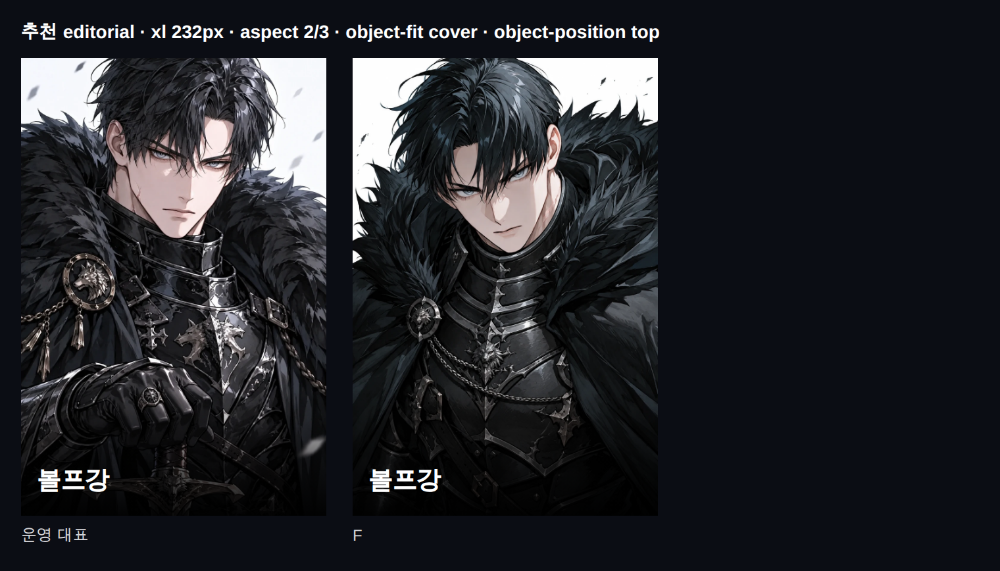

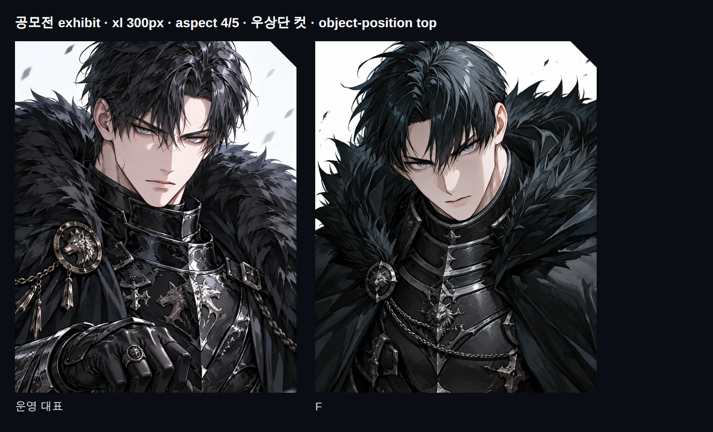

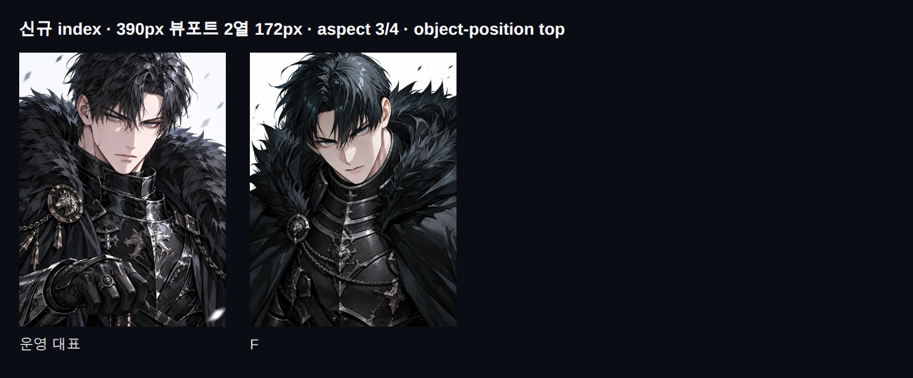

## 15. 성공 결과 두 장과 기존 생성 기록

대상은 재첨부 10·11이다. 파일명 `ai-ld-current-turn-45e89a27-5146-43bc-9d1c-a91ba0f59819.webp`, `ai-ld-current-turn-7561aec6-94c9-46d6-8f6d-bd262528fdff.webp`. 픽셀은 800x1200 webp다. 볼프강 생성 참조로 쓰지 않는다.

이 체크아웃의 `data/app.db`를 읽기 전용으로 봤다. `chat_image_generations` 0행, `character_image_album` 0행, `chat_image_generation_jobs` 0행, `image_generation_creator_earnings` 0행이다. `api_cost_ledger` 59행은 배경 TRPG 답변 제안이고 이미지 파일명과 무관하다. `point_logs`에도 이 파일의 차감이 없다. 두 파일의 실제 모델, 참조 목록, 전송문은 이 기록에서 확인되지 않는다.

현재 코드가 저장하는 모양도 전송문 본문을 남기지 않는다. `options_json`은 mode, source, quality, outputSize, identityReferenceCount를 남긴다. job의 `provider_attempts_json`은 promptHash와 promptCharCount를 남긴다. 행이 있어도 전송문 전문은 이 스키마에 없다. 지금 코드를 조립한 문장을 당시 전송문이라고 적지 않는다.

파일명 패턴과 800x1200은 현재 LD 일러스트 출력과 같다. 그것은 크기·이름 일치이고, 당시 호출의 증거는 아니다.

### 15.1 참조 역할 — 확인된 차이

| 작업 | owner | 참조 역할 |
|---|---|---|
| 같은 인물의 장면 변주 | `chatLdIllustrationGeneration.ts` | 인물 사진이 그 인물의 identity이자 style이다. `renderChatImageStyleFidelityContract`는 템플릿이 없으면 번호 이미지를 인물과 1:1로 매핑한다. LD는 `hasTemplate: false`다 |
| 참고 화풍으로 새 인물 | `officialSupply/imagePrompt.ts` 대표 | `STYLE ONLY`. 새 인물을 만들고, 참조의 얼굴·머리·의상·표식은 복사하지 않는다. 정체는 Appearance Lock이다 |
| 같은 인물의 다른 컷 | 같은 파일의 variation | Image 1 `IDENTITY ONLY`, Image 2 `STYLE ONLY` |
| E/F | 검토용 편집 한 장 | 이미지 한 장이 수정 대상이다. 구도와 채색 유지를 문장으로 요청하고 인물을 바꾼다 |

계약 문구를 복사하거나 런타임 프롬프트를 바꾸지 않았다.

원인 가설은 확인과 분리한다. LD가 화풍을 유지한 이유로 자주 거론되는 것은, 같은 인물 사진이 스타일 앵커이면서 장면만 바뀌기 때문이다. 공식 대표는 새 인물과 참조 정체 복제 금지가 같이 있다. 이 가설은 10·11의 전송문이 없어 그 두 장으로 확인되지 않는다. E/F 한 장씩으로 모델 우열을 닫지 않는다.

## 16. 옅은 미소 후보 — F identity+style

F를 다음 제작의 인물·그림체 기준으로 채택한다. 운영 대표·앵커 교체는 아직 승인하지 않는다. 이번 한 장은 승인된 sig4 재설계 `옅은 미소`다. 태그는 후보 제안으로만 적는다.

공식 합성 `composeOfficialSlotGeneration`의 샷·Lock·나이 가드·표정·포즈는 그대로다. 공식 primary SHA `4b906355…0ae02`는 이전 기록과 같다. 운영 compiler는 바꾸지 않았다. 이번 요청에서만 참조 지시를 한 장 F에 맞춘다. F가 identity와 style을 함께 담당한다. `renderChatImageStyleFidelityContract({ hasTemplate: false, subjectCount: 1 })`를 쓴다. STYLE ONLY와 스타일 DNA는 넣지 않는다. b7·b13·b5와 운영 대표는 보내지 않는다.

전송문 SHA `95e795a7…44223cf`. 전처리 SHA `39d425e5…2ae1c7`, 231636바이트. 원본 F SHA `a95f9aca…0f8032`. 모델 `gpt-image-2.5-sunburst`. 1536x1024 / medium / n=1 / webp 88 / opaque. 한도는 POST 1회, 0.08 USD.

### 16.1 결과

POST 1회. 원본 바이트를 검사보다 먼저 저장했고 SHA가 같다. 비용 0.030393 USD. 상한 0.08 USD 안이다. fallback, 재시도, vision은 없다. 같은 조건 재추첨과 나머지 13장 생성은 하지 않는다. 운영 대표·앵커로 승인하지 않는다. 이 한 장으로 전체 자동화 품질을 합격 처리하지 않는다. 태그 `옅은 미소`는 후보 제안이다.

| 항목 | 값 |
|---|---|
| 모델 | `gpt-image-2.5-sunburst` |
| request | `req_9f16055bae0840c4b0d2c49677a931c5` |
| 출력 SHA | `fc14ebff…a24dc1` |
| 크기 | 1536x1024 |

비교 창은 캔버스가 달라 좌표가 다르다. 전부 1:1 추출이고 리사이즈는 없다. 전체만 각 원본의 0.5 배다.

| 부위 | F | 후보 |
|---|---|---|
| 얼굴 | `280,160,460x460` | `500,70,360x360` |
| 머리 | `300,0,420x360` | `540,0,240x180` |
| 모피 | `10,520,180x180` | `720,200,200x180` |
| 갑옷 | `340,700,340x260` | `520,400,320x240` |

같은 인물·그림체: 검은 울프컷, 회청 눈, 흑철 판금, 검은 모피, 얼굴의 큰 비율은 F와 같은 방향이다. 선과 피부 면의 관계도 F에 가깝다. 머리의 넓은 윤광 띠는 이 3/4 구도에서 F의 정면 창보다 약하다. 후보 머리 비교 창은 3/4 옆정수리라 F의 정수리 창과 같지 않다. 갑옷은 F처럼 은색 테와 장식이 있고, 늑대 걸쇠와 체인이 이어진다. 후보 흉갑의 판 겹침은 F의 가로 띠보다 많다.

옅은 미소와 휴식: 입꼬리가 올라가고 이는 보이지 않는다. 창가 돌 난간에 앉아 상체를 돌리고 양손은 허벅지 위다. 음식·서류·열쇠 전달과 상대 인물은 없다. 배경은 창과 요새다. 집무실 책상은 없다. 카메라는 아래에서 올려 보는 쪽에 가깝고 무릎 이상이다.

화면 기준 좌우: 코끝은 화면 왼쪽을 향한다. 보이는 귀는 화면 오른쪽 귀이고, 마주 본 기준으로는 왼쪽 귀다. 화면에서 더 넓게 열린 볼은 화면 왼쪽 볼이고, 마주 본 기준으로는 오른쪽 볼이다. 샷 문장 `head turned right three-quarter view`는 화면 오른쪽인지 인물 오른쪽인지 그 문장만으로 정하지 않는다. 이 관찰만으로 구도 실패를 선언하지 않고 재생성하지 않는다.

승인 외형: 회청 눈, 검은 머리, 흑철과 검은 모피는 남는다. 승인 흉터는 왼쪽 턱 아래의 가는 흉터다. 이 구도에서 그 흉터는 분명하지 않다. 뺨에 짧은 선이 있어도 그 선을 승인 흉터의 구현으로 세지 않는다. 구도를 바꿔 흉터를 보이게 하지 않는다. 늑대 걸쇠·체인·벽 문양은 추가 장식이다. 명시적 금지 근거 없이 Lock 위반으로 단정하지 않는다.

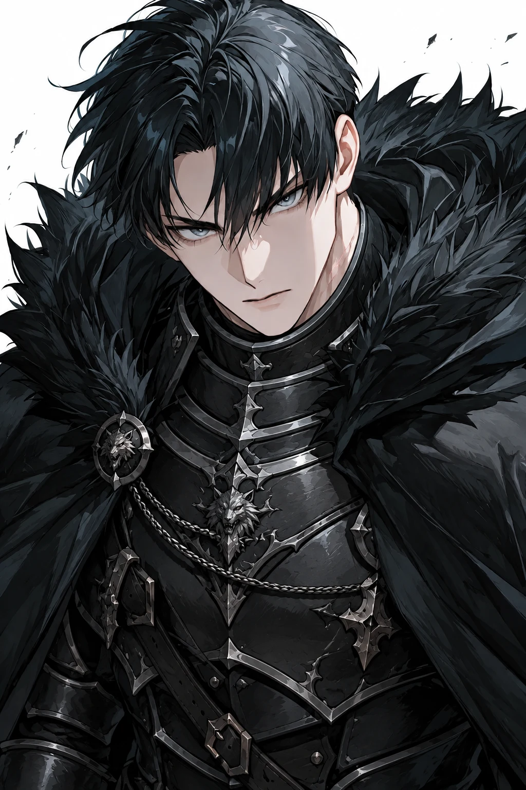

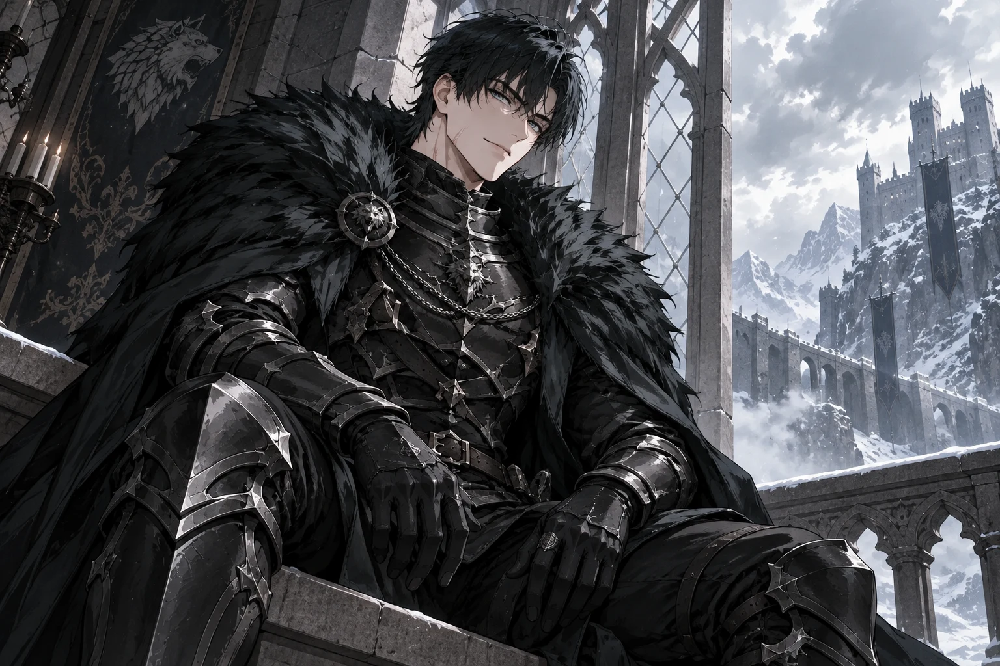

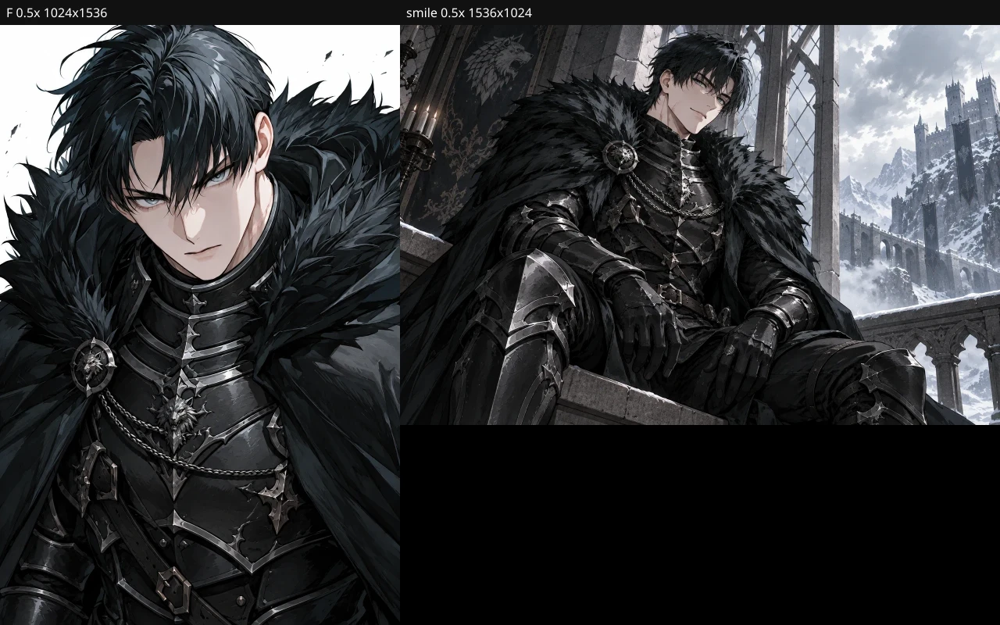

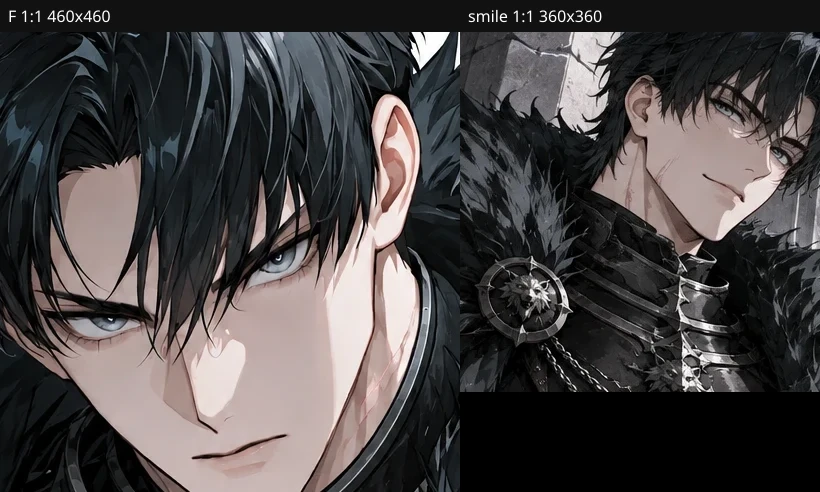

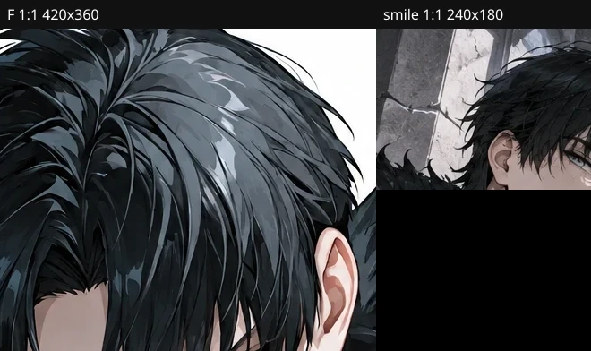

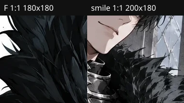

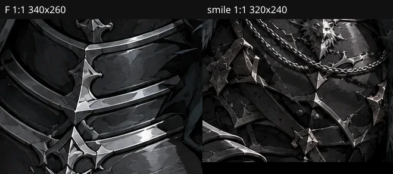

## 17. identity+style을 기존 조립 owner에 연결

같은 인물·그림체와 미소·휴식은 채택 가능한 방향이다. 전체 자동화 품질 합격이나 운영 대표·앵커 교체는 아니다. 이번 연결은 provider 호출이 없다.

조건은 합성 뒤 프롬프트를 치환하지 않는다. `resolveOfficialGenerationReferencePlan`이 로컬 이미지 한 장을 `variation_identity_and_style`로 고르고, `buildOfficialAssetPrompts`가 `identity_and_style` 규칙을 만든다. `composeOfficialSlotGeneration`과 `runOfficialAssetSlot`이 그 결과를 전송 직전 `transport.generate` 입력으로 넘긴다. 로컬 입력이 없으면 대표 STYLE ONLY와 Cluster B identity-then-style은 그대로다.

F는 로컬 후보 경로로만 넣었다. SHA `a95f9aca…0f8032`. 운영 대표 URL과 b7 style root는 참조에서 빠진다. 원고, Appearance Lock, 34세 나이 가드, sig4 샷·표정·포즈는 프롬프트에 남는다. 참조의 자세와 배경은 따라오지 않는다. STYLE ONLY, IDENTITY ONLY, ART STYLE DNA는 다시 넣지 않는다.

역할 충돌은 전송 전에 거절한다. 대표 슬롯에 이 입력을 주면 STYLE ONLY로 섞지 않는다. STYLE root, b7 경로, 운영 대표 URL을 이 한 장으로 쓰면 거절한다.

전송 직전 입력은 `officialSupply.identityStyleReference.test.ts`가 runner payload와 compose 결과가 같음을 확인했다. 네트워크 호출은 0이다. 조립 전문은 `assets/wolfgang-asset-redesign/sig4-smile-f-owner-prompt.txt`다. 요약은 `sig4-smile-f-owner-request.json`이다. primary SHA `8847a0d3…c2f7e5ff`. 운영 JSON의 sig4 태그는 여전히 `절제된 온기`다.
