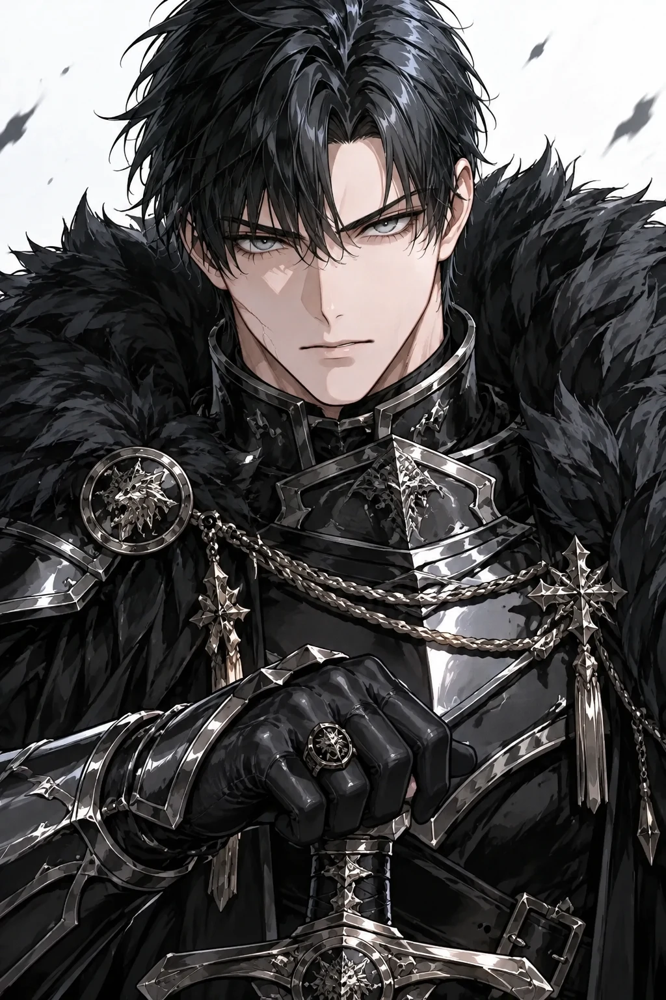
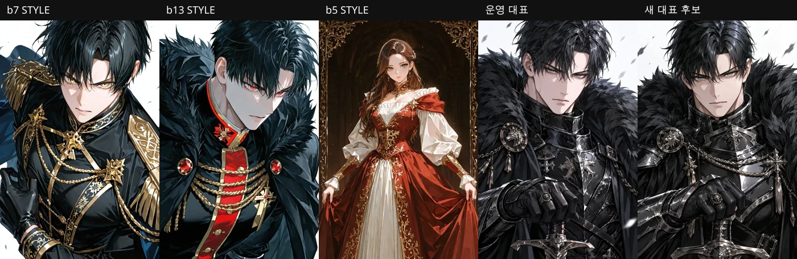
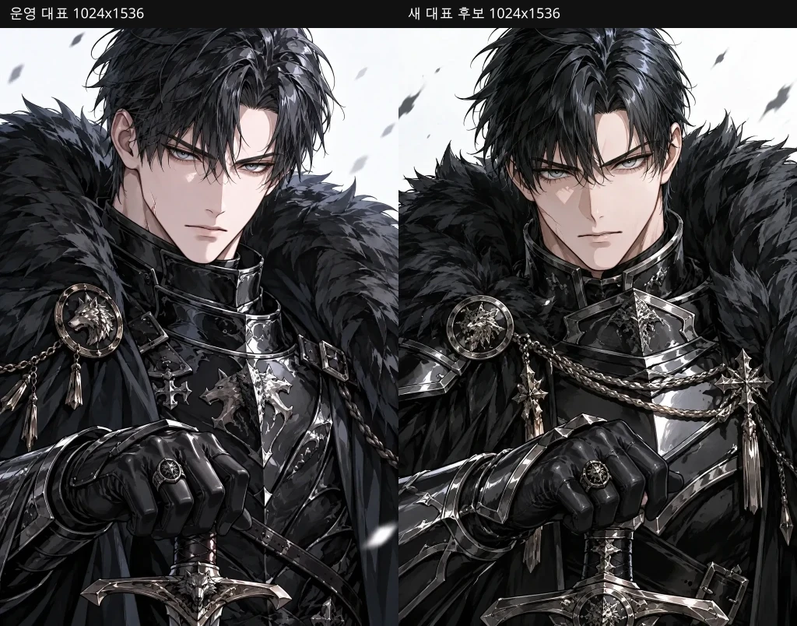
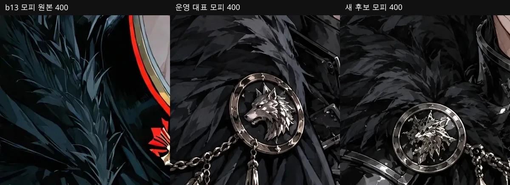
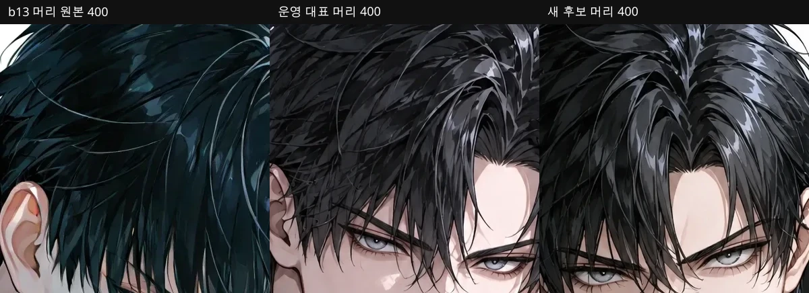
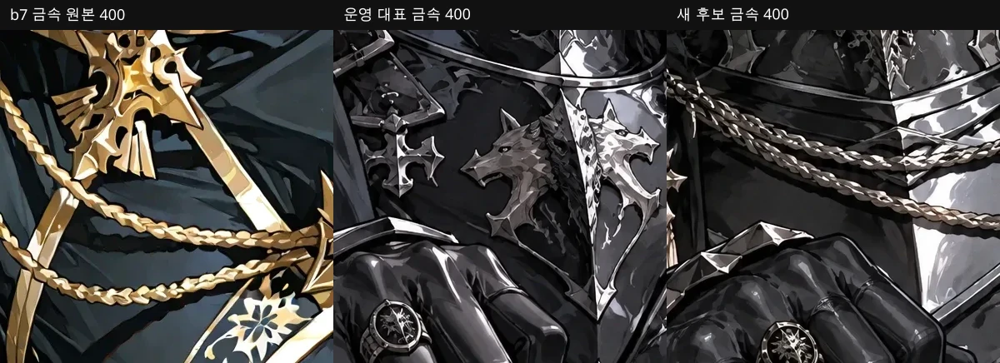

# Wolfgang #51 에셋 재설계 — 기존 참고자료 재사용, 식사 콘셉트 폐기

상태: **재설계 방향 승인. 운영 이미지·태그·DB·Lock·#50 미변경.** 승인 r2 본문 / Text Lock / Appearance Lock은 그대로다. 이미 병합된 #1633은 열거나 수정하지 않는다. 외부 반입 기능은 배포된 보조 경로로 유지하되, 자동 이미지 제작 목표를 사용자 재업로드로 넘기지 않는다.

식사 폐기와 감정 컷의 서류 반복을 줄이는 방향을 승인했다. 운영 태그는 아직 바꾸지 않는다. 현재 픽셀과 다른 감정을 이름만 바꿔 붙이지 않는다.

## 1. 기존 참고자료 복원

### 1.1 찾은 자료 — Cluster B 번들 (생성 후보의 실제 바이트)

경로: `public/official-supply/style-seeds/romance-fantasy-cluster-b-v1/`. 출처 커밋 `c343b1c5` (PR #1133). 사용자 원본을 STYLE ONLY로 재포장한 묶음이다. 원본 파일명 `user-ref-N.webp`는 저장소에 한 번도 없다.

| userRef | 파일 | 역할 (manifest) | 생성 기본 | 픽셀에서 읽히는 스타일 정보 |
|---|---|---|---|---|
| 7 | `primary/b7-black-gold-uniform.webp` | male_black_gold_sharp | **예** (Image 2 기본 STYLE 루트) | 흑·금 군복, 노란 눈, 흰 배경, 큰 면 단위 선과 셀 명암. 모피 거의 없음 |
| 13 | `primary/b13-black-red-fur.webp` | male_black_red_accent | **예** (대표 전용 companion) | 흑·적 군복, 빨간 눈, 검은 모피. 큰 깃털 덩어리·잉크 외곽·2~3단 명암 |
| 5 | `primary/b5-red-dress-female.webp` | female_gold_embroidery | **예** (대표 전용 companion) | 적·금 자수 드레스, 직물 면 분리. 남성 정체성 아님 |
| 3 | `primary/b3-blue-window-full.webp` | cool_light_full_body | 아니오 (catalog) | 창가 전신, 차가운 청광, 흑·금 군복 |
| 17 | `primary/b17-sword-flowers.webp` | graphic_red_mood | 아니오 (catalog) | 그래픽 적색 분위기 |
| 6 | `holdout/b6-black-gold-smirk.webp` | holdout | 아니오 | 흑·금, 얕은 미소. v3 `p1`과 **바이트 동일** |
| 10 | `holdout/b10-moon-scene.webp` | holdout | 아니오 | 달밤 장면 |
| 11 | `holdout/b11-purple-armor.webp` | holdout | 아니오 | 보라·은 갑옷. v3 `p4`와 **바이트 동일** |
| 14 | `holdout/b14-red-eyes-profile.webp` | holdout | 아니오 | 적안 측면 |

SHA 교차 확인 (같은 업로드가 두 번들에 다른 이름으로 들어감):

| Cluster B | user-owned v1 | SHA-256 |
|---|---|---|
| `b6-black-gold-smirk.webp` | `p1-face-rendering.webp` | `25e0c98e…cf5b9fb3` |
| `b5-red-dress-female.webp` | `p2-costume-material-female.webp` | `fdab6b92…32e4998` |
| `b11-purple-armor.webp` | `p4-face-armor-metal.webp` | `18a6216e…f4c42eff` |

### 1.2 찾은 자료 — 이전 user-owned v1 (Cluster A에 가깝다고 표시된 8장)

경로: `public/official-supply/style-seeds/romance-fantasy-user-owned-v1/`. 커밋 `6a8fcece`. UUID `sourceFile`이 남아 있어 원본 업로드 흔적은 이 번들만 보존한다.

| id | 파일 | sourceFile | 번들 기록 이유 | 생성 기본 |
|---|---|---|---|---|
| P1 | `primary/p1-face-rendering.webp` | `ca7d036e-…567.webp` | 얼굴 렌더 | 예 (v3 기본 3장) |
| P2 | `primary/p2-costume-material-female.webp` | `111f5776-…ebf.webp` | 여성 직물·자수 | 예 |
| P3 | `primary/p3-lighting-composition.webp` | `52dcbe81-…601.webp` | 림라이트·구도 | 예 |
| P4 | `catalog/p4-face-armor-metal.webp` | `0443606d-…7b4.webp` | 금속 catalog | 아니오 |
| P5 | `catalog/p5-face-skin-hair.webp` | `351d05d3-…bb5d.webp` | 피부·머리 catalog | 아니오 |
| H1–H3 | holdout 3장 | UUID 3개 | 각도·이벤트 holdout | 아니오 |

Cluster B 생성 가드는 이 v3 경로를 Cluster B 요청에 넣지 않는다 (`CLUSTER_A_LEGACY_STYLE_REF_PATH_MARKERS`). 검토용으로는 읽는다. 같은 바이트가 Cluster B 이름(b6/b5/b11)으로 이미 들어가 있으면 그쪽을 쓴다.

### 1.3 못 찾은 자료

저장소·git 전 역사·리뷰 에셋·`/opt/cursor/artifacts`에 **이미지 파일이 없다.** manifest 문자열만 있다. 사용자에게 다시 올리라고 요구하지 않는다. 아래는 빠진 번호이지, 지금 재업로드 목록이 아니다.

| ID | manifest 분류 | 파일 | 의미 |
|---|---|---|---|
| user-ref-1, 2 | `comparisonOnly` | 없음 | 비교 전용으로 생성에서 제외했다고만 기록 |
| user-ref-4, 12, 15 | `exposureBias` | 없음 | 노출 편향으로 제외 |
| user-ref-8, 9 | `otherFamilyReview` | 없음 | 다른 그림체 계열 검토 |
| user-ref-18 | `seasonalNovelty` | 없음 | 계절·이벤트 신규성 |
| user-ref-16 | **언급 없음** | 없음 | 18번 번호 체계에 16이 원래 있었는지는 저장소로 증명 불가 |

원본이 18장이었다면, 커밋된 바이트는 **9장(Cluster B) + v3 전용 5장(p3, p5, h1–h3)** 이고 제외 8장은 카테고리만 남았다. 전체 원본 세트는 복원하지 못했다.

### 1.4 검토 묶음과 생성 요청 묶음

한 요청에 찾은 자료를 전부 넣지 않는다. 코드 한도 `OFFICIAL_STYLE_GENERATION_REF_MAX = 3`.

| 용도 | 넣는 자료 | 넣지 않는 자료 |
|---|---|---|
| 사람 검토 (이번 문서) | 찾은 Cluster B 9장 + v3 잔여 5장 + 운영 14장 | 없는 파일 |
| 대표 생성 요청 | **b7 → b13 → b5** 만 | catalog b3/b17, holdout 4장, v3 레거시 경로, 없는 user-ref |
| 나머지 13장 생성 요청 | Image 1 = 승인 대표 IDENTITY, Image 2 = **b7만** | b13/b5는 variation에 안 감. 실패한 음식 후보는 참조 금지 |
| 나중에 한 축만 바꿀 때 | 대표가 실패한 뒤에만 catalog(b3 조명 또는 b17 무드)를 3장 자리 중 하나와 교체 | 4장 이상 동시 투입 |

b7/b13/b5가 3장으로 고른 근거는 역할이 겹치지 않게 짠 것이다.

- **b7**: 선·얼굴·금장 셀. 모피가 없어 흑철 갑옷 면 처리의 기준.
- **b13**: 검은 모피 덩어리와 잉크 외곽. Appearance Lock의 늑대 모피를 그릴 때 필요한 축.
- **b5**: 자수·직물 면 분리. 성별·의상 정체성은 복사 금지.

이 세 장이 “전체 자료 중 가장 예쁜 세 장”이 아니라, 3장 한도에 맞춘 기능 분할이다. 나머지 찾은 장은 검수용이다.

## 2. 운영 14장의 실제 픽셀 (2026-10-17 GET)

URL 패턴: `https://hav.chat/uploads/official-pilot-rf-v4-02__{slot}-a1.webp`. 로그인 없이 200. #1633 이후 SHA `9a92db1` 배포본과 동일 파일이다. 제목이 아니라 화면으로 판독했다.

문서·증거 대조가 반복되는 칸: **emo1, emo3, emo5, scene1, scene2** (두 장 서류). sig1은 지도, sig2는 책상 위 기록. 감정 6칸 중 3칸이 서류다.

미소가 실제로 보이는 칸: **없음.** sig4 `personTag`와 emo6 계획 태그는 미소지만, 입꼬리가 올라간 컷이 없다.

| 슬롯 | 현재 태그 | 화면에서 실제로 읽히는 것 |
|---|---|---|
| rep | 흑철 늑대공 | 흰 배경 상반신, 검을 잡은 정면, **무표정**. 모피는 b13보다 잔 결이 촘촘함 |
| sig1 | 철혈의 지휘관 | 지휘실, 장갑 손으로 지도를 짚음. 표정은 차가움 |
| sig2 | 흉터의 맹세 | 턱을 괴고 옆을 봄. 흉터를 만지거나 문서를 덮는 동작은 없음 |
| sig3 | 봉인고의 열쇠 | 상자 위 열쇠. 동작은 읽힘 |
| sig4 | 절제된 온기 | 옆얼굴 클로즈업 + 수프 그릇. **미소 없음. 건넴 없음.** 모피 잔 질감 |
| emo1 | 기록의 모순 | 봉인 편지 두 장. 무표정 |
| emo2 | 분노의 억제 | 주먹을 책상에 내린 클로즈업. 분노는 약하게 읽힘 |
| emo3 | 증거 앞의 판단 | 서류 두 장 + 전술판. 아래를 봄 |
| emo4 | 뜻밖의 동요 | 성벽에서 턱을 괴고 풍경을 봄. **당황 없음** |
| emo5 | 경계의 완화 | 펼친 서류를 내려다봄. 경계 완화로 안 읽힘 |
| emo6 | 귀환의 안도 | 성벽에 앉아 열쇠를 든 채 옆을 봄. **미소 없음** |
| scene1 | 위조된 명령서의 밤 | 집무실, 황실 문장 vs 늑대 인장 서류 두 장 |
| scene2 | 봉인된 장부의 빈칸 | 도서관, 서류 두 장 |
| scene3 | 황실의 마지막 압박 | 유리온실, 한 손에 검·한 손은 탁자. 단호함은 약함 |

## 3. sig4 식사 콘셉트 폐기

기존 음식 장면과 b7/b13 불합격 후보는 더 고치지 않는다. 수프를 더 잘 밀게 만드는 방향은 닫는다.

대체 장면은 일상 RP에서 자주 쓰이고, 소품 전달 없이도 감정이 보이게 한다.

- **표정:** 입꼬리만 살짝 올린 옅은 미소. 이를 보이지 않는다. 눈은 상대(카메라)를 본다.
- **행동:** 갑옷은 그대로. 창가 돌벤치에 앉아 상체를 상대 쪽으로 돌린다. 양손은 허벅지 위. 그릇·열쇠·서류를 들지 않는다.
- **구도:** 기존 shot owner 유지 — `right_three_quarter` / `low_angle` / `knee_or_full` / `environment`. 얼굴이 잘리지 않는 무릎~전신.
- **단독:** 유저·연인 실루엣 없음.

다른 슬롯과 겹침:

| 후보와 겹칠 수 있는 칸 | 구분 |
|---|---|
| emo6 현재 픽셀 (성벽 착석) | 그쪽은 옆모습·열쇠·미소 없음. 새 sig4는 **상대를 보고 웃는** 휴식 |
| emo6 새 계획 (`안도`) | 상대의 무사를 확인한 뒤 긴장이 풀리는 감정 컷. sig4는 창가에서 상대를 보며 옅게 웃는 휴식 |
| emo4 현재 픽셀 (턱 괴고 풍경) | 상대를 보지 않음. 새 sig4는 카메라 쪽 |
| sig2 (턱 괴고 생각) | 책상·사고. 새 sig4는 손 비움·온기 |
| emo2 (주먹) | 반대 감정 |

shot 판의 잔여 라벨: 합성 결과 `poseFamily=prop`, `expressionFamily=tense`가 아직 음식 판에서 돌고 있다. 이 메타데이터는 제출·재기록한 `primaryPrompt`에 들어가지 않는다. Expression/Pose 줄이 감정·동작을 소유한다. 이번 단계는 이 이유로 `shotPlan`을 바꾸지 않는다.

## 4. 슬롯별 현재 → 문제 → 새 장면·태그

태그는 자동 선택용이다. 작품 제목을 쓰지 않는다. 감정 칸은 감정, 행동·상황 칸은 짧은 행동·상황. `normalizeCreatorAssetTag` 32자. `personTag`만 `ASSET_PERSON_TAGS`에 묶는다. 일반 제작자 수동 태그는 그대로다 (`createCharacterFromForm` / `normalizeCreatorAssetTag`).

현재 이미지가 새 태그와 다르면 이름만 바꾸지 않는다. 그 칸은 재생성 대상이다.

| 슬롯 | 현재 장면 · 태그 | 문제 | 새 장면 · 태그 | 재생성 |
|---|---|---|---|---|
| rep | 정면 검 파지 · `흑철 늑대공` | 작품 제목. 픽셀은 무표정. 잔 질감 IDENTITY 위험 | 같은 카드 구도 유지. 태그 `기본 초상` (대표 고유 태그. RP 감정 태그와 분리). 현재 무표정 픽셀에 `편안함`/`안도`를 붙이지 않음 | 스타일 게이트 후 |
| sig1 | 지도를 짚음 · `철혈의 지휘관` | 제목 | 장면 유지. 태그 `지도를 짚음` (`personTag` 진지함) | 태그 교체만으로 가능. 그림체는 대표 이후 |
| sig2 | 턱을 괴고 생각 · `흉터의 맹세` | 제목. 흉터 동작 없음. 서류실 반복 | 현재 픽셀에 맞춰 `턱을 괴고 생각` (`personTag` 의심). 흉터 연출은 넣지 않음 | 태그 우선 |
| sig3 | 열쇠로 상자 확인 · `봉인고의 열쇠` | 제목 | 장면 유지. 태그 `열쇠를 확인함` (`personTag` 진지함) | 태그 우선 |
| sig4 | 수프 클로즈업 · `절제된 온기` | 폐기한 식사. 미소 없음 | **창가에서 상대를 보며 옅게 웃는 휴식** (§3). 태그 `옅은 미소` (`personTag` 미소) | 필수. 음식 후보 참조 금지 |
| emo1 | 편지 두 장 · `기록의 모순` | 제목. 서류 반복. 일반 대화 부적합 | 상대를 보며 눈썹만 좁힌 **의심**. 서류 없음. 태그 `의심` | 필수 |
| emo2 | 주먹을 내림 · `분노의 억제` | 제목에 가깝고 분노가 약함 | 턱을 다문 억제된 **분노**, 서류 없음. 태그 `분노` | 표정 강화 시 재생성 |
| emo3 | 서류 대조 · `증거 앞의 판단` | 제목. scene1/2와 동일 행동 | 상대 말을 듣는 **진지함**. 손 비움. 태그 `진지함` | 필수 |
| emo4 | 풍경을 봄 · `뜻밖의 동요` | 제목. 당황 없음 | 시선을 피했다가 다시 보는 **당황**. 태그 `당황` | 필수 |
| emo5 | 서류 응시 · `경계의 완화` | 제목. 또 서류. 현재 픽셀은 편안함이 아님 | 소품 없이 어깨와 눈가의 긴장이 풀린 **편안함**. 서류·검·열쇠 없음. 태그 `편안함`. 현재 서류 컷에 이 이름을 붙이지 않음 | 필수 |
| emo6 | 성벽 착석 · `귀환의 안도` | 제목. 미소 없음. 현재 픽셀은 안도가 아님 | 상대의 무사를 확인한 뒤 긴장이 풀리는 **안도**. 태그 `안도`. 현재 성벽·열쇠 컷을 `안도`나 `미소`로 부르지 않음 | 필수 |
| scene1 | 인장 다른 서류 · `위조된 명령서의 밤` | 제목. 사건 장면으로는 유효 | 장면 유지. 태그 `문서를 대조함` (`personTag` 의심) | 태그 우선 |
| scene2 | 도서관 서류 · `봉인된 장부의 빈칸` | 제목. 서류이지만 장소가 다름 | 장면 유지. 태그 `기록을 맞춤` (`personTag` 진지함) | 태그 우선 |
| scene3 | 유리온실 · `황실의 마지막 압박` | 제목. 압박 표정은 약함 | 장소 유지, 표정은 단호한 **긴장**. 태그 `긴장` | 표정 약하면 재생성 |

서류 조사는 scene1·scene2·(선택) sig1에만 남긴다. 감정 6칸은 일반 대화 태그(`의심` `분노` `진지함` `당황` `편안함` `안도`)로 연다. 대표 태그 `기본 초상`은 이 감정 목록에 넣지 않는다.

## 5. 생성 입력 확인 — 실험 합성과 승인 r2 컴파일러

제출했던 `sig4-rest-compose.json`에는 `MATURE MALE VISUAL AGE LOCK`이 없었다. 원인은 새 전역 문구 누락이 아니라 실험용 draft 입력이었다.

| 입력 | gender | age | genres | audience | `buildMatureMaleVisualAgePrompt` |
|---|---|---|---|---|---|
| `/tmp/compose-sig4-redesign.ts` 스텁 | male | 34 | `romance_fantasy` | `all` | null |
| 정식 compiler `loadCompiledOfficialCharacterSource("pilot-rf-02")` | male | 34 | `로맨스 판타지` | `female` | `MATURE_MALE_VISUAL_AGE_RULE` |
| 승인 r2 `loadApprovedWolfgangV4Source()` | male | 34 | `로맨스 판타지` | `female` | 동일 |

`isMatureMaleRofanRomanceTarget`은 한국어 장르 슬러그 `로맨스 판타지`와 `audience !== "male"`을 요구한다. 영어 `romance_fantasy`와 `audience: "all"`은 가드를 끈다. r2 원고·장르·Lock은 바꾸지 않았다. 새 전역 문장을 추가하지 않았다.

compiler draft와 승인 r2 draft로 다시 합성한 sig4 `primaryPrompt`는 바이트가 같다 (`compose-input-diff.json`). 고친 입력의 최종 prompt는 `sig4-rest-compose.json`이다. 이전 스텁 제출본은 `sig4-rest-compose.experimental-stub.json`으로 옮겼다. shot의 `poseFamily=prop` / `expressionFamily=tense`는 메타데이터로만 남고, 재기록한 `primaryPrompt`에는 없다. 이 이유로 shot 시스템을 수정하지 않는다.

대표 후보 합성도 같은 정식 compiler draft를 `composeOfficialSlotGeneration`에 넣었다. 증거: `rep-style-only-compose.json`. STYLE ONLY 참조는 b7→b13→b5. 운영 대표와 음식 후보는 참조 목록에 없다. `MATURE MALE VISUAL AGE LOCK`이 들어 있다.

## 6. sig4 최종 생성 prompt

유료 POST 없이 기존 owner로 합성했다. 증거: `assets/wolfgang-asset-redesign/sig4-rest-compose.json`.

슬롯 입력:

- `tag`: `옅은 미소`
- `personTag`: `미소`
- `expression`: `긴장을 풀고 상대를 바라보며 입꼬리만 살짝 올린 옅은 미소. 이를 보이지 않는다.`
- `pose`: `갑옷을 벗지 않은 채 창가 돌벤치에 앉아 상체를 상대(카메라) 쪽으로 돌린다. 양손은 허벅지 위에 올려 두고 소품을 건네지 않는다. 어깨는 살짝 내려가 있고, 얼굴·눈·옅은 미소가 한눈에 보인다. 유저는 그리지 않는다.`
- `location` / `situation`: 서명 슬롯이라 prompt에 들어가지 않는다. 장면은 expression/pose가 담당한다.

참조 (현행 variation owner):

1. IDENTITY — `https://hav.chat/uploads/official-pilot-rf-v4-02__rep-a1.webp`
2. STYLE — `https://hav.chat/official-supply/style-seeds/romance-fantasy-cluster-b-v1/primary/b7-black-gold-uniform.webp`

실패한 sig4·b7 음식 후보·b13 음식 후보는 참조 목록에 없다.

합성 primary prompt 전문은 위 JSON의 `primaryPrompt`다. 핵심 한 블록만 여기에 적는다.

```
Create one horizontal 3:2 roleplay illustration (1536x1024). ...
SHOT RESPONSIBILITY (sig4/signature): head turned right three-quarter view; low-angle camera ... knee-up or full-body ... identifiable environment ...
REFERENCE IMAGES: Image 1 is IDENTITY ONLY. Image 2 is STYLE ONLY. ...
MATURE MALE VISUAL AGE LOCK — Keep an adult man in his 30s visibly mature ...
Expression: 긴장을 풀고 상대를 바라보며 입꼬리만 살짝 올린 옅은 미소. 이를 보이지 않는다.
Pose: 갑옷을 벗지 않은 채 창가 돌벤치에 앉아 상체를 상대(카메라) 쪽으로 돌린다. 양손은 허벅지 위에 올려 두고 소품을 건네지 않는다. 어깨는 살짝 내려가 있고, 얼굴·눈·옅은 미소가 한눈에 보인다. 유저는 그리지 않는다.
FOREGROUND CAST: exactly one foreground person — the named character only.
```

Appearance Lock·Cluster B DNA·안전 문구는 기존 조립기를 그대로 탄다. 고친 것은 실험 draft의 genres/audience 입력뿐이다. quality/model/참조 루트와 r2 Lock은 그대로다.

## 7. 대표 잔 질감이 IDENTITY로 따라올 가능성

“잔 질감”은 유리 재질이 아니라, 운영 대표 모피·금속에 있는 **외곽 없는 잔 결·다중 반사**를 말한다.

확인된 사실:

- 운영 대표 `/uploads/official-pilot-rf-v4-02__rep-a1.webp` SHA `a66c49d4…3a45f1`은 b13 seed보다 모피 잔 결이 많다. 이전 기록과 이번 육안이 같다.
- 나머지 13장은 모두 이 대표를 Image 1 IDENTITY로 썼다. 14장 모두 같은 촘촘한 모피·크롬 반사가 반복된다.
- sig4를 b7 STYLE만 바꿔도, b13 STYLE만 바꿔도 음식 후보는 seed 그림체에 못 미쳤다. 공통항은 **같은 대표 IDENTITY**다.

판단:

- 잔 질감이 IDENTITY를 통해 따라올 **가능성은 높다.** 대표 후보를 한 장 뽑아 그림체를 비교하는 실험은 열 수 있다. 그 한 장이 나아 보여도 IDENTITY 질감이 원인이었다고 확정하지 않는다.
- 그래서 13장을 지금 운영 대표로 다시 그리면 같은 결이 재유입될 위험이 있다. 자동 제작을 사용자 외부 한 장 업로드로 우회하지 않는다. #1633 반입은 보조일 뿐 그림체 복구 경로가 아니다.
- 다음 생성 순서는 **대표를 Cluster B 3장(b7+b13+b5) STYLE ONLY로 다시 뽑는 것**이 먼저다. 그 대표가 검수를 통과한 뒤에만 나머지 칸의 IDENTITY로 쓴다.
- 현재 대표를 IDENTITY로 둔 채 variation STYLE만 바꾸는 실험은 이미 두 번 실패했다. 같은 방향의 세 번째 강화는 하지 않는다.

## 8. 유지 / 하지 않은 것

유지: 승인 r2 본문, Text Lock, Appearance Lock, #50, 운영 14 URL·태그·앵커, 로어북, 공개 상태, 소유권, 알림, 유료 RP, 일반 제작자 수동 태그, 배포된 #1633 반입 코드.

하지 않음: 운영 apply, 14태그 백필, 음식 후보 적용, 나머지 13장 생성, #1633 재오픈, 사용자 재업로드 요청, 원고·장르·Lock 재작성, shot 시스템 수정, 새 전역 prompt 문장 추가.

대표 후보 한 장은 기존 `composeOfficialSlotGeneration` owner와 격리 환경에서만 뽑았다. 검수 전에는 운영 대표를 바꾸지 않는다. 나머지 13장은 생성하지 않았다.

## 9. 격리 대표 후보 1장 (실험)

기존 owner: `composeOfficialSlotGeneration` + `prepareOfficialImageReferences` + `callOpenAiImageEdit`. fallback/retry/vision 없음. POST 1회.

| 항목 | 값 |
|---|---|
| 실행 환경 모델 | `gpt-image-2.5-sunburst` (Railway `chat-ai` production `OPENAI_IMAGE_MODEL`) |
| profile | 1024x1536 · medium · n=1 · compression 88 |
| 참조 | b7 + b13 + b5 STYLE ONLY. 운영 대표·음식 후보 없음 |
| b7 SHA | `fc4047ac…d3168` |
| b13 SHA | `f9d01ebc…d4ae6` |
| b5 SHA | `fdab6b92…e4998` |
| 전송 prompt SHA | `08b3634f…946a21` (`rep-style-only-compose.json`) |
| request ID | `req_8abe53c02b0a43adb963341c93359baf` |
| 비용 | 0.056524 USD (상한 0.08) |
| 이전 누적 | 0.13891452 USD |
| 이번 포함 누적 | **0.19543852 USD** |
| 원본 바이트 | `rep-candidate-raw.webp` 289838 B, SHA `23da8467…cb8a85`. inspect 전 보존. inspect 후에도 동일 |













### 그림체 충실도 (STYLE)

근거는 seed와 원본 크기 크롭이다. 새 후보는 운영 대표보다 머리카락 덩어리가 크고, 모피는 b13처럼 깃털 면이 보이며, 흉갑 반사는 운영 대표의 다중 크롬 띠보다 면이 단순하다. 다만 b13의 잉크 외곽·2~3단 명암에는 아직 못 미친다. 모피 잔 결이 완전히 사라진 것은 아니다.

이 한 장이 나아 보여도, IDENTITY 질감이 원인이었다고 확정하지 않는다. 이번 요청은 운영 대표를 참조에서 뺐을 뿐이고, prompt·모델·quality도 함께 쓰였다.

### 캐릭터 외형 일치 (Appearance Lock)

새 후보는 남성 30대 인상, 회청색 눈, 흑회색 울프컷, 창백한 피부, 왼쪽 턱 아래 흉터, 넓은 어깨, 흑철 갑옷, 검은 모피, 반지·장갑·검을 유지한다. b7의 금장 군복, b13의 적안, b5의 여성 드레스는 복사되지 않았다.

운영 대표·앵커·14장·태그는 그대로다. 이 후보를 검수하기 전에는 나머지 13장을 생성하지 않는다.

§9의 “2~3단 명암” 비교는 b13과의 당시 육안 기록이다. 그림체 합격 기준은 §10으로 바꾼다. 선·장식·명암 단계를 일괄로 줄이는 것을 정답으로 두지 않는다.

## 10. 재첨부 11장과 그림체 평가 기준

2026-10-17 첨부 11장을 열어 크기와 SHA-256을 기록했다. 목록: `assets/wolfgang-asset-redesign/reattach-2026-10-17/manifest.json`. 1~8번은 이번 비교의 평가 기준이다. 생성 참조는 바꾸지 않는다. 9~11번은 볼프강 참조에 넣지 않는다. 9~11번에서 당시 전송 프롬프트나 API 설정을 추정해 사실로 적지 않는다.

| # | 저장 파일 | SHA-256 | 크기 | 역할 |
|---|---|---|---|---|
| 1 | `01-eval_style.webp` | `19d5694a…505054` | 1024x1536 | 평가 기준. v1 `p5-face-skin-hair.webp`와 바이트 동일 |
| 2 | `02-eval_style.webp` | `c055069b…dbd0b0` | 1024x1536 | 평가 기준. 기존 seed와 SHA 불일치 |
| 3 | `03-eval_style.webp` | `7814a395…aab699` | 1024x1536 | 평가 기준. 흑·적 모피 군복. b13과 SHA 불일치 |
| 4 | `04-eval_style.webp` | `3c032658…2441a8` | 1024x1536 | 평가 기준. 같은 군복의 다른 각도 |
| 5 | `05-eval_style.webp` | `89b4d662…2cda4d` | 1020x1536 | 평가 기준. v1 `p3-lighting-composition.webp`와 바이트 동일 |
| 6 | `06-eval_style.webp` | `ae51cb8a…256f4f` | 1020x1536 | 평가 기준. 흰 머리·금장 |
| 7 | `07-eval_style.webp` | `a1679056…481c5d` | 1024x1536 | 평가 기준. 흑발·금안·미소 |
| 8 | `08-eval_style.webp` | `587b71ba…75159b` | 1024x1536 | 평가 기준. 청·금 재킷 |
| 9 | `09-user_stated_2_0_source.png` | `d9b1ccd2…45022b7` | 832x1216 | 사용자가 2.0 원본이라고 한 파일. 사용자 파일명 `daf5931a-b453-4e53-adc3-c5c018dc0509.png` |
| 10 | `10-user_stated_style_retention_result.webp` | `f7febcd5…8489ad` | 800x1200 | 그림체 유지 성공 비교. 사용자 파일명 `ai-ld-current-turn-45e89a27-5146-43bc-9d1c-a91ba0f59819.webp` |
| 11 | `11-user_stated_style_retention_result.webp` | `ec53daac…9652cd` | 800x1200 | 그림체 유지 성공 비교. 사용자 파일명 `ai-ld-current-turn-7561aec6-94c9-46d6-8f6d-bd262528fdff.webp` |

첨부 경로는 Cursor가 저장한 이름이다. 9~11의 원래 파일명은 사용자가 적은 값이다. 바이트로 원래 파일명을 증명하지는 않는다.

합격으로 보는 축은 다음이다.

- 선의 굵기와 끊김이 원본 1~8과 같은 쪽으로 가는지.
- 머리·모피의 큰 덩어리와, 그 안의 가닥·윤광이 같이 있는지. 덩어리만 남기거나 잔 결만 있는 경우를 따로 본다.
- 피부, 천, 모피, 금속의 하이라이트가 재질마다 다른지.
- 얼굴 묘사 밀도와 의상 묘사 밀도의 관계.
- 흑철 갑옷을 참고의 금색으로 바꾸지 않았는지. 금장 참고를 의상 색의 정답으로 쓰지 않는다.

일괄적인 선 감소, 장식 감소, 2~3단 명암 제한은 정답이 아니다.

## 11. A/B/C 조건

A는 §9 후보 `23da8467…cb8a85`다. 재생성하지 않는다. 전송 prompt SHA `08b3634f…946a21`.

B는 모델만 `gpt-image-2`. C는 `gpt-image-2.5-sunburst`를 유지하고, 실험 요청 문자열에서만 중복 스타일 지시와 structured style DNA를 한 문장으로 바꾼다. 운영 compiler는 수정하지 않는다. 축약 전문과 diff는 `rep-abc-prompt-a.txt`, `rep-abc-prompt-c.txt`, `rep-abc-prompt.diff`.

A가 보낸 전처리 바이트는 저장되지 않았다. 같은 `prepareOfficialImageReferences`로 다시 만든 바이트를 B와 C가 공유한다. A의 실제 전처리 바이트와 같다는 주장은 하지 않는다. 소스 파일 SHA, 순서, prompt, size `1024x1536`, quality `medium`, n=1, webp compression 88은 A 기록과 같다.

모델 지원: `gpt-image-2`와 `gpt-image-2.5-sunburst`는 `CHAT_IMAGE_GENERATION_KNOWN_MODEL_IDS`에 있다. 예상 비용은 A의 관측 0.056524 USD를 기준으로 호출당 약 0.07 USD, 2회 약 0.14 USD다. 이 지시의 상한은 0.16 USD, POST는 B·C 각 1회다.
