# Wolfgang #51 에셋 재설계 — 기존 참고자료 재사용, 식사 콘셉트 폐기

상태: **재설계 방향 승인. 운영 이미지·태그·DB·Lock·#50 미변경.** 승인 r2 본문 / Text Lock / Appearance Lock은 그대로다. 이미 병합된 #1633은 열거나 수정하지 않는다. 외부 반입 기능은 배포된 보조 경로로 유지하되, 자동 이미지 제작 목표를 사용자 재업로드로 넘기지 않는다.

식사 폐기와 감정 컷의 서류 반복을 줄이는 방향을 승인했다. 운영 태그는 아직 바꾸지 않는다. 현재 픽셀과 다른 감정을 이름만 바꿔 붙이지 않는다.

## 1. 기존 참고자료 복원

### 1.1 찾은 자료 — Cluster B 번들 (생성 후보의 실제 바이트)

경로: `public/official-supply/style-seeds/romance-fantasy-cluster-b-v1/`. 출처 커밋 `c343b1c5` (PR #1133). 사용자 원본을 STYLE ONLY로 재포장한 묶음이다. 원본 파일명 `user-ref-N.webp`는 저장소에 한 번도 없다.

| userRef | 파일 | 역할 (manifest) | 생성 기본 | 픽셀에서 읽히는 스타일 정보 |
|---|---|---|---|---|
| 7 | `primary/b7-black-gold-uniform.webp` | male_black_gold_sharp | **예** (Image 2 기본 STYLE 루트) | 흑·금 군복, 노란 눈, 흰 배경, 큰 면 단위 선과 셀 명암. 모피 거의 없음 |
| 13 | `primary/b13-black-red-fur.webp` | male_black_red_accent | **예** (대표 전용 companion) | 흑·적 군복, 빨간 눈, 검은 모피. 큰 깃털 덩어리·잉크 외곽·2~3단 명암 |
| 5 | `primary/b5-red-dress-female.webp` | female_gold_embroidery | **예** (대표 전용 companion) | 적·금 자수 드레스, 직물 면 분리. 남성 정체성 아님 |
| 3 | `primary/b3-blue-window-full.webp` | cool_light_full_body | 아니오 (catalog) | 창가 전신, 차가운 청광, 흑·금 군복 |
| 17 | `primary/b17-sword-flowers.webp` | graphic_red_mood | 아니오 (catalog) | 그래픽 적색 분위기 |
| 6 | `holdout/b6-black-gold-smirk.webp` | holdout | 아니오 | 흑·금, 얕은 미소. v3 `p1`과 **바이트 동일** |
| 10 | `holdout/b10-moon-scene.webp` | holdout | 아니오 | 달밤 장면 |
| 11 | `holdout/b11-purple-armor.webp` | holdout | 아니오 | 보라·은 갑옷. v3 `p4`와 **바이트 동일** |
| 14 | `holdout/b14-red-eyes-profile.webp` | holdout | 아니오 | 적안 측면 |

SHA 교차 확인 (같은 업로드가 두 번들에 다른 이름으로 들어감):

| Cluster B | user-owned v1 | SHA-256 |
|---|---|---|
| `b6-black-gold-smirk.webp` | `p1-face-rendering.webp` | `25e0c98e…cf5b9fb3` |
| `b5-red-dress-female.webp` | `p2-costume-material-female.webp` | `fdab6b92…32e4998` |
| `b11-purple-armor.webp` | `p4-face-armor-metal.webp` | `18a6216e…f4c42eff` |

### 1.2 찾은 자료 — 이전 user-owned v1 (Cluster A에 가깝다고 표시된 8장)

경로: `public/official-supply/style-seeds/romance-fantasy-user-owned-v1/`. 커밋 `6a8fcece`. UUID `sourceFile`이 남아 있어 원본 업로드 흔적은 이 번들만 보존한다.

| id | 파일 | sourceFile | 번들 기록 이유 | 생성 기본 |
|---|---|---|---|---|
| P1 | `primary/p1-face-rendering.webp` | `ca7d036e-…567.webp` | 얼굴 렌더 | 예 (v3 기본 3장) |
| P2 | `primary/p2-costume-material-female.webp` | `111f5776-…ebf.webp` | 여성 직물·자수 | 예 |
| P3 | `primary/p3-lighting-composition.webp` | `52dcbe81-…601.webp` | 림라이트·구도 | 예 |
| P4 | `catalog/p4-face-armor-metal.webp` | `0443606d-…7b4.webp` | 금속 catalog | 아니오 |
| P5 | `catalog/p5-face-skin-hair.webp` | `351d05d3-…bb5d.webp` | 피부·머리 catalog | 아니오 |
| H1–H3 | holdout 3장 | UUID 3개 | 각도·이벤트 holdout | 아니오 |

Cluster B 생성 가드는 이 v3 경로를 Cluster B 요청에 넣지 않는다 (`CLUSTER_A_LEGACY_STYLE_REF_PATH_MARKERS`). 검토용으로는 읽는다. 같은 바이트가 Cluster B 이름(b6/b5/b11)으로 이미 들어가 있으면 그쪽을 쓴다.

### 1.3 못 찾은 자료

저장소·git 전 역사·리뷰 에셋·`/opt/cursor/artifacts`에 **이미지 파일이 없다.** manifest 문자열만 있다. 사용자에게 다시 올리라고 요구하지 않는다. 아래는 빠진 번호이지, 지금 재업로드 목록이 아니다.

| ID | manifest 분류 | 파일 | 의미 |
|---|---|---|---|
| user-ref-1, 2 | `comparisonOnly` | 없음 | 비교 전용으로 생성에서 제외했다고만 기록 |
| user-ref-4, 12, 15 | `exposureBias` | 없음 | 노출 편향으로 제외 |
| user-ref-8, 9 | `otherFamilyReview` | 없음 | 다른 그림체 계열 검토 |
| user-ref-18 | `seasonalNovelty` | 없음 | 계절·이벤트 신규성 |
| user-ref-16 | **언급 없음** | 없음 | 18번 번호 체계에 16이 원래 있었는지는 저장소로 증명 불가 |

원본이 18장이었다면, 커밋된 바이트는 **9장(Cluster B) + v3 전용 5장(p3, p5, h1–h3)** 이고 제외 8장은 카테고리만 남았다. 전체 원본 세트는 복원하지 못했다.

### 1.4 검토 묶음과 생성 요청 묶음

한 요청에 찾은 자료를 전부 넣지 않는다. 코드 한도 `OFFICIAL_STYLE_GENERATION_REF_MAX = 3`.

| 용도 | 넣는 자료 | 넣지 않는 자료 |
|---|---|---|
| 사람 검토 (이번 문서) | 찾은 Cluster B 9장 + v3 잔여 5장 + 운영 14장 | 없는 파일 |
| 대표 생성 요청 | **b7 → b13 → b5** 만 | catalog b3/b17, holdout 4장, v3 레거시 경로, 없는 user-ref |
| 나머지 13장 생성 요청 | Image 1 = 승인 대표 IDENTITY, Image 2 = **b7만** | b13/b5는 variation에 안 감. 실패한 음식 후보는 참조 금지 |
| 나중에 한 축만 바꿀 때 | 대표가 실패한 뒤에만 catalog(b3 조명 또는 b17 무드)를 3장 자리 중 하나와 교체 | 4장 이상 동시 투입 |

b7/b13/b5가 3장으로 고른 근거는 역할이 겹치지 않게 짠 것이다.

- **b7**: 선·얼굴·금장 셀. 모피가 없어 흑철 갑옷 면 처리의 기준.
- **b13**: 검은 모피 덩어리와 잉크 외곽. Appearance Lock의 늑대 모피를 그릴 때 필요한 축.
- **b5**: 자수·직물 면 분리. 성별·의상 정체성은 복사 금지.

이 세 장이 “전체 자료 중 가장 예쁜 세 장”이 아니라, 3장 한도에 맞춘 기능 분할이다. 나머지 찾은 장은 검수용이다.

## 2. 운영 14장의 실제 픽셀 (2026-10-17 GET)

URL 패턴: `https://hav.chat/uploads/official-pilot-rf-v4-02__{slot}-a1.webp`. 로그인 없이 200. #1633 이후 SHA `9a92db1` 배포본과 동일 파일이다. 제목이 아니라 화면으로 판독했다.

문서·증거 대조가 반복되는 칸: **emo1, emo3, emo5, scene1, scene2** (두 장 서류). sig1은 지도, sig2는 책상 위 기록. 감정 6칸 중 3칸이 서류다.

미소가 실제로 보이는 칸: **없음.** sig4 `personTag`와 emo6 계획 태그는 미소지만, 입꼬리가 올라간 컷이 없다.

| 슬롯 | 현재 태그 | 화면에서 실제로 읽히는 것 |
|---|---|---|
| rep | 흑철 늑대공 | 흰 배경 상반신, 검을 잡은 정면, **무표정**. 모피는 b13보다 잔 결이 촘촘함 |
| sig1 | 철혈의 지휘관 | 지휘실, 장갑 손으로 지도를 짚음. 표정은 차가움 |
| sig2 | 흉터의 맹세 | 턱을 괴고 옆을 봄. 흉터를 만지거나 문서를 덮는 동작은 없음 |
| sig3 | 봉인고의 열쇠 | 상자 위 열쇠. 동작은 읽힘 |
| sig4 | 절제된 온기 | 옆얼굴 클로즈업 + 수프 그릇. **미소 없음. 건넴 없음.** 모피 잔 질감 |
| emo1 | 기록의 모순 | 봉인 편지 두 장. 무표정 |
| emo2 | 분노의 억제 | 주먹을 책상에 내린 클로즈업. 분노는 약하게 읽힘 |
| emo3 | 증거 앞의 판단 | 서류 두 장 + 전술판. 아래를 봄 |
| emo4 | 뜻밖의 동요 | 성벽에서 턱을 괴고 풍경을 봄. **당황 없음** |
| emo5 | 경계의 완화 | 펼친 서류를 내려다봄. 경계 완화로 안 읽힘 |
| emo6 | 귀환의 안도 | 성벽에 앉아 열쇠를 든 채 옆을 봄. **미소 없음** |
| scene1 | 위조된 명령서의 밤 | 집무실, 황실 문장 vs 늑대 인장 서류 두 장 |
| scene2 | 봉인된 장부의 빈칸 | 도서관, 서류 두 장 |
| scene3 | 황실의 마지막 압박 | 유리온실, 한 손에 검·한 손은 탁자. 단호함은 약함 |

## 3. sig4 식사 콘셉트 폐기

기존 음식 장면과 b7/b13 불합격 후보는 더 고치지 않는다. 수프를 더 잘 밀게 만드는 방향은 닫는다.

대체 장면은 일상 RP에서 자주 쓰이고, 소품 전달 없이도 감정이 보이게 한다.

- **표정:** 입꼬리만 살짝 올린 옅은 미소. 이를 보이지 않는다. 눈은 상대(카메라)를 본다.
- **행동:** 갑옷은 그대로. 창가 돌벤치에 앉아 상체를 상대 쪽으로 돌린다. 양손은 허벅지 위. 그릇·열쇠·서류를 들지 않는다.
- **구도:** 기존 shot owner 유지 — `right_three_quarter` / `low_angle` / `knee_or_full` / `environment`. 얼굴이 잘리지 않는 무릎~전신.
- **단독:** 유저·연인 실루엣 없음.

다른 슬롯과 겹침:

| 후보와 겹칠 수 있는 칸 | 구분 |
|---|---|
| emo6 현재 픽셀 (성벽 착석) | 그쪽은 옆모습·열쇠·미소 없음. 새 sig4는 **상대를 보고 웃는** 휴식 |
| emo6 새 계획 (`안도`) | 상대의 무사를 확인한 뒤 긴장이 풀리는 감정 컷. sig4는 창가에서 상대를 보며 옅게 웃는 휴식 |
| emo4 현재 픽셀 (턱 괴고 풍경) | 상대를 보지 않음. 새 sig4는 카메라 쪽 |
| sig2 (턱 괴고 생각) | 책상·사고. 새 sig4는 손 비움·온기 |
| emo2 (주먹) | 반대 감정 |

shot 판의 잔여 라벨: 합성 결과 `poseFamily=prop`, `expressionFamily=tense`가 아직 음식 판에서 돌고 있다. 이 메타데이터는 제출·재기록한 `primaryPrompt`에 들어가지 않는다. Expression/Pose 줄이 감정·동작을 소유한다. 이번 단계는 이 이유로 `shotPlan`을 바꾸지 않는다.

## 4. 슬롯별 현재 → 문제 → 새 장면·태그

태그는 자동 선택용이다. 작품 제목을 쓰지 않는다. 감정 칸은 감정, 행동·상황 칸은 짧은 행동·상황. `normalizeCreatorAssetTag` 32자. `personTag`만 `ASSET_PERSON_TAGS`에 묶는다. 일반 제작자 수동 태그는 그대로다 (`createCharacterFromForm` / `normalizeCreatorAssetTag`).

현재 이미지가 새 태그와 다르면 이름만 바꾸지 않는다. 그 칸은 재생성 대상이다.

| 슬롯 | 현재 장면 · 태그 | 문제 | 새 장면 · 태그 | 재생성 |
|---|---|---|---|---|
| rep | 정면 검 파지 · `흑철 늑대공` | 작품 제목. 픽셀은 무표정. 잔 질감 IDENTITY 위험 | 같은 카드 구도 유지. 태그 `기본 초상` (대표 고유 태그. RP 감정 태그와 분리). 현재 무표정 픽셀에 `편안함`/`안도`를 붙이지 않음 | 스타일 게이트 후 |
| sig1 | 지도를 짚음 · `철혈의 지휘관` | 제목 | 장면 유지. 태그 `지도를 짚음` (`personTag` 진지함) | 태그 교체만으로 가능. 그림체는 대표 이후 |
| sig2 | 턱을 괴고 생각 · `흉터의 맹세` | 제목. 흉터 동작 없음. 서류실 반복 | 현재 픽셀에 맞춰 `턱을 괴고 생각` (`personTag` 의심). 흉터 연출은 넣지 않음 | 태그 우선 |
| sig3 | 열쇠로 상자 확인 · `봉인고의 열쇠` | 제목 | 장면 유지. 태그 `열쇠를 확인함` (`personTag` 진지함) | 태그 우선 |
| sig4 | 수프 클로즈업 · `절제된 온기` | 폐기한 식사. 미소 없음 | **창가에서 상대를 보며 옅게 웃는 휴식** (§3). 태그 `옅은 미소` (`personTag` 미소) | 필수. 음식 후보 참조 금지 |
| emo1 | 편지 두 장 · `기록의 모순` | 제목. 서류 반복. 일반 대화 부적합 | 상대를 보며 눈썹만 좁힌 **의심**. 서류 없음. 태그 `의심` | 필수 |
| emo2 | 주먹을 내림 · `분노의 억제` | 제목에 가깝고 분노가 약함 | 턱을 다문 억제된 **분노**, 서류 없음. 태그 `분노` | 표정 강화 시 재생성 |
| emo3 | 서류 대조 · `증거 앞의 판단` | 제목. scene1/2와 동일 행동 | 상대 말을 듣는 **진지함**. 손 비움. 태그 `진지함` | 필수 |
| emo4 | 풍경을 봄 · `뜻밖의 동요` | 제목. 당황 없음 | 시선을 피했다가 다시 보는 **당황**. 태그 `당황` | 필수 |
| emo5 | 서류 응시 · `경계의 완화` | 제목. 또 서류. 현재 픽셀은 편안함이 아님 | 소품 없이 어깨와 눈가의 긴장이 풀린 **편안함**. 서류·검·열쇠 없음. 태그 `편안함`. 현재 서류 컷에 이 이름을 붙이지 않음 | 필수 |
| emo6 | 성벽 착석 · `귀환의 안도` | 제목. 미소 없음. 현재 픽셀은 안도가 아님 | 상대의 무사를 확인한 뒤 긴장이 풀리는 **안도**. 태그 `안도`. 현재 성벽·열쇠 컷을 `안도`나 `미소`로 부르지 않음 | 필수 |
| scene1 | 인장 다른 서류 · `위조된 명령서의 밤` | 제목. 사건 장면으로는 유효 | 장면 유지. 태그 `문서를 대조함` (`personTag` 의심) | 태그 우선 |
| scene2 | 도서관 서류 · `봉인된 장부의 빈칸` | 제목. 서류이지만 장소가 다름 | 장면 유지. 태그 `기록을 맞춤` (`personTag` 진지함) | 태그 우선 |
| scene3 | 유리온실 · `황실의 마지막 압박` | 제목. 압박 표정은 약함 | 장소 유지, 표정은 단호한 **긴장**. 태그 `긴장` | 표정 약하면 재생성 |

서류 조사는 scene1·scene2·(선택) sig1에만 남긴다. 감정 6칸은 일반 대화 태그(`의심` `분노` `진지함` `당황` `편안함` `안도`)로 연다. 대표 태그 `기본 초상`은 이 감정 목록에 넣지 않는다.

## 5. 생성 입력 확인 — 실험 합성과 승인 r2 컴파일러

제출했던 `sig4-rest-compose.json`에는 `MATURE MALE VISUAL AGE LOCK`이 없었다. 원인은 새 전역 문구 누락이 아니라 실험용 draft 입력이었다.

| 입력 | gender | age | genres | audience | `buildMatureMaleVisualAgePrompt` |
|---|---|---|---|---|---|
| `/tmp/compose-sig4-redesign.ts` 스텁 | male | 34 | `romance_fantasy` | `all` | null |
| 정식 compiler `loadCompiledOfficialCharacterSource("pilot-rf-02")` | male | 34 | `로맨스 판타지` | `female` | `MATURE_MALE_VISUAL_AGE_RULE` |
| 승인 r2 `loadApprovedWolfgangV4Source()` | male | 34 | `로맨스 판타지` | `female` | 동일 |

`isMatureMaleRofanRomanceTarget`은 한국어 장르 슬러그 `로맨스 판타지`와 `audience !== "male"`을 요구한다. 영어 `romance_fantasy`와 `audience: "all"`은 가드를 끈다. r2 원고·장르·Lock은 바꾸지 않았다. 새 전역 문장을 추가하지 않았다.

compiler draft와 승인 r2 draft로 다시 합성한 sig4 `primaryPrompt`는 바이트가 같다 (`compose-input-diff.json`). 고친 입력의 최종 prompt는 `sig4-rest-compose.json`이다. 이전 스텁 제출본은 `sig4-rest-compose.experimental-stub.json`으로 옮겼다. shot의 `poseFamily=prop` / `expressionFamily=tense`는 메타데이터로만 남고, 재기록한 `primaryPrompt`에는 없다. 이 이유로 shot 시스템을 수정하지 않는다.

대표 후보 합성도 같은 정식 compiler draft를 `composeOfficialSlotGeneration`에 넣었다. 증거: `rep-style-only-compose.json`. STYLE ONLY 참조는 b7→b13→b5. 운영 대표와 음식 후보는 참조 목록에 없다. `MATURE MALE VISUAL AGE LOCK`이 들어 있다.

## 6. sig4 최종 생성 prompt

유료 POST 없이 기존 owner로 합성했다. 증거: `assets/wolfgang-asset-redesign/sig4-rest-compose.json`.

슬롯 입력:

- `tag`: `옅은 미소`
- `personTag`: `미소`
- `expression`: `긴장을 풀고 상대를 바라보며 입꼬리만 살짝 올린 옅은 미소. 이를 보이지 않는다.`
- `pose`: `갑옷을 벗지 않은 채 창가 돌벤치에 앉아 상체를 상대(카메라) 쪽으로 돌린다. 양손은 허벅지 위에 올려 두고 소품을 건네지 않는다. 어깨는 살짝 내려가 있고, 얼굴·눈·옅은 미소가 한눈에 보인다. 유저는 그리지 않는다.`
- `location` / `situation`: 서명 슬롯이라 prompt에 들어가지 않는다. 장면은 expression/pose가 담당한다.

참조 (현행 variation owner):

1. IDENTITY — `https://hav.chat/uploads/official-pilot-rf-v4-02__rep-a1.webp`
2. STYLE — `https://hav.chat/official-supply/style-seeds/romance-fantasy-cluster-b-v1/primary/b7-black-gold-uniform.webp`

실패한 sig4·b7 음식 후보·b13 음식 후보는 참조 목록에 없다.

합성 primary prompt 전문은 위 JSON의 `primaryPrompt`다. 핵심 한 블록만 여기에 적는다.

```
Create one horizontal 3:2 roleplay illustration (1536x1024). ...
SHOT RESPONSIBILITY (sig4/signature): head turned right three-quarter view; low-angle camera ... knee-up or full-body ... identifiable environment ...
REFERENCE IMAGES: Image 1 is IDENTITY ONLY. Image 2 is STYLE ONLY. ...
MATURE MALE VISUAL AGE LOCK — Keep an adult man in his 30s visibly mature ...
Expression: 긴장을 풀고 상대를 바라보며 입꼬리만 살짝 올린 옅은 미소. 이를 보이지 않는다.
Pose: 갑옷을 벗지 않은 채 창가 돌벤치에 앉아 상체를 상대(카메라) 쪽으로 돌린다. 양손은 허벅지 위에 올려 두고 소품을 건네지 않는다. 어깨는 살짝 내려가 있고, 얼굴·눈·옅은 미소가 한눈에 보인다. 유저는 그리지 않는다.
FOREGROUND CAST: exactly one foreground person — the named character only.
```

Appearance Lock·Cluster B DNA·안전 문구는 기존 조립기를 그대로 탄다. 고친 것은 실험 draft의 genres/audience 입력뿐이다. quality/model/참조 루트와 r2 Lock은 그대로다.

## 7. 대표 잔 질감이 IDENTITY로 따라올 가능성

“잔 질감”은 유리 재질이 아니라, 운영 대표 모피·금속에 있는 **외곽 없는 잔 결·다중 반사**를 말한다.

확인된 사실:

- 운영 대표 `/uploads/official-pilot-rf-v4-02__rep-a1.webp` SHA `a66c49d4…3a45f1`은 b13 seed보다 모피 잔 결이 많다. 이전 기록과 이번 육안이 같다.
- 나머지 13장은 모두 이 대표를 Image 1 IDENTITY로 썼다. 14장 모두 같은 촘촘한 모피·크롬 반사가 반복된다.
- sig4를 b7 STYLE만 바꿔도, b13 STYLE만 바꿔도 음식 후보는 seed 그림체에 못 미쳤다. 공통항은 **같은 대표 IDENTITY**다.

판단:

- 잔 질감이 IDENTITY를 통해 따라올 **가능성은 높다.** 대표 후보를 한 장 뽑아 그림체를 비교하는 실험은 열 수 있다. 그 한 장이 나아 보여도 IDENTITY 질감이 원인이었다고 확정하지 않는다.
- 그래서 13장을 지금 운영 대표로 다시 그리면 같은 결이 재유입될 위험이 있다. 자동 제작을 사용자 외부 한 장 업로드로 우회하지 않는다. #1633 반입은 보조일 뿐 그림체 복구 경로가 아니다.
- 다음 생성 순서는 **대표를 Cluster B 3장(b7+b13+b5) STYLE ONLY로 다시 뽑는 것**이 먼저다. 그 대표가 검수를 통과한 뒤에만 나머지 칸의 IDENTITY로 쓴다.
- 현재 대표를 IDENTITY로 둔 채 variation STYLE만 바꾸는 실험은 이미 두 번 실패했다. 같은 방향의 세 번째 강화는 하지 않는다.

## 8. 유지 / 하지 않은 것

유지: 승인 r2 본문, Text Lock, Appearance Lock, #50, 운영 14 URL·태그·앵커, 로어북, 공개 상태, 소유권, 알림, 유료 RP, 일반 제작자 수동 태그, 배포된 #1633 반입 코드.

하지 않음: 운영 apply, 14태그 백필, 음식 후보 적용, 나머지 13장 생성, #1633 재오픈, 사용자 재업로드 요청, 원고·장르·Lock 재작성, shot 시스템 수정, 새 전역 prompt 문장 추가.

대표 후보 한 장은 기존 `composeOfficialSlotGeneration` owner와 격리 환경에서만 뽑았다. 검수 전에는 운영 대표를 바꾸지 않는다. 나머지 13장은 생성하지 않았다.

## 9. 격리 대표 후보 1장 (실험)

기존 owner: `composeOfficialSlotGeneration` + `prepareOfficialImageReferences` + `callOpenAiImageEdit`. fallback/retry/vision 없음. POST 1회.

| 항목 | 값 |
|---|---|
| 실행 환경 모델 | `gpt-image-2.5-sunburst` (Railway `chat-ai` production `OPENAI_IMAGE_MODEL`) |
| profile | 1024x1536 · medium · n=1 · compression 88 |
| 참조 | b7 + b13 + b5 STYLE ONLY. 운영 대표·음식 후보 없음 |
| b7 SHA | `fc4047ac…d3168` |
| b13 SHA | `f9d01ebc…d4ae6` |
| b5 SHA | `fdab6b92…e4998` |
| 전송 prompt SHA | `08b3634f…946a21` (`rep-style-only-compose.json`) |
| request ID | `req_8abe53c02b0a43adb963341c93359baf` |
| 비용 | 0.056524 USD (상한 0.08) |
| 이전 누적 | 0.13891452 USD |
| 이번 포함 누적 | **0.19543852 USD** |
| 원본 바이트 | `rep-candidate-raw.webp` 289838 B, SHA `23da8467…cb8a85`. inspect 전 보존. inspect 후에도 동일 |


### 그림체 충실도 (STYLE)

근거는 seed와 원본 크기 크롭이다. 새 후보는 운영 대표보다 머리카락 덩어리가 크고, 모피는 b13처럼 깃털 면이 보이며, 흉갑 반사는 운영 대표의 다중 크롬 띠보다 면이 단순하다. 다만 b13의 잉크 외곽·2~3단 명암에는 아직 못 미친다. 모피 잔 결이 완전히 사라진 것은 아니다.

이 한 장이 나아 보여도, IDENTITY 질감이 원인이었다고 확정하지 않는다. 이번 요청은 운영 대표를 참조에서 뺐을 뿐이고, prompt·모델·quality도 함께 쓰였다.

### 캐릭터 외형 일치 (Appearance Lock)

새 후보는 남성 30대 인상, 회청색 눈, 흑회색 울프컷, 창백한 피부, 왼쪽 턱 아래 흉터, 넓은 어깨, 흑철 갑옷, 검은 모피, 반지·장갑·검을 유지한다. b7의 금장 군복, b13의 적안, b5의 여성 드레스는 복사되지 않았다.

운영 대표·앵커·14장·태그는 그대로다. 이 후보를 검수하기 전에는 나머지 13장을 생성하지 않는다.

§9의 “2~3단 명암” 비교는 b13과의 당시 육안 기록이다. 그림체 합격 기준은 §10으로 바꾼다. 선·장식·명암 단계를 일괄로 줄이는 것을 정답으로 두지 않는다.

## 10. 재첨부 11장과 그림체 평가 기준

2026-10-17 첨부 11장을 열어 크기와 SHA-256을 기록했다. 목록: `assets/wolfgang-asset-redesign/reattach-2026-10-17/manifest.json`. 1~8번은 이번 비교의 평가 기준이다. 생성 참조는 바꾸지 않는다. 9~11번은 볼프강 참조에 넣지 않는다. 9~11번에서 당시 전송 프롬프트나 API 설정을 추정해 사실로 적지 않는다.

| # | 저장 파일 | SHA-256 | 크기 | 역할 |
|---|---|---|---|---|
| 1 | `01-eval_style.webp` | `19d5694a…505054` | 1024x1536 | 평가 기준. v1 `p5-face-skin-hair.webp`와 바이트 동일 |
| 2 | `02-eval_style.webp` | `c055069b…dbd0b0` | 1024x1536 | 평가 기준. 기존 seed와 SHA 불일치 |
| 3 | `03-eval_style.webp` | `7814a395…aab699` | 1024x1536 | 평가 기준. 흑·적 모피 군복. b13과 SHA 불일치 |
| 4 | `04-eval_style.webp` | `3c032658…2441a8` | 1024x1536 | 평가 기준. 같은 군복의 다른 각도 |
| 5 | `05-eval_style.webp` | `89b4d662…2cda4d` | 1020x1536 | 평가 기준. v1 `p3-lighting-composition.webp`와 바이트 동일 |
| 6 | `06-eval_style.webp` | `ae51cb8a…256f4f` | 1020x1536 | 평가 기준. 흰 머리·금장 |
| 7 | `07-eval_style.webp` | `a1679056…481c5d` | 1024x1536 | 평가 기준. 흑발·금안·미소 |
| 8 | `08-eval_style.webp` | `587b71ba…75159b` | 1024x1536 | 평가 기준. 청·금 재킷 |
| 9 | `09-user_stated_2_0_source.png` | `d9b1ccd2…45022b7` | 832x1216 | 사용자가 2.0 원본이라고 한 파일. 사용자 파일명 `daf5931a-b453-4e53-adc3-c5c018dc0509.png` |
| 10 | `10-user_stated_style_retention_result.webp` | `f7febcd5…8489ad` | 800x1200 | 그림체 유지 성공 비교. 사용자 파일명 `ai-ld-current-turn-45e89a27-5146-43bc-9d1c-a91ba0f59819.webp` |
| 11 | `11-user_stated_style_retention_result.webp` | `ec53daac…9652cd` | 800x1200 | 그림체 유지 성공 비교. 사용자 파일명 `ai-ld-current-turn-7561aec6-94c9-46d6-8f6d-bd262528fdff.webp` |

첨부 경로는 Cursor가 저장한 이름이다. 9~11의 원래 파일명은 사용자가 적은 값이다. 바이트로 원래 파일명을 증명하지는 않는다.

합격으로 보는 축은 다음이다.

- 선의 굵기와 끊김이 원본 1~8과 같은 쪽으로 가는지.
- 머리·모피의 큰 덩어리와, 그 안의 가닥·윤광이 같이 있는지. 덩어리만 남기거나 잔 결만 있는 경우를 따로 본다.
- 피부, 천, 모피, 금속의 하이라이트가 재질마다 다른지.
- 얼굴 묘사 밀도와 의상 묘사 밀도의 관계.
- 흑철 갑옷을 참고의 금색으로 바꾸지 않았는지. 금장 참고를 의상 색의 정답으로 쓰지 않는다.

일괄적인 선 감소, 장식 감소, 2~3단 명암 제한은 정답이 아니다.

## 11. A/B/C 조건

A는 §9 후보 `23da8467…cb8a85`다. 재생성하지 않는다. 전송 prompt SHA `08b3634f…946a21`.

B는 모델만 `gpt-image-2`. C는 `gpt-image-2.5-sunburst`를 유지하고, 실험 요청 문자열에서만 중복 스타일 지시와 structured style DNA를 한 문장으로 바꾼다. 운영 compiler는 수정하지 않는다. 축약 전문과 diff는 `rep-abc-prompt-a.txt`, `rep-abc-prompt-c.txt`, `rep-abc-prompt.diff`.

A가 보낸 전처리 바이트는 저장되지 않았다. 같은 `prepareOfficialImageReferences`로 다시 만든 바이트를 B와 C가 공유한다. A의 실제 전처리 바이트와 같다는 주장은 하지 않는다. 소스 파일 SHA, 순서, prompt, size `1024x1536`, quality `medium`, n=1, webp compression 88은 A 기록과 같다.

모델 지원: `gpt-image-2`와 `gpt-image-2.5-sunburst`는 `CHAT_IMAGE_GENERATION_KNOWN_MODEL_IDS`에 있고, `isLucianSig4ProofSupportedImageModel`도 둘 다 통과했다. 비용식은 `calculateGptImage2CostUsd` 하나다. 모델별 별도 단가는 코드에 없다. 호출 전 예상은 A의 관측 0.056524 USD를 기준으로 호출당 약 0.07 USD, 2회 약 0.14 USD, 상한 0.16 USD였다.

### 11.1 실제 호출

POST는 2회다. fallback, 재시도, vision은 없다. 성공 응답의 원본 바이트를 검사보다 먼저 저장했다. 검사 결과는 원본과 SHA가 같다. 운영 대표·앵커·14장·태그·r2·Lock·#50은 바꾸지 않았다.

| 조건 | 모델 | prompt SHA | request | 비용 USD | 출력 SHA | 크기 |
|---|---|---|---|---|---|---|
| A | `gpt-image-2.5-sunburst` | `08b3634f…946a21` | `req_8abe53c02b0a43adb963341c93359baf` | 0.056524 | `23da8467…cb8a85` | 1024x1536 |
| B | `gpt-image-2` | `08b3634f…946a21` | `req_706630cddfa846d5bbb21d63f875e8af` | 0.087244 | `33c23f5a…322f67` | 1024x1536 |
| C | `gpt-image-2.5-sunburst` | `34e86626…ef9238` | `req_777a75255a514ae081374ead310d73a6` | 0.054064 | `2d8116b0…ae0406` | 1024x1536 |

B+C 합계는 0.141308 USD다. 상한 0.16 USD 안이다. 첫 비용 게이트는 B의 0.087244 USD를 다음 호출 예측에 써서 C를 건너뛸 뻔했다. C는 sunburst라 A의 관측과 0.07 USD 상한을 기준으로 다시 허용했고, B는 다시 호출하지 않았다.

B와 C가 공유한 전처리 바이트:

| 순서 | 소스 SHA | 전처리 SHA | 전처리 바이트 |
|---|---|---|---|
| b7 | `fc4047ac…0d3168` | `ba5f3896…7b5b89` | 250552 |
| b13 | `f9d01ebc…ed4ae6` | `f13d1f15…e13592` | 215350 |
| b5 | `fdab6b92…2e4998` | `80e0ab0c…c2efbf` | 213464 |

같은 준비 함수를 두 번 돌려 해시가 같았다. 이 바이트를 B와 C가 같이 썼다. A가 실제로 보낸 전처리 바이트는 남아 있지 않으므로, A와 B를 바이트까지 같은 조건이라고 하지 않는다. 소스 파일, 순서, prompt, 1024x1536, medium, n=1, webp 88은 A 기록과 같다.

A 대 B는 모델 비교다. A 대 C는 실험 prompt 비교다. B 대 C는 모델과 prompt가 함께 바뀌므로 한 원인으로 읽지 않는다. 재첨부 1~8은 평가에만 썼고 요청 참조에는 넣지 않았다.

비교 시트는 같은 픽셀 창이다. 얼굴 `282,180,460x460`, 머리 `312,0,400x400`, 모피 `0,500,400x400`, 금속 `312,760,400x400`. 세 장 모두 1024x1536이라 창을 다시 맞추거나 배율을 따로 키우지 않았다. 전체 시트만 세 장을 같은 0.5 배로 줄였다.

### 11.2 한 장씩의 육안 기록

정답으로 두지 않는 것: 선을 일괄로 줄이기, 장식을 일괄로 줄이기, 명암을 2~3단으로 제한하기, 흑철을 참고의 금색으로 바꾸기.

- 선: A와 C는 얼굴·머리 외곽이 끊기지 않고 굵다. B는 같은 창에서 선이 명암에 섞이고 더 가늘다.
- 머리: 세 장 모두 큰 덩어리와 안의 가닥이 같이 있다. A와 C는 굵은 윤광 띠가 있고, B는 잔 가닥과 부드러운 번짐이 더 많다.
- 모피: A와 C는 깃털 덩어리와 내부 선이 같이 보인다. B는 같은 왼쪽 어깨 창에서 덩어리는 있으나 결이 더 부드럽다.
- 금속: 세 장 모두 어두운 판 위에 은색 하이라이트가 있고, 금색 군복으로 바뀌지 않았다. 무광 흑철만 있는 장면도 아니다. 피부 하이라이트와 금속 하이라이트는 재질이 다르다.
- 얼굴과 의상: A와 C는 얼굴 선과 갑옷 장식이 같이 읽힌다. B는 얼굴이 더 매끈하고 의상 장식은 남아 있다.
- 외형: 세 장 모두 성인 남성, 흑회색 머리, 검은 모피, 어두운 갑옷, 장갑, 반지, 검이다. 적안·금색 군복·여성 드레스는 복사되지 않았다. 같은 얼굴 창에서 턱 흉터는 A에서 읽히고, B와 C에서는 그만큼 읽히지 않는다. B의 눈은 A보다 푸른 기가 강하다.

이 기록은 조건당 한 장의 탐색이다. 모델 전체의 우열이나, 스타일 DNA 한 블록이 원인이라는 결론으로 쓰지 않는다. 이번 B 한 장은 1~8의 선 굵기와 덩어리·내부 묘사 관계에서 A·C보다 멀리 보인다. 그래도 2.0을 이후 검수에서 다시 쓸 길은 닫지 않는다. 운영 대표로 올리거나 나머지 13장을 생성하는 단계는 아니다.


## 12. 조건 D

D는 `gpt-image-2`에 C의 전송문을 그대로 쓴다. prompt SHA `34e866261b217a5a54f84f0cb1a052c7a26be378d292b8c45cc590d856ef9238`. 참조는 B·C가 쓴 `rep-abc-prepared/b7.webp`, `b13.webp`, `b5.webp`를 같은 순서·같은 바이트로 쓴다. 전처리 SHA는 b7 `ba5f3896…7b5b89`, b13 `f13d1f15…e13592`, b5 `80e0ab0c…c2efbf`. 출력은 1024x1536, medium, n=1, webp 88, opaque. 흉터 강조, 의상 수정, 참조 교체는 이 요청에 넣지 않는다.

이 실험의 한도는 POST 1회, 0.10 USD다. 같은 모델인 B의 관측 비용은 0.087244 USD이고, D의 문장은 그보다 짧다. 이미지 입력은 같다. 예상은 0.10 USD 안이다. 비용식은 기존 `calculateGptImage2CostUsd`다. 운영 compiler는 바꾸지 않는다.

비교 축은 B 대 D가 같은 모델·같은 참조의 prompt 차이고, C 대 D가 같은 prompt·같은 참조의 모델 차이다. A는 과거 결과로 둔다. A의 전처리 바이트가 복원된 것은 아니다.

### 12.1 실제 호출

POST 1회. fallback, 재시도, vision은 없다. 원본 바이트를 검사보다 먼저 저장했고, 검사 SHA가 원본과 같다. 비용 0.084784 USD. 상한 0.10 USD 안이다.

| 항목 | 값 |
|---|---|
| 모델 | `gpt-image-2` |
| prompt SHA | `34e866261b217a5a54f84f0cb1a052c7a26be378d292b8c45cc590d856ef9238` |
| 참조 순서 | b7, b13, b5 |
| 전처리 SHA | `ba5f3896…7b5b89`, `f13d1f15…e13592`, `80e0ab0c…c2efbf` |
| request | `req_ab82e37d250b46af853ec5f224378a97` |
| 원본 SHA | `5e338c0aa0b5a05d351162ba9ddfa8f158067de3d4bb7273149b8ec183b373a5` |
| 크기 | 1024x1536 webp |
| 비용 | 0.084784 USD |

기존 A/B/C 고정 좌표 시트는 그대로다. B/C/D 추가 크롭은 같은 창을 원본 1:1로 잘랐다. 전체 시트만 각 패널 0.5 배다.

| 시트 | 창 | 배율 | 부위 |
|---|---|---|---|
| 얼굴 | `282,180,460x460` | 1:1 | 얼굴 |
| 머리 | `312,0,400x400` | 1:1 | 머리 |
| 모피 | `80,560,220x180` | 1:1 | 모피 덩어리. 금속·피부 제외 |
| 흉갑 | `390,700,280x200` | 1:1 | 흉갑 평면. 장갑·피부 제외 |
| 턱 | 화면 왼쪽 `282,430,230x210` / 화면 오른쪽 `512,430,230x210` | 1:1 | 정면 기준 인물 오른쪽 / 인물 왼쪽 |

굵은 선, 적은 디테일, 강한 광택은 합격 기준으로 쓰지 않는다.

- B 대 D: 모델과 참조가 같다. 둘 다 선이 명암에 섞인다. D는 머리 가닥과 모피 끝이 더 분리되고, 흉갑의 흰 하이라이트가 더 넓다. 이 prompt 교체가 이번 한 장을 재첨부 1~8의 선·덩어리 관계로 옮기지는 않았다.
- C 대 D: prompt와 참조가 같다. C는 머리와 모피의 덩어리 외곽이 더 또렷하다. D는 같은 창에서 가닥과 광택이 더 많다. 모델 전체의 우열로 쓰지 않는다.
- 눈: B는 채도가 높은 청색이다. C와 D는 그보다 옅은 회청이다.
- 나이: 세 얼굴 모두 주름 없는 피부다. C의 눈매가 더 날카롭고, B와 D는 그보다 어린 인상이다. 한 장으로 34세를 확정하지 않는다.
- 흉터: 정면 기준 인물 오른쪽 턱 창에서는 B·C·D 모두 선이 읽히지 않는다. 인물 왼쪽 턱 창에서 C는 턱에서 칼라로 내려오는 가는 선이 있고, D는 턱과 칼라 경계의 짧은 선이 있다. B는 같은 창을 단독으로 보면 짧은 밝은 선이 있고, 세 장을 붙인 시트에서는 그만큼 읽히지 않는다. Lock의 위치는 인물 왼쪽 턱 아래의 가는 흉터다.
- 갑옷은 세 장 모두 어두운 판 위의 은색 하이라이트다. 금색으로 바뀌지 않았다. D의 넓은 광택은 그 자체로 합격이나 탈락이 아니다.

이 한 장은 재첨부 1~8 옆에 둘 그림체에 미치지 못한다. 같은 조건의 재추첨은 하지 않는다.


## 13. 편집 입력안

이 절의 입력은 재첨부 원본 한 장을 편집해 그림체를 유지하고 인물만 승인 Appearance Lock으로 바꾸는 방식이다. 그 입력으로 호출한 결과는 13.1이다.

기준 이미지는 `reattach-2026-10-17/03-eval_style.webp`, SHA `7814a3950742201a5a0d9fff3b38b9ad3d706b93d52b6d3b603221c3d5aab699`다. 정면 상반신에 큰 모피 덩어리, 내부 선, 피부와 분리된 금속 하이라이트가 같이 있다. 적안과 적·금 군복 색은 복사 대상이 아니다. 9~11번, b7·b13·b5, 운영 대표, A~D 출력은 이 입력에 넣지 않는다.

입력안을 고쳤다. 모델은 `gpt-image-2`다. 새 정면 구도와 검 손잡이 포즈 문장은 뺐다. 원본의 캔버스, 크롭, 카메라, 머리 각도, 시선, 포즈, 배경을 유지한다. 화면 밖의 손·반지·열쇠·검을 보여 주려고 프레임을 넓히지 않는다. 소지품 문장은 Appearance Lock 안에 그대로 둔다. 흉터의 왼쪽은 인물 자신의 왼쪽이라고 실험 문장에만 적는다. Lock 원문과 hash `1c3ccd13…24dcc3`은 바꾸지 않았다. 공통 스타일 DNA와 새 광택·조명 규칙은 넣지 않았다.

전송문 SHA `e24378f1…3de46e`. 이전 안 SHA `a0236c6f…5af570`. diff는 `rep-edit-input-prompt.diff`. 전처리 SHA `8d3b42d1…1a90fa`, 183858바이트. `prepareOfficialImageReferences`는 업로드·플랫폼 seed URL만 받으므로, 로컬 검토 파일에는 그 함수와 같은 sharp 단계(rotate, 1536 이내 확대 없음, webp quality 90 effort 4)를 적용했다.

### 13.1 편집 후보 E

POST 1회. fallback, 재시도, vision은 없다. 원본 바이트를 검사보다 먼저 저장했고 SHA가 같다. 비용 0.058213 USD. 상한 0.10 USD 안이다. 같은 조건 재추첨은 하지 않는다. 대표·앵커로 승인하지 않는다.

| 항목 | 값 |
|---|---|
| 모델 | `gpt-image-2` |
| request | `req_97784cb608234364b6c3caf8c92706f6` |
| 출력 SHA | `49cc70ce…77ec7c` |
| 크기 | 1024x1536 |

비교 창은 원본과 E에 같다. 얼굴 `280,160,460x460`, 머리 `300,0,420x360`, 모피 `10,520,180x180`, 갑옷 `340,700,340x260`. 이 네 창은 1:1이다. 전체 시트만 0.5 배다.

그림체: 캔버스, 흰 배경, 머리 각도, 시선, 모피의 큰 덩어리 위치는 같은 창에 남는다. 모피의 깃털 결도 남는다. 머리의 굵은 광택 띠는 줄고 가닥이 더 잘게 나뉜다. 갑옷 창은 원본의 평면 색덩어리에서 금속 판의 흠집과 반사로 바뀐다. 선과 피부 음영도 원본보다 부드럽다. 구도는 유지되고, 채색 방식은 일부만 유지된다.

외형: 적안, 적·금 군복, 보석, 금색 십자 문장은 빠진다. 눈은 회청이고 갑옷은 어두운 판금이다. 검은 머리와 검은 모피는 남는다. 인물 왼쪽 뺨에서 턱으로 가는 짧은 선이 있다. 이 높이는 명시된 승인 위치(인물 왼쪽 턱 아래)와 다른 항목이다. 가슴의 늑대 부조는 승인 외형에 없는 추가 장식이다. 명시적 금지 근거 없이 Lock 위반으로 단정하지 않는다. 손·반지·검은 프레임 밖에 그대로다. 가려진 소지품이나 흉터를 보이게 하려고 위치·구도를 바꾸지 않는다. 이전 A~D가 어긋난 단일 원인을 이 결과로 확정하지 않는다.


## 14. 편집 후보 F

전송문은 E와 같다. SHA `e24378f1f1b5de20ca7ff21f54f206aa73e21776b4350938b2f81e58883de46e`. 참조는 E가 보낸 `rep-e-prepared/source.webp` 한 장이다. SHA `8d3b42d117198038a2608fa5e3b8eaf366416efa530aab120222c4a6171a90fa`, 183858바이트. 저장된 바이트를 다시 인코딩하지 않는다. 모델만 `gpt-image-2.5-sunburst`다. 흉터 수정문, 문양 금지문, 새 스타일·광택 규칙은 넣지 않는다.

한도는 POST 1회, 0.08 USD. fallback, 재시도, vision은 없다. `callOpenAiImageEdit`와 원본 선보존을 재사용한다.

### 14.1 결과

POST 1회. 원본 바이트를 검사보다 먼저 저장했고 SHA가 같다. 비용 0.027393 USD. 상한 0.08 USD 안이다. 같은 조건 재추첨과 새 유료 실험은 하지 않는다. 대표·앵커로 승인하지 않는다. E/F 한 장씩을 모델 전체의 우열이나 A~D 실패의 단일 원인으로 확정하지 않는다.

| 항목 | 값 |
|---|---|
| 모델 | `gpt-image-2.5-sunburst` |
| request | `req_77188f324f0845b388c50a5b856161a8` |
| 출력 SHA | `a95f9aca…0f8032` |
| 크기 | 1024x1536 |

비교 창은 원본·E·F에 같다. 얼굴 `280,160,460x460`, 머리 `300,0,420x360`, 모피 `10,520,180x180`, 갑옷 `340,700,340x260`. 이 네 창은 1:1이다. 전체 시트만 0.5 배다.

머리: 큰 덩어리의 위치는 같은 창에 남는다. 원본의 넓은 윤광 띠는 E와 F 모두에서 가는 가닥 하이라이트로 줄어든다.

모피: 큰 형태와 깃털 결의 내부 관계는 같은 창에 남는다. F의 가장자리는 원본보다 부드럽다.

얼굴·갑옷의 선화·채색: 원본 얼굴은 또렷한 선과 평면 피부다. E와 F는 선과 피부가 더 부드럽다. 원본 군복의 천과 새 갑옷의 금속이라는 소재 차이 자체는 실패가 아니다. 실패는 새 갑옷이 원본의 넓은 색면이 아니라 은색 엣지와 작은 장식으로 그려진 점이다. F의 갑옷은 E보다 은색 테와 리벳이 많다.

외형: 적안과 적·금 군복은 빠진다. 눈은 회청이고 갑옷은 어두운 판금이다. 검은 머리와 검은 모피는 남는다. F의 얼굴 창에서 인물 왼쪽 턱 아래의 가는 선은 분명하지 않다. 이 항목은 승인 위치와의 차이로 적는다. 구도를 바꿔 흉터나 소지품을 보이게 하지 않는다. F의 늑대 걸쇠·펜던트·체인은 승인 외형에 없는 추가 장식이다. 명시적 금지 근거 없이 Lock 위반으로 단정하지 않는다. 손·반지·검은 프레임 밖에 있다.

### 14.2 현재 방식에서 남는 것과 빠지는 것

남는다: 흰 배경의 상반신 크롭, 손과 검이 화면 밖인 구도, 모피의 큰 덩어리와 깃털 결, 적안·적금의 제거, 회청 눈, 흑철 판금과 검은 머리·모피의 방향.

빠진다: 머리의 넓은 윤광 띠, 원본 얼굴의 선 굵기와 평면 채색, 새 갑옷을 원본과 같은 넓은 색면으로 그리는 일, 승인 위치의 턱 아래 흉터를 안정적으로 그리는 일. 가슴·옷깃의 추가 장식은 이번 입력에 금지문이 없다.

이 편집 경로의 한 장 E와 한 장 F로 모델 우열을 닫지 않는다. 같은 조건 재추첨과 새 유료 실험은 여기서 멈춘다.

### 14.3 이미지 대조 정정

14.1의 제작자 관찰은 그대로 둔다. 그중 “원본의 넓은 윤광 띠는 E와 F 모두에서 가는 가닥 하이라이트로 줄어든다”와 14.2의 “빠진다: 머리의 넓은 윤광 띠”는 머리 1:1 창과 맞지 않아 정정한다.

머리 창 `300,0,420x360`: 원본은 넓은 윤광 띠다. E는 그 띠가 가는 가닥으로 나뉜다. F는 넓은 윤광 띠가 원본 쪽에 더 가깝다. 가닥이 조금 더 나뉘지만 E와 같은 정도로 줄었다고 적지 않는다.

얼굴 창과 모피 창도 같은 방향이다. F의 얼굴 선·명암 경계와 모피 깃의 분리는 E보다 원본에 가깝다. 원본과 같은 평면 색면이라고 적지는 않는다.

### 14.4 GPT 재검수

GPT 판단은 제작자 관찰과 별도로 적는다. F는 E보다 원본의 넓은 머리 윤광 띠, 얼굴의 선·명암, 모피 표현에 가깝다.

F는 그림체 채택 검토 후보다. 대표·앵커 승인이나 운영 QA 통과로 기록하지 않는다.

### 14.5 그림체와 분리한 항목

원본 인물과의 얼굴 유사성: 머리 각도, 시선, 얼굴의 큰 배치는 원본 3번과 가깝다. 눈은 적안에서 회청으로 바뀌었다. 이 유사성은 그림체 채택과 다른 항목이다.

승인 흉터 위치: E의 짧은 선은 인물 왼쪽 뺨에서 턱으로 가고, 명시된 턱 아래와 높이가 다르다. F의 같은 얼굴 창에서는 턱 아래의 가는 선이 분명하지 않다. 보이게 하려고 구도를 바꾸지 않는다.

추가 장식: E의 가슴 늑대 부조, F의 늑대 걸쇠·펜던트·체인은 승인 외형에 없는 추가 장식이다. 명시적 금지 근거 없이 Lock 위반으로 단정하지 않는다.

### 14.6 홈카드 미리보기

새 화면은 만들지 않았다. `CharacterCard`의 홈 프레임과 `CharacterCardCarousel`의 `object-cover object-top`을 로컬 Chrome에서 그렸다. 운영 DB write 0, Provider POST 0이다. 운영 대표 파일 SHA `a66c49d4…3a45f1`. 저장 PNG는 CSS 크기의 2배 픽셀이다. 1:1 질감 비교는 위의 원본·E·F 창을 유지한다.

| 홈 변형 | 규칙 |
|---|---|
| 추천 editorial | xl 232px, aspect 2/3. 원본이 2:3이면 추가 크롭이 없다. 하단 이름 그라데이션이 있다 |
| 공모전 exhibit | xl 300px, aspect 4/5, 우상단 컷. 위쪽 정렬로 아래가 잘린다 |
| 신규 index | 390px 뷰포트의 2열 172px, aspect 3/4. 위쪽 정렬로 아래가 잘린다 |


## 15. 성공 결과 두 장과 기존 생성 기록

대상은 재첨부 10·11이다. 파일명 `ai-ld-current-turn-45e89a27-5146-43bc-9d1c-a91ba0f59819.webp`, `ai-ld-current-turn-7561aec6-94c9-46d6-8f6d-bd262528fdff.webp`. 픽셀은 800x1200 webp다. 볼프강 생성 참조로 쓰지 않는다.

이 체크아웃의 `data/app.db`를 읽기 전용으로 봤다. `chat_image_generations` 0행, `character_image_album` 0행, `chat_image_generation_jobs` 0행, `image_generation_creator_earnings` 0행이다. `api_cost_ledger` 59행은 배경 TRPG 답변 제안이고 이미지 파일명과 무관하다. `point_logs`에도 이 파일의 차감이 없다. 두 파일의 실제 모델, 참조 목록, 전송문은 이 기록에서 확인되지 않는다.

현재 코드가 저장하는 모양도 전송문 본문을 남기지 않는다. `options_json`은 mode, source, quality, outputSize, identityReferenceCount를 남긴다. job의 `provider_attempts_json`은 promptHash와 promptCharCount를 남긴다. 행이 있어도 전송문 전문은 이 스키마에 없다. 지금 코드를 조립한 문장을 당시 전송문이라고 적지 않는다.

파일명 패턴과 800x1200은 현재 LD 일러스트 출력과 같다. 그것은 크기·이름 일치이고, 당시 호출의 증거는 아니다.

### 15.1 참조 역할 — 확인된 차이

| 작업 | owner | 참조 역할 |
|---|---|---|
| 같은 인물의 장면 변주 | `chatLdIllustrationGeneration.ts` | 인물 사진이 그 인물의 identity이자 style이다. `renderChatImageStyleFidelityContract`는 템플릿이 없으면 번호 이미지를 인물과 1:1로 매핑한다. LD는 `hasTemplate: false`다 |
| 참고 화풍으로 새 인물 | `officialSupply/imagePrompt.ts` 대표 | `STYLE ONLY`. 새 인물을 만들고, 참조의 얼굴·머리·의상·표식은 복사하지 않는다. 정체는 Appearance Lock이다 |
| 같은 인물의 다른 컷 | 같은 파일의 variation | Image 1 `IDENTITY ONLY`, Image 2 `STYLE ONLY` |
| E/F | 검토용 편집 한 장 | 이미지 한 장이 수정 대상이다. 구도와 채색 유지를 문장으로 요청하고 인물을 바꾼다 |

계약 문구를 복사하거나 런타임 프롬프트를 바꾸지 않았다.

원인 가설은 확인과 분리한다. LD가 화풍을 유지한 이유로 자주 거론되는 것은, 같은 인물 사진이 스타일 앵커이면서 장면만 바뀌기 때문이다. 공식 대표는 새 인물과 참조 정체 복제 금지가 같이 있다. 이 가설은 10·11의 전송문이 없어 그 두 장으로 확인되지 않는다. E/F 한 장씩으로 모델 우열을 닫지 않는다.

## 16. 옅은 미소 후보 — F identity+style

F를 다음 제작의 인물·그림체 기준으로 채택한다. 운영 대표·앵커 교체는 아직 승인하지 않는다. 이번 한 장은 승인된 sig4 재설계 `옅은 미소`다. 태그는 후보 제안으로만 적는다.

공식 합성 `composeOfficialSlotGeneration`의 샷·Lock·나이 가드·표정·포즈는 그대로다. 공식 primary SHA `4b906355…0ae02`는 이전 기록과 같다. 운영 compiler는 바꾸지 않았다. 이번 요청에서만 참조 지시를 한 장 F에 맞춘다. F가 identity와 style을 함께 담당한다. `renderChatImageStyleFidelityContract({ hasTemplate: false, subjectCount: 1 })`를 쓴다. STYLE ONLY와 스타일 DNA는 넣지 않는다. b7·b13·b5와 운영 대표는 보내지 않는다.

전송문 SHA `95e795a7…44223cf`. 전처리 SHA `39d425e5…2ae1c7`, 231636바이트. 원본 F SHA `a95f9aca…0f8032`. 모델 `gpt-image-2.5-sunburst`. 1536x1024 / medium / n=1 / webp 88 / opaque. 한도는 POST 1회, 0.08 USD.

### 16.1 결과

POST 1회. 원본 바이트를 검사보다 먼저 저장했고 SHA가 같다. 비용 0.030393 USD. 상한 0.08 USD 안이다. fallback, 재시도, vision은 없다. 같은 조건 재추첨과 나머지 13장 생성은 하지 않는다. 운영 대표·앵커로 승인하지 않는다. 이 한 장으로 전체 자동화 품질을 합격 처리하지 않는다. 태그 `옅은 미소`는 후보 제안이다.

| 항목 | 값 |
|---|---|
| 모델 | `gpt-image-2.5-sunburst` |
| request | `req_9f16055bae0840c4b0d2c49677a931c5` |
| 출력 SHA | `fc14ebff…a24dc1` |
| 크기 | 1536x1024 |

비교 창은 캔버스가 달라 좌표가 다르다. 전부 1:1 추출이고 리사이즈는 없다. 전체만 각 원본의 0.5 배다.

| 부위 | F | 후보 |
|---|---|---|
| 얼굴 | `280,160,460x460` | `500,70,360x360` |
| 머리 | `300,0,420x360` | `540,0,240x180` |
| 모피 | `10,520,180x180` | `720,200,200x180` |
| 갑옷 | `340,700,340x260` | `520,400,320x240` |

같은 인물·그림체: 검은 울프컷, 회청 눈, 흑철 판금, 검은 모피, 얼굴의 큰 비율은 F와 같은 방향이다. 선과 피부 면의 관계도 F에 가깝다. 머리의 넓은 윤광 띠는 이 3/4 구도에서 F의 정면 창보다 약하다. 후보 머리 비교 창은 3/4 옆정수리라 F의 정수리 창과 같지 않다. 갑옷은 F처럼 은색 테와 장식이 있고, 늑대 걸쇠와 체인이 이어진다. 후보 흉갑의 판 겹침은 F의 가로 띠보다 많다.

옅은 미소와 휴식: 입꼬리가 올라가고 이는 보이지 않는다. 창가 돌 난간에 앉아 상체를 돌리고 양손은 허벅지 위다. 음식·서류·열쇠 전달과 상대 인물은 없다. 배경은 창과 요새다. 집무실 책상은 없다. 카메라는 아래에서 올려 보는 쪽에 가깝고 무릎 이상이다.

화면 기준 좌우를 이미지마다 따로 적는다. F 원본은 코가 화면 왼쪽을 향하고, 보이는 귀는 화면 오른쪽 귀다. 마주 본 기준으로 그 귀는 왼쪽 귀다. 화면에서 더 넓게 열린 볼은 화면 왼쪽 볼이고, 마주 본 기준으로는 오른쪽 볼이다. 옅은 미소 후보는 코가 화면 오른쪽을 향하고, 보이는 귀는 화면 왼쪽 귀다. 샷 문장 `head turned right three-quarter view`는 화면 오른쪽인지 인물 오른쪽인지 그 문장만으로 정하지 않는다. 이 관찰만으로 구도 실패를 선언하지 않고 재생성하지 않는다.

승인 외형: 회청 눈, 검은 머리, 흑철과 검은 모피는 남는다. 승인 흉터는 왼쪽 턱 아래의 가는 흉터다. 이 구도에서 그 흉터는 분명하지 않다. 뺨에 짧은 선이 있어도 그 선을 승인 흉터의 구현으로 세지 않는다. 구도를 바꿔 흉터를 보이게 하지 않는다. 늑대 걸쇠·체인·벽 문양은 추가 장식이다. 명시적 금지 근거 없이 Lock 위반으로 단정하지 않는다.


## 17. identity+style을 기존 조립 owner에 연결

같은 인물·그림체와 미소·휴식은 채택 가능한 방향이다. 전체 자동화 품질 합격이나 운영 대표·앵커 교체는 아니다. 이미지를 다시 생성하지 않는다.

조건은 합성 뒤 프롬프트를 치환하지 않는다. `resolveOfficialGenerationReferencePlan`이 로컬 이미지 한 장을 `variation_identity_and_style`로 고르고, `buildOfficialAssetPrompts`가 `identity_and_style` 규칙을 만든다. `composeOfficialSlotGeneration`과 `runOfficialAssetSlot`이 그 결과를 전송 직전 `transport.generate` 입력으로 넘긴다. 로컬 입력이 없으면 대표 STYLE ONLY와 Cluster B identity-then-style은 그대로다.

F는 검토 자산 후보로만 넣는다. 런타임은 F 경로를 하드코딩하지 않는다. 호출자가 `officialReviewCandidateReference`로 저장소 상대 경로와 원본 SHA를 지정한다. 경로는 `docs/official-supply/reviews/assets/` 안으로 제한된다. 임의의 로컬 파일과 절대 경로는 받지 않는다. F 원본 SHA `a95f9aca…0f8032`, 249520바이트.

`prepareOfficialImageReferences`가 그 토큰을 읽는다. 원본 SHA가 맞은 뒤에만 기존 전처리(회전, 1536 이내, webp q90)로 이미지 데이터를 만든다. F 전처리 결과는 SHA `39d425e5…2ae1c7`, 231636바이트, 1024x1536 webp다. 이 해시는 이미 생성에 쓴 전처리와 같다. 파일이 없거나 SHA가 다르면 provider 호출 전에 `providerAttempted: false`, 비용 0으로 실패한다. 절대 경로도 같은 단계에서 `unsupported reference source`로 실패한다.

운영 대표 URL과 b7 style root는 참조에서 빠진다. 원고, Appearance Lock, 34세 나이 가드, sig4 샷·표정·포즈는 프롬프트에 남는다. 참조의 자세와 배경은 따라오지 않는다. STYLE ONLY, IDENTITY ONLY, ART STYLE DNA는 다시 넣지 않는다.

역할 충돌은 전송 전에 거절한다. 대표 슬롯에 이 입력을 주면 STYLE ONLY로 섞지 않는다. STYLE root, b7 경로, 운영 대표 URL을 이 한 장으로 쓰면 거절한다.

조립 확인은 `officialSupply.identityStyleReference.test.ts`다. runner payload와 compose 결과가 같고, 참조 문자열은 후보 토큰이다. 그 테스트는 transport를 대체하므로 준비 단계의 증거가 아니다. 준비 증거는 `officialSupply.reviewCandidatePreparation.test.ts`다. 실제 `openAiOfficialImageTransport`가 `prepareOfficialImageReferences`를 호출하고, 이미지 바이트를 `https://api.openai.com/v1/images/edits` POST 본문에 넣은 뒤 응답 전에 중단한다. provider 응답은 없다. 누락·해시 불일치·절대 경로는 fetch가 0회다. 기록은 `sig4-smile-f-reference-preparation.json`이다.

조립 전문은 `assets/wolfgang-asset-redesign/sig4-smile-f-owner-prompt.txt`다. 요약은 `sig4-smile-f-owner-request.json`이다. primary SHA `8847a0d3…c2f7e5ff`. 운영 JSON의 sig4 태그는 여전히 `절제된 온기`다.

## 18. F 기준 감정 2컷 — emo2 `분노`, emo6 `안도`

F 한 장을 `official-review-candidate` 토큰으로 identity+style 참조에 넣었다. `resolveOfficialGenerationReferencePlan` → `buildOfficialAssetPrompts` → `prepareOfficialImageReferences` → `callOpenAiImageEdit` 단발 POST다. 합성 뒤 문자열 치환, b7, STYLE DNA 재삽입은 없다. Appearance Lock·34세 가드·승인 재설계 표정·행동·샷은 owner prompt에 그대로다. fallback·재시도·vision은 없다. 운영 대표·앵커·14장·태그·r2·Lock·#50은 바꾸지 않았다.

| 슬롯 | 태그 | POST | request | 비용 USD | 출력 SHA |
|---|---|---|---|---|---|
| emo2 | 분노 | 1 | `req_995ff002b4864ac695708ad75a5f0523` | 0.030123 | `c4d38db0…6d5db8` |
| emo6 | 안도 | 1 | `req_e8a41d84ed504492b42b37c1617ef0a9` | 0.030233 | `c4775c0d…7ba802` |

합계 POST 2회, 0.060356 USD. 각 상한 0.08 USD. 모델 `gpt-image-2.5-sunburst`, 1536×1024 / medium / n=1 / webp 88 / opaque. F 원본 SHA `a95f9aca…0f8032`. 전처리 SHA `39d425e5…2ae1c7`. primary SHA emo2 `c76aec7e…733311`, emo6 `2ffade03…cecf2b`. 기록: `emo-f-candidates-ledger.json`, 슬롯별 `*-owner-request.json`, `*-actual.json`, `*-owner-prompt.txt`.

원본 webp는 검사보다 먼저 `*-raw.webp`에 저장했다. 후처리는 표시용 `*.webp` 복사만이다.

### 18.1 F·옅은 미소·분노·안도 — 함께 보는 판

| 컷 | 역할 | 감정·행동 구분 |
|---|---|---|
| F | identity+style 기준 | 무표정에 가까운 3/4 대표 후보. 재생성 대상 아님 |
| sig4 옅은 미소 | 휴식·온기 | 창가 돌벤치, 입꼬리만 올린 옅은 미소, 손·어깨 풀림 |
| emo2 분노 | 억제된 분노 | high-angle medium, 주먹을 책상에 내림, 턱·눈썹 긴장. 미소·안도와 다른 각·표정 |
| emo6 안도 | 긴장 해소 | low-angle medium, 어깨 내림·숨 고름. 크게 웃지 않음. sig4의 “웃는 휴식”과 다른 컷 |

**인물 일관성:** 네 컷 모두 검은 울프컷, 회청 눈, 흑철 판금·검은 모피, 늑대 문양·체인 계열이 F와 같은 사람·같은 그림체로 읽힌다. emo2·emo6도 F의 선·면 처리와 은색 테·모피 덩어리감이 가깝다.

**그림체:** F 대비 sig4·emo2·emo6 모두 cel-shaded 로판 남주 렌더링을 유지한다. emo6은 배경이 단순해 F·sig4보다 장식 대비가 약하지만, 얼굴·갑옷 선화는 같은 계열이다.

**감정 전달:** sig4는 옅은 미소와 창가 휴식이 분명하다. emo2는 턱을 다문 긴장·주먹으로 분노 억제가 미소·안도와 구별된다. 다만 책상 위 서류가 보이면 prompt의 “서류 없음”과 어긋난다. Lock 위반이나 자동 합격 근거로 쓰지 않는다. emo6은 큰 웃음 없이 어깨·눈가가 풀린 안도로, sig4의 “입꼬리 미소”와 감정 톤이 다르다.

**화면 기준 좌우:** emo2 분노 원본에서 코는 화면 오른쪽, 보이는 귀는 화면 왼쪽이다. emo6 안도도 코는 화면 오른쪽, 보이는 귀는 화면 왼쪽이다. F·sig4는 §16.1과 같다.

F를 대표 후보로 세면 현재 후보는 4칸(rep F, sig4 옅은 미소, emo2 분노, emo6 안도)이다. 14칸 재설계에서 남은 제작 대상은 10칸이다.

비교 좌표는 1:1 추출이다. 얼굴은 검수 좌표를 그대로 썼다. 분노 얼굴 `825,125,310×300`. 안도 얼굴 `820,75,290×250`. 머리·모피·갑옷 창은 비교판을 열어 해당 부위가 들어가게 다시 잡았다. 기록은 `compare-anger-f-windows.json`, `compare-relief-f-windows.json`이다.

네 컷 요약의 미소 전송 SHA는 실제 생성 기록 `95e795a7…44223cf`다. 이후 owner 조립 `8847a0d3…c2f7e5ff`는 그 호출에 소급하지 않는다. `sig4-smile-f-actual.json`은 그대로다.


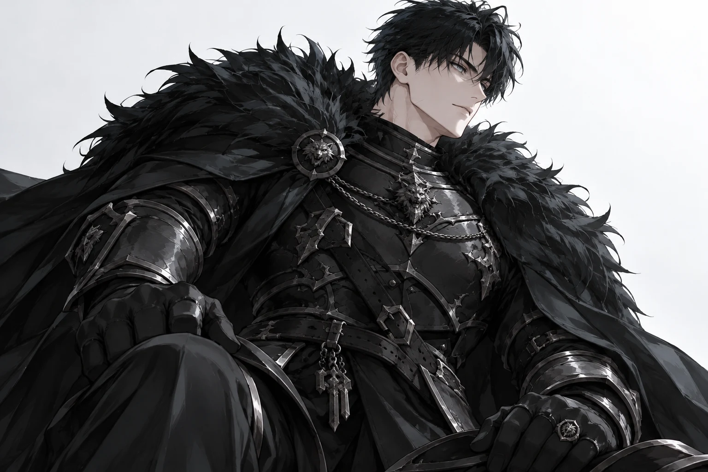

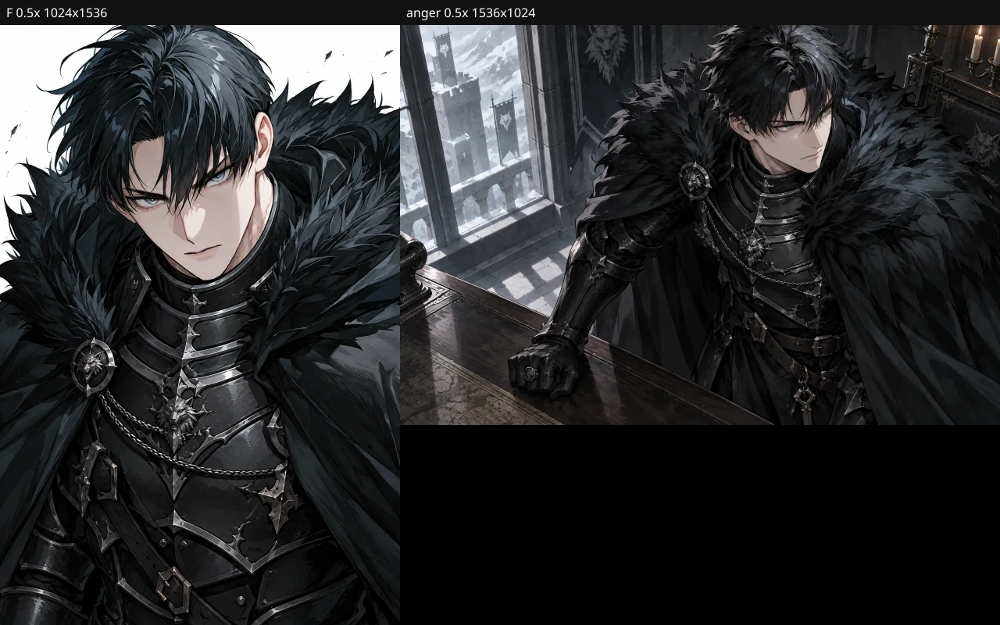

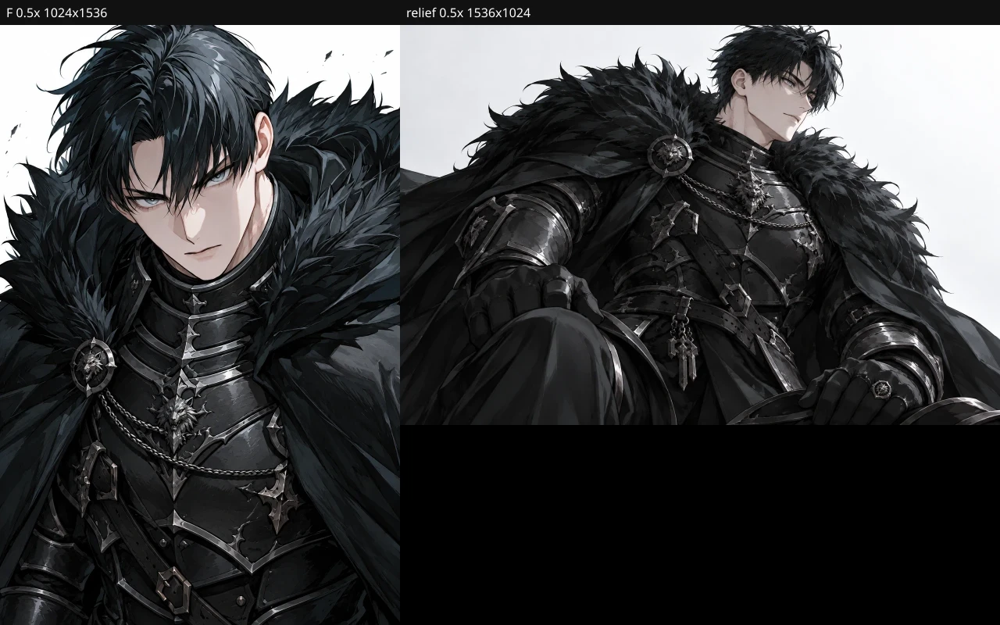

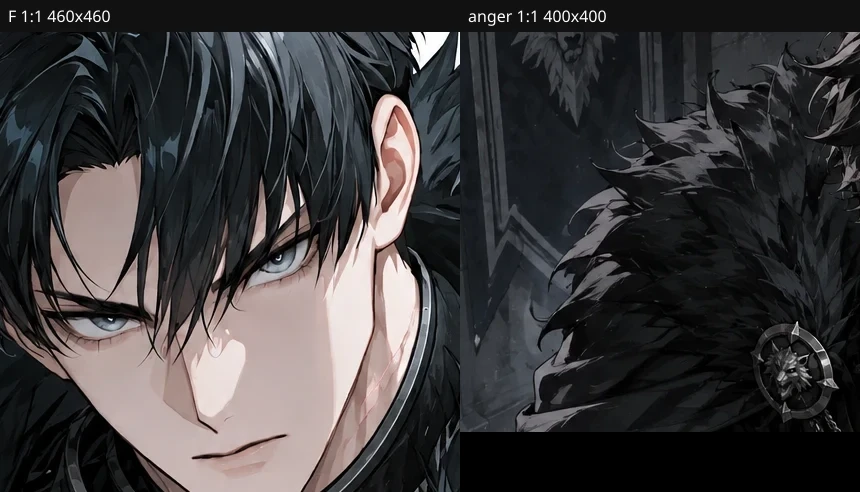

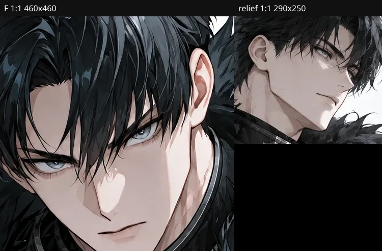

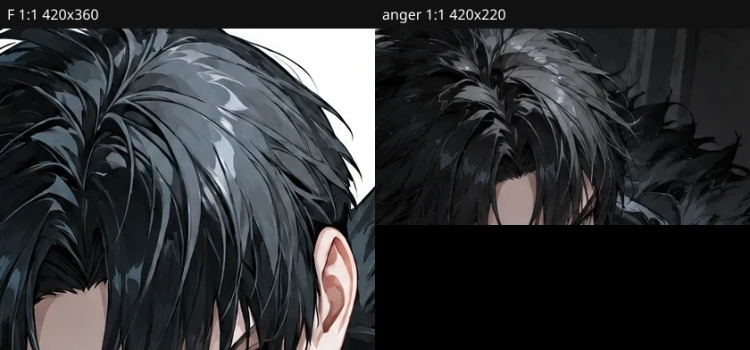

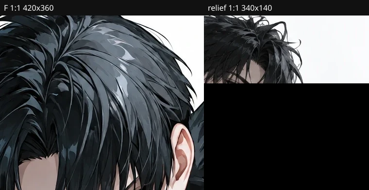

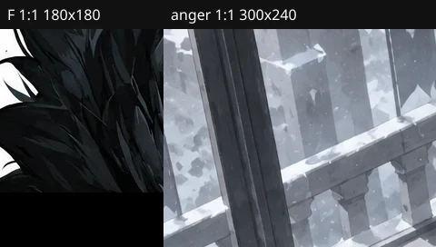

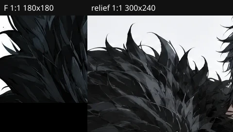

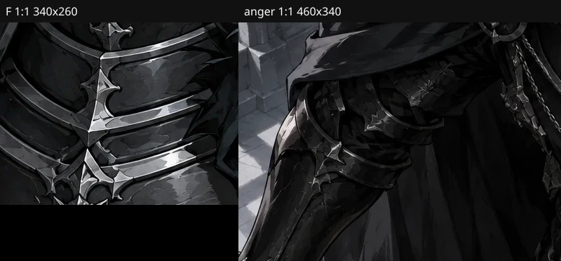

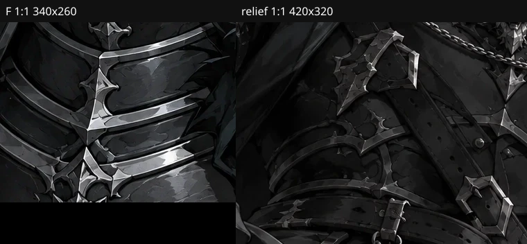

옅은 미소·F 비교는 §16.1과 `compare-smile-f-*.webp`를 그대로 본다. 네 컷 전체 요약 JSON: `four-f-candidates-summary.json`.

## 19. emo6-r2 — Expression만 바꾼 안도

기존 emo6은 여유 있는 미소에 가깝다. 그 파일과 2회 호출 ledger는 덮어쓰지 않았다. r2는 Expression만 바꿨다. Pose·샷·F 참조·Appearance Lock·34세 가드는 같다. 전송문 diff는 `emo6-r2-prompt.diff`다. 바뀐 줄은 Expression 한 줄뿐이다.

새 Expression: 눈을 잠깐 감고 미간의 힘이 풀리며, 입술을 살짝 벌려 길게 숨을 내쉬는 안도. 웃는 입꼬리나 장난기보다 긴장이 풀리는 표정이다.

경로: `composeOfficialSlotGeneration` → `prepareOfficialImageReferences` → `callOpenAiImageEdit` 1회. 모델 `gpt-image-2.5-sunburst`. 1536×1024 / medium / n=1 / webp 88 / opaque. fallback·재시도·vision 없음. 원본 `emo6-r2-raw.webp`를 검사보다 먼저 저장했다. 실행 기록은 `emo6-r2-ledger.json`, `emo6-r2-actual.json`이다.

| 항목 | 값 |
|---|---|
| request | `req_3ec37eba8f184d68af6ee9b6fbc7b8a5` |
| 비용 | 0.030293 USD (상한 0.08) |
| 전송 SHA | `40e0c454…372e05` |
| 원본 SHA | `f52f9f21…47e214` |
| F 전처리 | `39d425e5…2ae1c7` |

**인물:** 검은 울프컷, 흑철 판금, 검은 모피, 늑대 문양은 F·미소·분노·기존 안도와 같은 사람이다. 이 컷은 눈을 감아 회청 눈동자는 보이지 않는다.

**그림체:** 같은 cel-shaded 로판 남주 선과 면이다. 배경은 기존 안도처럼 단순하다.

**감정:** 눈은 감겨 있고 입술은 살짝 벌어져 숨을 내쉬는 쪽에 가깝다. 기존 안도의 여유 있는 미소, sig4의 눈을 뜬 옅은 미소, emo2의 턱을 다문 분노와 구별된다. 코는 화면 오른쪽을 향한다. 귀는 머리카락에 많이 가려 이 창만으로 단정하지 않는다.

얼굴 비교 1:1은 `compare-five-faces.webp`다. r2 얼굴 창은 `700,40,360×300`이다. 칸 수는 그대로다. r2는 emo6의 표현 보완이지 다섯 번째 슬롯이 아니다. 채워진 후보는 4칸, 남은 제작 대상은 10칸이다.

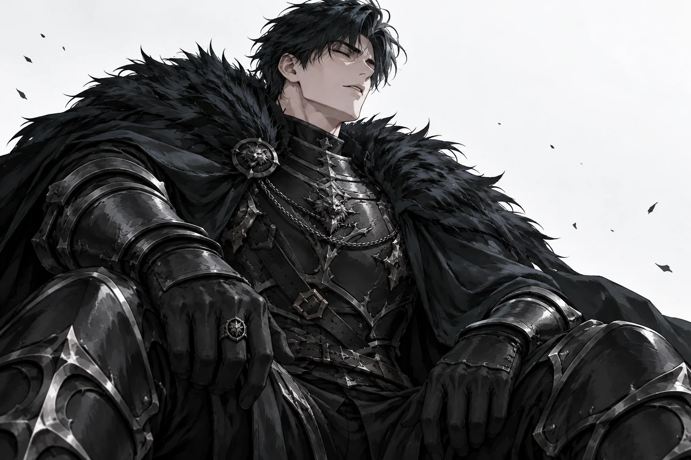

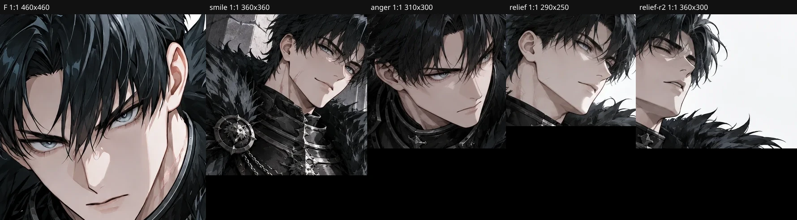

10칸 제작과 14칸 제출은 §20이다.

## 20. 남은 10칸 후보 제출

유지한 네 칸은 재생성하지 않았다. rep F, sig4 `옅은 미소`, emo2 `분노`, emo6 `안도` r2다. 기존 안도 r1(`emo6-relief-f-*`)은 비교 이력으로 남기고 최종 emo6 후보와 구분한다. 운영 대표·앵커·이미지·태그·r2·Locks·#50·소유권은 그대로다.

새 10칸은 승인 재설계 §4의 장면·행동을 메모리 오버레이로만 썼다. 운영 JSON의 옛 제목 태그는 넣지 않았다. 경로: `composeOfficialSlotGeneration` → `prepareOfficialImageReferences` → `callOpenAiImageEdit` 1회. 모델 `gpt-image-2.5-sunburst`. 1536×1024 / medium / n=1 / webp 88 / opaque. F는 같은 `official-review-candidate` 토큰으로 identity+style에 썼다. Appearance Lock·34세 가드·슬롯별 샷은 유지했다. 합성 후 문자열 치환, b7, 스타일 DNA, 새 전역 화풍 문구는 없다.

호출은 슬롯당 1회, 합계 10회다. 순차 실행이고 fallback·재시도·재추첨·vision은 없다. 원본 바이트를 검사보다 먼저 저장했다. 후처리 복구는 없었다. provider 실패·비용 불명·예산 초과는 없었다. 실행 기록은 새 파일 `remaining-10-f-ledger.json`이다. 기존 smile·emo2·emo6·emo6-r2 actual과 ledger는 덮어쓰지 않았다.

이번 10회 비용은 0.302265 USD다. 슬롯 상한 0.08, 합계 상한 0.80이다. 중단 사유는 없다.

전송 SHA는 각 호출 actual의 해당 필드에서 복사했다. sig4의 이후 재조립 SHA `8847a0d3…c2f7e5ff`는 그 호출의 전송값이 아니다. 전체 목록은 `fourteen-f-candidates.json`이다. 아래 표의 SHA는 그 파일과 같다.

| 슬롯 | 태그 | 파일 | 원본 SHA | 전송 SHA | request | USD |
|---|---|---|---|---|---|---|
| rep | F | `rep-f-raw.webp` | `a95f9aca…0f8032` | `e24378f1…83de46e` | `req_77188f324f0845b388c50a5b856161a8` | 0.027393 |
| sig1 | 지도를 짚음 | `sig1-map-f-raw.webp` | `e9864034…6782f5` | `1dc3003b…1323a5` | `req_8cad5780dde64785a419d63ceb53e453` | 0.030198 |
| sig2 | 턱을 괴고 생각 | `sig2-chin-f-raw.webp` | `3242bbad…f9bdb4` | `ab17ab9e…9ce15c` | `req_ee31e437cdbb4702adf28ace9a88c8b4` | 0.030153 |
| sig3 | 열쇠를 확인함 | `sig3-key-f-raw.webp` | `b7df32fa…0f8a19` | `83f11f68…5e030d` | `req_905fc7abe4ce4e21a00252f67ca0e1b0` | 0.030018 |
| sig4 | 옅은 미소 | `sig4-smile-f-raw.webp` | `fc14ebff…a24dc1` | `95e795a7…4223cf` | `req_9f16055bae0840c4b0d2c49677a931c5` | 0.030393 |
| emo1 | 의심 | `emo1-doubt-f-raw.webp` | `6f345d95…346a07` | `84c0eb9b…e67d72` | `req_b474a1e014164ecbaae1dd27765ea7e0` | 0.030063 |
| emo2 | 분노 | `emo2-anger-f-raw.webp` | `c4d38db0…6d5db8` | `c76aec7e…733311` | `req_995ff002b4864ac695708ad75a5f0523` | 0.030123 |
| emo3 | 진지함 | `emo3-serious-f-raw.webp` | `758e1f8d…19643a` | `6ac62f40…adf245` | `req_8c5320ba66274741bbfa59692c6bb587` | 0.030138 |
| emo4 | 당황 | `emo4-fluster-f-raw.webp` | `52708694…7bf4d4` | `6995697c…873b51` | `req_5db3268c0ca94919a6587368050b3e7b` | 0.030038 |
| emo5 | 편안함 | `emo5-ease-f-raw.webp` | `113e7a2c…033a1a` | `9e04e897…f09d73` | `req_93aa24e820c541f9bab6444fb19a7c6d` | 0.030173 |
| emo6 | 안도 r2 | `emo6-r2-raw.webp` | `f52f9f21…47e214` | `40e0c454…372e05` | `req_3ec37eba8f184d68af6ee9b6fbc7b8a5` | 0.030293 |
| scene1 | 문서를 대조함 | `scene1-docs-f-raw.webp` | `1150bf9d…e6230c` | `9f89d980…898cc5` | `req_9c5d7971ef8c4a619ae0a5e471b8fb94` | 0.030438 |
| scene2 | 기록을 맞춤 | `scene2-records-f-raw.webp` | `0cb364a2…74b3e5` | `a24b813c…8075f2` | `req_7608b37f1a06407a838014d8a8f765c1` | 0.030388 |
| scene3 | 긴장 | `scene3-tense-f-raw.webp` | `bd3a47bc…33482c` | `3a8469dc…3ab860` | `req_44c5e4bdebb3457dadc0b9d179096297` | 0.030658 |

이력 emo6-r1은 최종 후보가 아니다. 파일 `emo6-relief-f-raw.webp`, 원본 `c4775c0d…7ba802`, 전송 `2ffade03…cecf2b`, request `req_e8a41d84ed504492b42b37c1617ef0a9`, 0.030233 USD.

rep F의 과거 호출 크기는 1024×1536이다. 이번 10칸과 유지한 sig4·emo2·emo6-r2는 1536×1024다.

**인물:** 열 장 모두 검은 울프컷, 회청 눈, 흑철 판금, 검은 모피, 늑대 문양이다. F·미소·분노·안도 r2와 같은 사람 쪽으로 읽힌다.

**그림체:** 같은 cel-shaded 로판 남주 선과 면이다. 배경은 슬롯 장소가 달라 눈 내리는 성벽, 집무실, 아카이브, 유리온실로 갈린다.

**행동·감정:** 후보 제출용으로 원본을 연 관찰이다. 14장 품질 검수는 이 제출 다음에 한다.

- sig1: 탁자 위 지도를 장갑 낀 검지로 짚는다. 지도와 손이 프레임 안에 있다. 코는 화면 왼쪽, 보이는 귀는 화면 오른쪽이다.
- sig2: 앉아 장갑 낀 손으로 턱을 괸다. 서류·지도·열쇠는 없다.
- sig3: 열쇠 꾸러미를 들어 열쇠를 본다. 열쇠와 손이 프레임 안에 있다.
- emo1: 눈썹을 좁히고 입을 다문 근접이다. 서류가 없다.
- emo3: 눈 오는 성벽에서 눈을 뜨고 손을 비운 채 선다. 웃음이 아니다. 얼굴이 프레임에서 작다.
- emo4: 눈이 커지고 입술이 살짝 벌어진 근접이다. 웃음이 아니다.
- emo5: 눈을 뜨고 어깨를 내린 채 선다. 눈을 감고 숨을 내쉬는 안도 r2와 창가에 앉아 웃는 미소와 다르다. 서류·검·열쇠가 없다.
- scene1: 인장이 다른 문서 두 장을 양손에 들고 대조한다. 탁자에 지도가 더 있다.
- scene2: 아카이브 탁자의 기록을 양손으로 맞춰 본다.
- scene3: 유리온실에서 눈을 뜨고 선다. 턱과 어깨에 힘이 있고 주먹을 가볍게 쥐고 있다. 문서·열쇠·유혈은 없다. 프롬프트에서 처형 표현은 뺐다. 재시도가 금지된 호출에서 안전 거부를 피하기 위한 것이고, 장소와 긴장된 자세는 남겼다.

얼굴·머리·모피·갑옷 1:1은 원본에서 해당 부위가 들어가도록 창을 열어 맞춘 뒤 붙였다. 좌표는 `compare-remaining-10-windows.json`이다. scene3 머리 창은 작은 머리 위 유리 골조가 함께 보이고, emo5 모피 창은 깃 가장자리에 갑옷이 조금 남는다. 두 창 모두 해당 부위가 주된 내용이다.

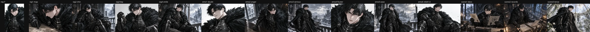

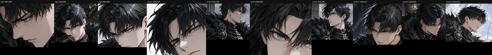

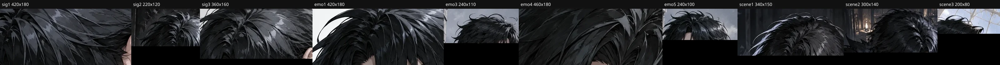

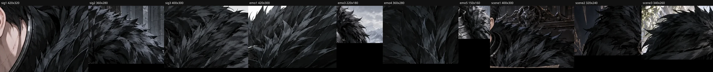

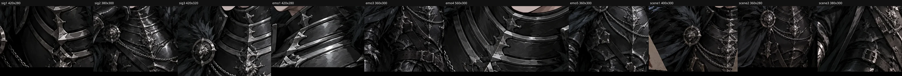

§20 표의 emo5 행과 대표 표기 `F`는 그 시점의 제출이다. 현재 최종 후보는 §21이다.

## 21. emo5-r2 편안함과 비공개 적용 준비

GPT 검수에서 emo5를 뺀 13장은 유지한다. 기존 emo5와 10회 ledger는 덮어쓰지 않았다. 슬롯 수는 14개다.

### 21.1 emo5-r2

Expression과 Pose만 바꿨다. emo5 샷 책임(왼쪽 3/4, 눈높이, 무릎 이상, 환경 배경), F `official-review-candidate`, Appearance Lock, 34세 가드는 같다. 전송문 diff는 `emo5-r2-prompt.diff`다. 바뀐 것은 29번째 줄의 Expression·Pose뿐이다.

- Expression: 눈꺼풀을 조금 낮추고 미간과 입술의 힘을 뺀 편안함. 눈은 뜨고 입술은 부드럽게 다문다.
- Pose: 돌벽에 등을 가볍게 기대고 한쪽 다리에 체중을 싣는다. 어깨와 팔꿈치와 손의 힘을 풀어 편하게 쉰다. 손은 비어 있다.

경로: `composeOfficialSlotGeneration` → `prepareOfficialImageReferences` → `callOpenAiImageEdit` 1회. `gpt-image-2.5-sunburst`, 1536×1024 / medium / n=1 / webp 88 / opaque. fallback·재시도·vision 없음. 원본을 검사보다 먼저 저장했다. 실행 기록은 `emo5-r2-ledger.json`, `emo5-r2-actual.json`이다. 전처리 SHA는 기존 F와 같은 `39d425e5…2ae1c7`이다.

| 항목 | 값 |
|---|---|
| request | `req_36a02238b64642f7a13befe73a642d20` |
| 비용 | 0.030133 USD (상한 0.08) |
| 전송 SHA | `1fbf0dbc…c44ca8` |
| 원본 SHA | `ef87914c…6ab517` |

**인물·그림체:** 검은 울프컷, 흑철 판금, 검은 모피, 늑대 문양이다. 기존 13장과 같은 cel-shaded 로판 남주다.

**자세:** 돌벽에 등을 기대고 한쪽 무릎을 굽혀 체중을 싣는다. 손은 비어 있고 소품과 상대 인물은 없다. 눈은 뜨고 입술은 다물어 있다. 기존 편안함의 곧게 선 자세, 진지함의 성벽 옆모습, 옅은 미소의 앉은 웃음, 안도 r2의 눈 감고 앉은 숨과 구별된다.


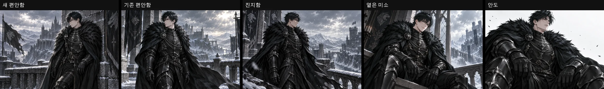

### 21.2 최종 14칸

사용자용 대표 태그는 `기본 초상`이다. `F`는 내부 후보 이름이다. emo5 최종 파일은 `emo5-r2-raw.webp`, emo6 최종 파일은 `emo6-r2-raw.webp`다. 전송 SHA는 각 actual에서 복사했다. 전체 문자열은 `fourteen-f-candidates.json`이다.

| 슬롯 | 태그 | 파일 | request | USD |
|---|---|---|---|---|
| rep | 기본 초상 | `rep-f-raw.webp` | `req_77188f324f0845b388c50a5b856161a8` | 0.027393 |
| sig1 | 지도를 짚음 | `sig1-map-f-raw.webp` | `req_8cad5780dde64785a419d63ceb53e453` | 0.030198 |
| sig2 | 턱을 괴고 생각 | `sig2-chin-f-raw.webp` | `req_ee31e437cdbb4702adf28ace9a88c8b4` | 0.030153 |
| sig3 | 열쇠를 확인함 | `sig3-key-f-raw.webp` | `req_905fc7abe4ce4e21a00252f67ca0e1b0` | 0.030018 |
| sig4 | 옅은 미소 | `sig4-smile-f-raw.webp` | `req_9f16055bae0840c4b0d2c49677a931c5` | 0.030393 |
| emo1 | 의심 | `emo1-doubt-f-raw.webp` | `req_b474a1e014164ecbaae1dd27765ea7e0` | 0.030063 |
| emo2 | 분노 | `emo2-anger-f-raw.webp` | `req_995ff002b4864ac695708ad75a5f0523` | 0.030123 |
| emo3 | 진지함 | `emo3-serious-f-raw.webp` | `req_8c5320ba66274741bbfa59692c6bb587` | 0.030138 |
| emo4 | 당황 | `emo4-fluster-f-raw.webp` | `req_5db3268c0ca94919a6587368050b3e7b` | 0.030038 |
| emo5 | 편안함 r2 | `emo5-r2-raw.webp` | `req_36a02238b64642f7a13befe73a642d20` | 0.030133 |
| emo6 | 안도 r2 | `emo6-r2-raw.webp` | `req_3ec37eba8f184d68af6ee9b6fbc7b8a5` | 0.030293 |
| scene1 | 문서를 대조함 | `scene1-docs-f-raw.webp` | `req_9c5d7971ef8c4a619ae0a5e471b8fb94` | 0.030438 |
| scene2 | 기록을 맞춤 | `scene2-records-f-raw.webp` | `req_7608b37f1a06407a838014d8a8f765c1` | 0.030388 |
| scene3 | 긴장 | `scene3-tense-f-raw.webp` | `req_44c5e4bdebb3457dadc0b9d179096297` | 0.030658 |

이력: emo5-r1 `emo5-ease-f-raw.webp` `req_93aa24e820c541f9bab6444fb19a7c6d` 0.030173 USD. emo6-r1 `emo6-relief-f-raw.webp` `req_e8a41d84ed504492b42b37c1617ef0a9` 0.030233 USD.


### 21.3 #51 비공개 적용 경로

이 절은 §22 이전의 기록이다. 대표 교체, `characters.images`, 복구에 대한 현재 동작은 §22다.

이번 턴은 절차 확인만 했다. provider 호출, DB 쓰기, 대표 교체 금지 검사 삭제는 없다.

13개 RP 슬롯(sig1–4, emo1–6, scene1–3)의 기존 owner는 다음 순서다.

1. `registerExternalOfficialAssetReplacement`. 공식 관리자가 외부 바이트와 승인 태그를 넘긴다. 저장 전 intake lease를 잡고, 파일은 `ext-<intakeId>` 경로에 둔다. 활성 슬롯은 `approved`이고 `result_url`이 있어야 한다. Appearance Lock이 현재 잠금과 같아야 한다. 크기는 해당 칸 프로필과 정확히 같아야 한다. RP 프로필은 1536×1024다. 이번 후보 13장은 그 크기다.
2. moderation이 `checked`이고 거절이 아니어야 한다. `reviewReplacement`는 검수한 후보 URL과 variation QA를 CAS로 묶는다. 이 검수는 아직 실행하지 않았다.
3. `applyApprovedOfficialAssetReplacements({ dryRun: true })`가 같은 검사를 통과한 뒤 롤백한다.
4. dry-run과 같은 인자에서 `dryRun` 없이 apply 한다.

한 트랜잭션이 대상 칸의 `characters.assets` URL·태그·크기, `official_supply_assets.result_url`·`approved_tag`, replacement `status=applied`를 함께 갱신한다. `mapOfficialPublicAssetSlots`는 계획 순서와 활성 URL이 공개 URL과 같을 때만 인덱스를 준다. 대표는 계획 순서의 0번이고 `representativeRank`는 기존 에셋을 복사해 유지한다. 카드 URL은 순위가 있는 assets를 먼저 본다. `characters.images`는 이 apply가 쓰지 않으며, assets에 순위 URL이 없을 때만 레거시 fallback이다. 소유권, `official`, `visibility`, 공개, 알림, 원고는 바꾸지 않는다. #51은 `staged_private`라 `official=0`, `visibility=private`가 유지되어야 한다.

복구(정정): dry-run과 중간 SQL 실패는 트랜잭션이 전부 되돌린다. 이것은 실패한 apply의 원자성이지 백업이 아니다. `base_result_url`은 교체 전 URL 한 칸만 남기고, 태그·QA·moderation·대표 지정·계획은 남기지 않는다. 그래서 "트랜잭션과 `base_result_url`이 백업"이라는 이전 문장은 틀렸다. 이 시점에는 성공한 apply의 복구 경로가 없었다. 현재는 §22.4의 apply 기록과 `rollbackOfficialAssetReplacementApply`가 그 역할을 한다. `VACUUM INTO` 백업은 locked-snapshot reconcile owner의 절차이고, 그 owner는 대표 URL 변경을 거부한다.

대표 이미지 반입은 이 경로에서 지원되지 않는다. `assertReplacementSlotAllowed`, `createReplacementCandidate`, 외부 반입, apply가 모두 `replacement_representative_forbidden`으로 대표를 거부한다. 거부는 파일 쓰기와 공개 행 변경 전에 일어난다. 근거는 `officialSupply.replacement.test.ts`의 representative create/apply fail-closed 테스트다. F 원본은 1024×1536이라 대표 프로필 `OFFICIAL_REPRESENTATIVE_IMAGE_PROFILE`의 크기와는 맞지만, 종류 검사가 크기 검사보다 먼저 거부한다.

앵커도 같이 막힌다. `reviewAnchor`는 stage가 `asset_plan_locked`이고 대표 status가 `generated`일 때만 동작한다. #51은 이미 staged라 그 게이트로 새 초상을 다시 승인할 수 없다. `reviewReplacement`도 대표에서 `use_anchor_review`가 아니라 대표 교체 금지로 멈춘다. 그래서 현재 앵커 QA는 살아 있는 대표 URL에 묶인 채로 남는다.

태그는 두 owner가 다르다. 이미 staged된 칸의 교체 태그는 `replacementAppliedTag`가 승인 태그를 쓴다. 처음 스테이징의 대표 태그는 `stagedAssetTag`가 계획 태그를 반환한다. 현재 `pilot-rf-02.json` 대표 계획 태그는 `흑철 늑대공`이다. `기본 초상`은 그 계획 태그를 바꾸지 않은 승인 태그다. 운영 JSON은 이번에도 수정하지 않았다.

필요한 변경은 대표 한 칸에 한정된다. 금지 검사를 지우기보다, 같은 외부 저장·moderation·1024×1536 정확 크기·Appearance Lock·기준 URL CAS·dry-run·롤백 안에 대표를 넣고, staged 상태의 대표 행에 새 앵커 QA를 기록하는 owner가 필요하다. 그 owner가 생기기 전에는 #51 대표와 앵커를 F로 바꾸지 않는다. 13개 RP 슬롯은 위 1–4 순서로 품질 승인 뒤에 적용할 수 있다. 이번 턴은 그 적용을 실행하지 않았다.

## 22. 승인 후보 14장의 비공개 적용 경로

범위는 코드와 격리 DB 검증이다. 새 provider 호출, vision 호출, 운영 DB 쓰기, 이미지 적용, 소유권 이전, 공개, 알림, 병합·배포는 하지 않았다. 아래의 moderation·앵커 QA·variation QA는 모두 테스트용 게이트 fixture다(`reason: test-fixture-not-quality-approval`, 검수자 `test-fixture-reviewer-not-quality-approval`). 이것은 14장의 품질 승인이나 실제 RP 품질 합격이 아니다. 기록은 임시 DB에만 쓰이고 테스트가 끝나면 지워진다.

입력은 §21.2의 14칸 그대로다. `fourteen-f-candidates.json`의 원본 SHA와 파일 바이트가 같은지 테스트가 먼저 확인한다. 대표 태그는 `기본 초상`이고 `F`는 내부 이름이다. emo5는 `emo5-r2-raw.webp`, emo6는 `emo6-r2-raw.webp`다. r1 컷은 이력이다.

### 22.1 바뀐 owner

| 책임 | owner | 변경 |
|---|---|---|
| 대표 교체 허용 | `OfficialSupplyStore.assertReplacementTargetAllowed` | 새 게이트. 대표는 `staged_private`일 때만 허용한다. 외부 반입·검수·apply가 사용한다 |
| 기본 거부 | `assertReplacementSlotAllowed` | 그대로. 유료 교체 생성(`createReplacementCandidate`, `assertReplacementGenerationAllowed`)과 published 행은 대표를 계속 거부한다 |
| 연결 확인 | `claimExternalReplacementIntake` | 연결된 공개 행의 assets가 이 draft의 활성 슬롯과 계획 순서로 일치해야 한다. 파일 쓰기 전에 검사한다 |
| 대표 검수 | `reviewRepresentativeReplacement` | 새 메서드. 앵커 QA 10항목 전부 통과 + moderation 통과일 때만 승인한다. 후보 URL·파일 SHA-256·Text Lock·Appearance Lock에 CAS로 묶는다. `reviewReplacement`는 대표에서 `use_anchor_review`로 멈춘다 |
| 후보 파일 SHA | `registerExternalOfficialAssetReplacement` | 저장한 바이트의 SHA-256을 `candidate_sha256`에 기록한다. 재반입과 생성 후보는 SHA·검수자·검수 시 Text Lock을 지운다 |
| 적용 | `applyApprovedOfficialAssetReplacements` | 대표가 대상이면 `representative`(승인 계획 + 참조 정책)가 필수다. 대표가 대상이 아니면 받지 않는다 |
| 복구 | `rollbackOfficialAssetReplacementApply` | 새 함수. 같은 파일(`replacement.ts`)에 있다 |
| 적용 기록 | `official_supply_replacement_applies` | 새 테이블. apply마다 before/after 상태와 실행자를 남긴다 |
| 이후 생성 참조 | `official_supply_characters.generation_reference_json` → `resolveOfficialGenerationReferencePlan` | 캐릭터별 저장 정책. 조립 owner 하나가 읽는다 |
| 참조 준비 | `prepareOfficialImageReferences` | `official-approved-asset:<sha>:<url>`을 일반 업로드/https 경로로 읽고 SHA가 다르면 provider 전에 실패한다 |

볼프강 이름 분기와 별도 compiler는 없다. 승인 계획은 `src/lib/officialSupply/pilot/fixtures/pilot-rf-02-approved-asset-plan-f.json`이다. `pilot-rf-02.json`과 r2 본문, 두 Lock은 바꾸지 않았다.

### 22.2 대표 교체 조건

모두 만족해야 한다. 앞의 네 개는 파일 쓰기 전에 검사한다.

1. 실행자가 연결 캐릭터를 관리할 수 있는 공식 관리자다(`canAdminManageOfficialCharacter`). 아니면 `replacement_forbidden`.
2. 공급 stage가 `staged_private`이고 연결 행이 `official=0`, `visibility=private`다. published면 `replacement_representative_forbidden`, 행이 어긋나면 `replacement_target_mismatch`.
3. `staged_character_id`가 가리키는 행의 assets가 이 draft의 활성 슬롯과 같다. 아니면 `staged_character_mismatch`.
4. 대상 칸 종류 검사가 크기 검사보다 먼저다. 크기는 대표 프로필 1024×1536과 정확히 같아야 한다(`asset_dimensions`).
5. moderation이 `checked`이고 거절이 아니다. 누락은 `moderation_missing`, unavailable은 `moderation_unavailable`, 거절은 검수 결과 `rejected`다.
6. 앵커 검수가 현재 후보 URL과 파일 SHA에 묶여 있다. 다른 URL이나 SHA는 `replacement_review_stale`이다. 검수 뒤 Text Lock이 다르면 `representative_review_stale`, 앵커 QA 항목이 빠지면 `representative_review_missing`이다.
7. 후보의 Appearance Lock과 `base_result_url`이 현재 대표와 같다(`appearance_lock_stale`, `replacement_base_stale`).

옛 대표의 앵커 승인(`anchor_approved_by`, 활성 행 `qa_json`)은 새 후보에 쓰지 않는다. 새 후보의 검수자와 앵커 QA는 apply 때만 활성 행과 공급 캐릭터로 옮겨진다.

### 22.3 한 트랜잭션 적용

`applyApprovedOfficialAssetReplacements({ slotKeys: 14칸, representative: { nextAssetPlan, generationReference: "representative_identity_and_style" } })`가 한 트랜잭션에서 다음을 함께 쓴다.

- `characters.assets`: 14칸 URL·태그·크기·moderation 필드. 대표 순위 1은 기존 에셋에서 그대로 복사한다. 대표가 바뀌면 `characters.images`도 `listingImageUrls(assets)`로 맞춘다.
- `official_supply_assets`: 칸별 `result_url`, `approved_tag`, QA(대표는 앵커 QA), moderation.
- replacement `status=applied`.
- `official_supply_characters`: `asset_plan_json`(승인 계획), `anchor_approved_by`(새 대표 검수자), `generation_reference_json`(`{ mode, url, sha256 }`).
- apply 기록 1행(before/after).

태그: 대표 `기본 초상`, RP는 manifest 태그다. vision의 `visionTag`(테스트 fixture는 `앉음`)는 수동 승인 태그를 덮지 않는다. 승인 계획은 plan QA를 통과해야 하고, 슬롯 키·종류·순서를 유지해야 하며, 대상이 아닌 칸은 바뀌면 안 되고(`asset_plan_untargeted_change`), 대상 칸의 계획 태그는 적용 태그와 같아야 한다(`asset_plan_tag_mismatch`). 공급 캐릭터 갱신은 stage·연결·두 Lock·이전 계획/검수자/정책에 CAS를 건다.

기존 동작은 그대로다. 단일 RP 교체, published 교체, intake lease, 만료 lease 회수, `ext-<intakeId>` 불변 경로, stale moderation/QA CAS 테스트(`officialSupply.replacement.test.ts` 22개)가 통과한다.

### 22.4 성공한 apply 복구

`rollbackOfficialAssetReplacementApply({ applyId })`는 apply 기록의 before 상태를 한 트랜잭션에서 되돌린다. 대상은 `characters.assets`·`images`, 칸별 활성 행 전체(QA, moderation, 승인 태그 포함), replacement status·`applied_at`, 공급 캐릭터의 계획·앵커 검수자·참조 정책이다.

- 현재 상태가 그 apply의 after와 정확히 같을 때만 실행한다. 이후 편집이 하나라도 있으면 `rollback_stale`로 아무것도 쓰지 않는다.
- 끝난 뒤 상태가 before와 같은지 다시 확인한다(`rollback_postcondition`).
- 옛 파일과 새 파일을 지우지 않는다. apply 기록은 `rolled_back`과 실행자로 남는다. 후보는 `approved`로 돌아가 다시 apply 할 수 있다.
- 전체 DB 덮어쓰기는 쓰지 않는다. `dryRun`을 지원한다.

### 22.5 이후 생성 참조

정책이 저장된 캐릭터에서 `resolveOfficialGenerationReferencePlan`은 RP 칸마다 승인 대표 한 장을 identity+style로 보낸다(`variation_identity_and_style`, 참조 `official-approved-asset:<F sha>:<업로드 URL>`). docs 경로나 로컬 경로는 정책 URL로 받지 않는다. 대표 재생성은 `role_conflict`, 별도 same-person 이미지는 `role_conflict`, 현재 대표 URL과 정책 URL이 다르면 `reference_policy_stale`로 provider 전에 멈춘다. 옛 대표 + b7/DNA나 food sig4, 옛 제목 태그로 돌아가지 않는다.

정책이 없는 캐릭터(#50 포함)는 기존 Cluster B `identity_then_style`이다. 테스트에서 기본 경로 캐릭터가 대표 URL + 기본 STYLE root를 그대로 받는 것을 확인했다.

승인 계획의 sig4 location/situation은 식사 문구를 `흑철 요새 집무실 창가` / `늦은 당직을 마친 뒤 짧은 휴식을 취하며 상대를 바라본다`로 바꿨다. signature 칸은 location을 프롬프트에 쓰지 않으므로 전송문은 바뀌지 않는다.

### 22.6 격리 DB 검증

테스트: `src/lib/officialSupply/officialSupply.approvedRepresentativeApply.test.ts` (11개). 실제 14개 파일 바이트를 `storeUpload`로 임시 DATA_DIR에 저장하고 sharp로 크기를 읽는다. fetch는 막혀 있고 provider 어댑터는 없다. 호출 0건.

| 요구 | 테스트 | 결과 |
|---|---|---|
| 14칸 apply 성공, dry-run 무변경 | 1a, 1b | 통과 |
| 권한 없음·published·연결 불일치·기본 대표 거부, 파일 쓰기 전 차단 | 2 | 통과. 저장 파일 수 변화 0 |
| 크기 오류·검수 누락/거절·후보 변경·stale QA·기준 URL 변경 차단 | 3 | 통과 |
| 트랜잭션 중간 실패 시 14칸·앵커·참조 정책 복구 | 4 (마지막 쓰기인 apply 기록 INSERT에서 실패 주입) | 통과 |
| 재적용 시 중복·상태 손상 없음 | 5, 6 | 통과 |
| 성공 후 rollback, stale rollback 거부 | 6 | 통과 |
| 재조회 후 다음 조립이 승인 대표 identity+style + 14칸 계획 | 7 | 통과. 13개 RP 전송문 SHA가 기록과 일치 |
| 카드·상세·채팅 이미지, RP 태그 목록 | 8 | 통과 |
| 원고·두 Lock·공유 세계/로어북·소유권·공개 범위·official, 기본 경로 캐릭터 보존 | 9 | 통과 |

7번은 store에서 다시 읽은 캐릭터로 조립했다. 비교 기준은 manifest의 전송 SHA다. sig4는 manifest의 `laterOwnerAssemblyPromptSha256`(`8847a0d3…`)이다. 준비 단계에서 저장 파일의 SHA를 확인했고, 다른 SHA를 넣으면 `approved asset hash mismatch`로 실패했다.

### 22.7 격리 before/after

기록: `assets/wolfgang-asset-redesign/isolated-apply-evidence.json`. 스크립트: `isolated-apply-evidence.ts.txt`(같은 owner 호출 순서, 임시 DB). 결과 요약은 provider 호출 0, dry-run 무변경, apply `applied`, 전송 SHA 13/13 일치, stale rollback `rollback_stale`, rollback 후 before와 동일이다.

| 칸 | before 태그 | after 태그 |
|---|---|---|
| rep (순위 1) | 흑철 늑대공 | 기본 초상 |
| sig1 | 철혈의 지휘관 | 지도를 짚음 |
| sig2 | 흉터의 맹세 | 턱을 괴고 생각 |
| sig3 | 봉인고의 열쇠 | 열쇠를 확인함 |
| sig4 | 절제된 온기 | 옅은 미소 |
| emo1 | 기록의 모순 | 의심 |
| emo2 | 분노의 억제 | 분노 |
| emo3 | 증거 앞의 판단 | 진지함 |
| emo4 | 뜻밖의 동요 | 당황 |
| emo5 | 경계의 완화 | 편안함 |
| emo6 | 귀환의 안도 | 안도 |
| scene1 | 위조된 명령서의 밤 | 문서를 대조함 |
| scene2 | 봉인된 장부의 빈칸 | 기록을 맞춤 |
| scene3 | 황실의 마지막 압박 | 긴장 |

after에서 `characters.images`는 새 대표 업로드 URL 하나다. `anchor_approved_by`는 seed 값에서 테스트 검수자로 바뀌고, `generation_reference_json`은 `{ mode: representative_identity_and_style, url: /uploads/official-pilot-rf-v4-02__rep-ext-…webp, sha256: a95f9aca…8032 }`이다. Text Lock·Appearance Lock·`official=0`·`visibility=private`·소유자는 그대로다. rollback 뒤에는 태그·이미지·앵커 검수자·정책(null)·칸별 QA가 before로 돌아갔고 apply 기록은 `rolled_back`으로 남았다.

### 22.8 운영 절차 (이번에 실행하지 않음)

같은 owner를 이 순서로 호출한다. 각 단계는 별도 승인 뒤에만 실행한다. 이 순서를 감싸는 단계 명령은 §23.3이다.

1. 실행 전: `git rev-parse HEAD`가 배포 SHA와 같은지 확인한다. #51 `stage=staged_private`, `official=0`, `visibility=private`, 현재 Text Lock·Appearance Lock 해시, 현재 대표 URL을 운영 행에서 읽어 기록한다. 검수와 apply는 그 값과 같아야 한다.
2. 14칸마다 `registerExternalOfficialAssetReplacement({ actor: 공식 관리자, draftKey: "pilot-rf-v4-02", slotKey, bytes, approvedTag })`. 바이트 SHA는 `fourteen-f-candidates.json`과 같아야 한다.
3. 14칸마다 `moderateOfficialAssetReplacement`. 운영 moderator는 canonical asset vision이고 유료 호출이다. 별도 비용 승인이 필요하다.
4. RP 13칸은 `reviewReplacement`(variation QA), 대표는 `reviewRepresentativeReplacement`(앵커 QA, 후보 URL, 원본 SHA `a95f9aca…8032`, 검수자). 검수 기록은 GPT/사용자 육안 승인을 옮겨 적는 것이고 코드가 대신하지 않는다.
5. `applyApprovedOfficialAssetReplacements({ slotKeys: 14칸, representative: { nextAssetPlan: 승인 계획, generationReference: "representative_identity_and_style" }, dryRun: true })`.
6. 같은 인자에서 `dryRun` 없이 apply. 반환된 `applyId`를 기록한다.
7. 되돌릴 때: `rollbackOfficialAssetReplacementApply({ draftKey, applyId, dryRun: true })` 뒤 `dryRun` 없이 실행. 이후 편집이 있으면 거부된다.

### 22.9 남은 것

- 14장의 품질 승인과 실제 RP 품질은 이번 범위가 아니다. 테스트 승인은 fixture다.
- 운영 moderation은 유료 vision 호출이다. 비용 승인 전에는 3단계를 실행하지 않는다.
- 절차를 감싸는 단계 명령과 personTag는 §23에서 처리했다.
- 대표가 바뀐 뒤 유료 교체 생성은 published 전용이고 대표 재생성은 막혀 있다. 공개 뒤 RP 교체 생성은 저장 정책으로 조립된다.

## 23. 이전 이미지 메타데이터 잔존 수정과 단계 명령

범위는 코드와 격리 DB 검증이다. 새 이미지, vision, 유료 RP 호출, 운영 DB 쓰기, 소유권 변경, 병합·배포·공개·알림은 하지 않았다. 최종 14장 파일, r2 원고, Text Lock, Appearance Lock, #50은 그대로다. GPT의 14장 후보 시각 검수는 유지 상태이고 이번 코드 보완으로 다시 요구하지 않는다.

### 23.1 이전 이미지 메타데이터 잔존 (차단 항목)

원인: `nextAssetFromCandidate`가 현재 에셋을 펼친 뒤 url만 바꿨다. 옛 파일의 `mediaId`·`publicRenditionUrl`·`blurPreviewUrl`·`moderationStatus`·`nippleExposure`가 새 url 옆에 남았다. 표시 owner는 `mediaId` → `publicRenditionUrl` → url 순서로 읽으므로(`publicRepresentativeUrl`), 이런 대표가 바뀌면 카드·상세·채팅이 옛 이미지를 계속 보여 준다. 흐림 미리보기(`safeLockedPreviewUrl`, `projectAssetsForViewer`)도 옛 `blurPreviewUrl`을 썼다.

수정: 에셋 모양 owner인 `characterAssets.ts`에 `withReplacedAssetFile(current, file)`를 두었다. 파일과 무관한 배치 필드만 허용 목록으로 옮긴다(tag, visualSubjectKey, public, chat, viewerBlur, representativeRank). 크기는 새 파일 값이다. `nextAssetFromCandidate`는 이것에 적용 태그와 새 후보의 moderation 필드(`canonicalAssetModerationFields`)를 더한다. 결과는 `buildStagingAssets`가 새 `/uploads/` 파일에 쓰는 모양과 같다. 표시 경로는 바꾸지 않았다. 새 url에서 공개 이미지와 `legacy-blur-<파일명>.webp`를 그대로 계산한다. 화면에서 URL을 덮는 우회는 없다.

테스트 `officialSupply.approvedRepresentativeApply.test.ts` "applied images carry no metadata of the replaced file":

| 테스트 | 시작 상태 | 확인 |
|---|---|---|
| 10a | 옛 대표에 `mediaId`·`blurPreviewUrl`·`moderationStatus`·`nippleExposure` | 대표 이미지·공개 URL 목록·기본 채팅·비로그인 열람 투영이 새 url, 흐림 미리보기가 새 파일 기준, 순위 1·`viewerBlur` 유지, rollback 뒤 옛 assets 문자열과 정확히 같음 |
| 10b | 옛 대표에 `publicRenditionUrl`·`blurPreviewUrl` | 위와 같음 |
| 10c | 흐림이 켜진 RP 칸에 `mediaId`·`blurPreviewUrl`·`moderationStatus: pending`·`nippleExposure: uncertain` | 사용자 흐림 유지, 나머지 13칸 불변, `assetModerationSummary` 비성인, 공개 미디어 route가 새 파일의 legacy-blur를 200 webp로 생성, rollback 뒤 옛 assets와 같음 |

| 실행 | 결과 | 기록 |
|---|---|---|
| 수정 전 owner + 새 테스트 | 10a·10b·10c 실패 3. 10a `representative kept the replaced file's mediaId`, 10c `RP slot kept the replaced file's mediaId` | `stale-metadata-before-fix.log` |
| 수정 전, 10b만 | 실패 1. `representative kept the replaced file's publicRenditionUrl` (`/media/public/old-representative-public.webp`) | `stale-metadata-before-fix-10b-alone.log` |
| 수정 후, 적용 테스트 + 기존 교체 테스트 | 36/36 통과. 기존 RP 교체·published 교체·intake lease·stale CAS 22개 포함 | `stale-metadata-after-fix.log` |

10b는 10a 실패 뒤 상태가 이어져 단독으로 다시 실행했다.

### 23.2 personTag

승인 계획 `pilot-rf-02-approved-asset-plan-f.json`에서 emo5는 `tag 편안함, personTag null`, emo6는 `tag 안도, personTag null`이다. 이전의 `진지함`·`미소` 대체 값은 지웠다. `ASSET_PERSON_TAGS`는 늘리지 않았다. personTag는 프롬프트에 들어가지 않으므로 13개 RP 전송문 SHA는 manifest 기록과 그대로 일치한다(테스트 7). 테스트 1b가 적용 뒤 계획의 두 칸이 `personTag: null`인지 확인한다.

### 23.3 단계 명령

기존 운영 스크립트 `scripts/official-supply-wolfgang-approved-source.ts`에 `assets` 하위 명령을 더했다. 판단은 `src/lib/officialSupply/approvedAssetApplyOperator.ts`에 있고, 각 단계는 기존 owner(`registerExternalOfficialAssetReplacement`, `moderateOfficialAssetReplacement`, `reviewReplacement`·`reviewRepresentativeReplacement`, `applyApprovedOfficialAssetReplacements`, `rollbackOfficialAssetReplacementApply`)만 호출한다. SQL이나 교체 로직을 따로 두지 않았다. 볼프강 이름 분기나 별도 compiler는 없다.

```
npm run official-supply:wolfgang-approved-source -- assets status   --admin-email <관리자> --character-id <#51 id>
npm run official-supply:wolfgang-approved-source -- assets intake   --admin-email <관리자> --character-id <#51 id> [--execute]
npm run official-supply:wolfgang-approved-source -- assets moderate --admin-email <관리자> --character-id <#51 id> [--execute --max-calls 28 --max-cost-usd 0.28 --per-call-reserve-usd 0.01]
npm run official-supply:wolfgang-approved-source -- assets review   --admin-email <관리자> --character-id <#51 id> [--evidence <검수 파일> [--execute]]
npm run official-supply:wolfgang-approved-source -- assets apply    --admin-email <관리자> --character-id <#51 id> [--execute]
npm run official-supply:wolfgang-approved-source -- assets rollback --admin-email <관리자> --character-id <#51 id> --apply-id <applyId> [--execute]
```

- 기본 실행은 조회 또는 dry-run이다. `--execute`가 없으면 쓰지 않는다. moderation 기본 실행은 호출 0건 계획이다.
- 모든 단계 전에 확인한다. 실행자는 `users` 행이 있는 공식 관리자다. `--character-id`가 draft의 `staged_character_id`와 같아야 한다(`operator_target_mismatch`). manifest는 14칸이 승인 계획 슬롯과 같고, 태그가 계획과 같으며, 파일 바이트 SHA가 `rawSha256`과 같아야 한다(`operator_manifest_slots/tag/file/sha`).
- 재개: 칸마다 다음 단계(intake / moderate / review / apply / applied / blocked)를 저장 상태에서 계산한다. 끝난 칸은 다시 반입·moderation·검수하지 않는다. 저장 후보가 manifest SHA와 다르면, 검수 전이면 다시 반입하고 승인·적용·거절된 다른 파일이면 `blocked`로 멈춘다. moderation 거절도 `blocked`다.
- apply는 `applyId`와 rollback 명령을 출력한다. 같은 상태에서 다시 실행하면 `already_applied`와 같은 `applyId`를 보여 준다.
- 기본값: draft `pilot-rf-v4-02`, manifest `fourteen-f-candidates.json`, 계획 `pilot-rf-02-approved-asset-plan-f.json`.

### 23.4 moderation 최대 호출·비용 계획

운영 moderator는 canonical asset vision이고 한 장마다 primary가 실패하면 내부 fallback 모델을 한 번 더 부른다(`visionModels()` 2개). 단계 명령은 이 fallback을 호출 수와 비용에 넣는다.

| 항목 | 값 |
|---|---|
| 대상 | 14장 |
| 한 장의 최대 시도 | 2 (primary + fallback) |
| 최대 호출 | 28 |
| 시도당 예약액 (`--per-call-reserve-usd`) | 0.01 USD (운영자가 정하는 상한) |
| 최대 비용 (`--max-cost-usd`) | 0.28 USD |

- `--execute`에는 세 상한이 모두 필요하다(`operator_moderation_budget_required`). 첫 호출 전에 최악값(남은 장 × 2 시도 × 예약액)이 상한 안인지 확인한다(`operator_moderation_budget_exceeded`).
- ~~한 장이 끝날 때마다 2시도를 청구한다.~~ **정정(§24.2):** 이 방식은 실제 provider 호출이 없어도 한 장당 2시도 × 예약액을 "청구"로 표시했다. 키가 없어 POST가 0건인 실행도 "2회 / 0.02 USD 청구"로 보였다. 이 값은 최악값 예약이었고 실제 호출·청구가 아니다. 현재는 실제 POST마다 직전에 상한을 확인하고, 호출·확정 비용·비용 미확인 시도·예약을 따로 보고한다.
- unavailable이면 그 장에서 멈춘다. 거절·unavailable을 통과로 바꾸지 않는다.
- ~~vision 모델 단가는 이번에 확인하지 않았다.~~ 단가는 §24.3에서 읽기 전용으로 확인했다. 운영 실행 자체는 여전히 별도 비용 승인 대상이다.

### 23.5 운영 검수 증거 파일

`assets review`(evidence 없이)는 검수 대기 칸의 빈 양식을 출력한다. 양식에는 칸별 저장 후보 URL, 원본 SHA, 대표 앵커 QA 10항목 또는 RP variation QA 항목이 `ok: null`로 들어 있고 그대로는 제출되지 않는다.

- `reviewer`와 `approvalEvidence`(GPT/사용자 승인 근거의 위치)가 필요하다. 모든 QA 항목은 명시적인 `ok`와 메모가 있어야 하고, 모르는 항목은 거부한다.
- 칸마다 URL과 SHA가 저장된 후보와 manifest에 같아야 한다.
- `test-fixture`·`not-quality-approval` 문구가 있으면 거부한다. `isolatedProofOnly: true` 증거는 운영 DB(`RAILWAY_ENVIRONMENT_NAME=production` 또는 운영 SQLite 경로)에서 거부한다.
- 출력에 증거 파일 SHA-256이 남는다. 코드가 검수 결과를 채우지 않는다.

### 23.6 격리 DB 실행

이 절은 이전 실행(applyId `a2095028…`)이다. 같은 경로의 기록은 §24.5의 새 실행으로 교체됐고, 이 절의 원래 기록은 커밋 `d574519e`에 남아 있다. 그 기록의 `chargedCalls 2 / chargedCostUsd 0.02`와 단계 이름의 "charged at the reserve"는 예약이었다(§24.2).

기록(이전): `assets/wolfgang-asset-redesign/isolated-operator-cli-evidence.json`. 스크립트: `isolated-operator-cli-evidence.ts.txt`. 임시 DATA_DIR에 스테이징한 #51 형태 draft에 대해 실제 CLI를 자식 프로세스로 실행했다. provider 키와 네트워크는 없고 실행 뒤 DB를 지웠다.

| 단계 | 결과 |
|---|---|
| status | 쓰기 0. 14칸 `next=intake`, manifest SHA 일치 |
| intake 기본 / `--execute` / 재실행 | 계획만 / 14칸 반입 / 14칸 건너뜀(`next=moderate`) |
| moderate 기본 | `planned`, 호출 0 |
| moderate `--execute` 상한 없음 | `operator_moderation_budget_required`로 중단 |
| moderate `--execute` 상한 27회 | `operator_moderation_budget_exceeded` ("14 images need up to 28 calls / 0.28 USD") |
| moderate `--execute` 28 / 0.28 / 0.01, 키 없음 | vision unavailable로 rep에서 `stopped`. 실제 provider POST 0, 확정 비용 0. 당시 출력의 "청구 2회 / 0.02 USD"는 최악값 예약이었다(정정, §24.2) |
| (격리 전용) moderation fixture | 같은 owner에 테스트 moderator를 넣어 14칸 기록. provider 호출 0. 품질 승인이 아니다. 새 실행에서는 mock provider moderation으로 바꿨다(§24.5) |
| moderate 재실행 | `completed`, 호출 0, 14칸 건너뜀 |
| review 양식 / production 표시 상태에서 격리 증거 | 빈 양식 / `operator_review_evidence`로 거부 |
| review 기본 / `--execute` / 재실행 | 기록 0 / 14칸 기록 / 14칸 `alreadyReviewed` |
| apply 기본 / `--execute` / 재실행 | `dry_run` / `applied`, applyId `a2095028…`와 rollback 명령 / `already_applied` 같은 applyId |
| rollback 기본 / `--execute` | `dry_run` / `rolled_back` |

화면 owner 기준 before / apply 후 / rollback 후:

| | before | apply 후 | rollback 후 |
|---|---|---|---|
| 카드 대표 | `rep-a1.webp` | `rep-ext-<id>.webp` | `rep-a1.webp` |
| 대표 태그 | 흑철 늑대공 | 기본 초상 | 흑철 늑대공 |
| 흐림 미리보기 | `legacy-blur-…rep-a1.webp` | `legacy-blur-…rep-ext-<id>.webp` | `legacy-blur-…rep-a1.webp` |

rollback 뒤 캐릭터 행은 before와 같았다(`rollbackRestoredCharacterRow: true`). 같은 흐름의 owner 테스트는 `officialSupply.approvedAssetOperator.test.ts`(7개)다.

### 23.7 검수 상태

| 항목 | 상태 |
|---|---|
| 14장 후보 시각 검수 | GPT 검수 유지 |
| 운영 moderation | 미실행. 비용 승인 필요 |
| 운영 검수 기록 | 미실행. §23.5 형식의 실제 검수 파일 필요 |
| 운영 apply | 미실행 |
| 실제 RP 품질 | 별도 미결 |

테스트·격리 실행의 moderation과 검수는 게이트 fixture이고 실제 품질 승인 기록이 아니다.

### 23.8 `npm run test:regular` 차이

| 실행 | 실패 | `SQLITE_BUSY` 실패 기록 |
|---|---|---|
| 기준 `50e23fe8` | 299 | 31 |
| 이전 브랜치 실행 | 340 | 71 |
| 이번 HEAD | 303 | 29 |

확인한 것:

- 이번 HEAD와 기준의 차이는 파일 10개다. HEAD에서 늘어난 파일은 `investigationDiscovery.s3`(0 → 28), `personaSecretDiscovery.followup`(0 → 9), `worldShares.borrow`(2 → 3)이고, 나머지 7개는 기준에서 더 많이 실패했다(`knowledgeTransfer.s4d` 13 → 0 등).
- HEAD에서 늘어난 세 파일의 실패는 `SQLITE_BUSY`/`database is locked`다. 기준에서만 실패한 `knowledgeTransfer.s4d`·`points.deepseekCheaperInference`·`investigationDiscovery.s3Home`도 같은 오류다.
- 세 파일은 HEAD에서 단독 실행 시 모두 통과한다(21/21, 8/8, 40/40). 이전 실행에서 차이가 난 7개 파일도 단독으로는 통과했다(`knowledgeTransfer.s4VariantProjection`은 기준에서도 1개 실패).
- 세 파일은 `installIsolatedTestDatabase` 없이 기본 `getDb()`를 연다. 이번 브랜치의 새 테스트는 격리 DB helper를 쓰고, 세 파일과 import로 연결되지 않는다.
- 차이가 나는 파일 묶음은 실행마다 바뀌었다.

확인하지 못한 것: 실행마다 실패 위치가 달라지는 원인, 그리고 이 브랜치가 추가한 테스트 파일이 병렬 실행의 잠금 경합에 영향을 주는지 여부. 기준과 HEAD를 같은 조건에서 반복 실행해 분포를 비교하지 않았다. 따라서 무관하다거나 해결됐다고 판단하지 않는다.

### 23.9 검증

| 확인 | 결과 |
|---|---|
| official-supply 전체 (`src/lib/officialSupply/**/*.test.ts`) | 573/573 통과, 연속 2회 |
| 적용 테스트 + 기존 교체 테스트 | 36/36 통과 |
| 단계 명령 테스트 | 7/7 통과 |
| `npm run lint` | 통과 |
| `npm run typecheck:app` | 통과 |
| `git diff --check` | 통과 |
| `npm run test:regular` | 13546개 중 303 실패, §23.8 |

official-supply 전체 실행에서 처음 두 문제가 나왔고 고쳤다. 단계 명령 테스트가 `productionAdapters`를 import해 기존 경계 테스트("tests never load the network-capable production adapters")가 실패했다. 그 테스트를 지웠고, 운영 moderator 연결은 §23.6의 CLI 실행이 확인한다. rollback 비교에서 초 단위 `updated_at`이 부하 중 1초 넘어가 실패했다. 기존 적용 테스트와 같이 `updated_at`을 비교에서 뺐다.

## 24. 실패한 반입 재개와 moderation 실행 제어

운영 DB 쓰기, 이미지 적용, 병합·배포·공개·알림·소유권 변경, 추가 이미지 생성, 유료 RP는 하지 않았다. 모든 검증은 mock provider 또는 네트워크 차단 상태에서 했고 실제 유료 호출은 없다.

### 24.1 실패한 반입 재개

원인: 단계 명령의 `nextStep`이 `planned`·`failed` 교체 행을 `blocked`로 분류했다. 기존 owner `registerExternalOfficialAssetReplacement`는 저장이나 등록이 실패하면 `releaseExternalReplacementIntake`로 lease를 풀고 행을 `planned`로 남긴다. 그래서 저장 실패 한 번 뒤에는 같은 intake로 그 칸을 다시 반입할 수 없었다.

수정(`approvedAssetApplyOperator.ts`): 분류만 바꿨다. 반입은 기존 owner(`claimExternalReplacementIntake` → 검사 → 저장 → `registerExternalReplacementCandidate`)를 그대로 부른다.

| 저장 상태 | 다음 단계 |
|---|---|
| `planned`, lease 없음 | intake ("previous intake stopped before registration") |
| `planned`/`failed`, lease 만료 | intake. 기존 claim CAS(`lease_expires_at < now`)가 회수한다 |
| `planned`/`failed`/다른 파일의 `generated`, 유효한 lease | blocked ("another intake holds the lease (<만료 시각>)") |
| `failed`, lease 없음 | intake ("previous attempt failed: <오류>") |
| `generating`·`upload_pending` | blocked (생성 진행 중) |
| 승인·적용된 후보, 거절 | 기존과 같이 blocked / applied |
| manifest와 같은 파일로 등록된 후보 | moderate 이후 단계. 다시 저장하지 않는다 |

- intake 출력은 `status: planned | completed | stopped`, `registered[]`(`resumed` 표시), `failed {slot, code, message}`, `skipped[]`다. 첫 오류에서 멈추고 `stopped`로 보고하며 CLI 종료 코드는 1이다. 실패를 skip이나 성공으로 보고하지 않는다.
- 남은 위험(후속): 저장은 성공했는데 등록이 실패하면, 기존 owner는 시도마다 새 `intakeId`로 파일 이름을 만들기 때문에 처음 저장한 파일은 참조 없이 남는다. 재실행은 새 파일을 저장한다. 이번에는 owner의 파일 정리 규칙을 바꾸지 않았다.

전/후: 같은 주입 실패를 기준 `b4d2eb96`과 수정본에서 재현했다. 기준에서는 rep가 `planned`로 남고 `blocked "replacement is planned"`로 분류돼 재실행에서도 건너뛰었다. 수정본에서는 첫 실행이 `stopped`(rep `intake_error`)로 끝나고, 같은 intake 재실행에서 rep가 등록됐다.

### 24.2 moderation 실행 제어

원인: 이전 계량은 vision owner 바깥에서 한 장이 끝난 뒤 계산했다. primary 결과를 보고 fallback을 막을 수 없었고, 실제 POST 없이도 2시도 × 예약액을 "청구"로 표시했다.

수정:

- `src/lib/vision.ts`의 `analyzeAssetImage(url, index, control?)`에 선택 인자 `VisionRunControl`을 더했다. 실제 provider POST 직전마다 `beforeProviderPost(model)`을 묻고, 응답이 정리된 뒤 `afterProviderPost({model, outcome, cost})`를 알린다. primary가 끝난 뒤 fallback POST 전에도 다시 묻는다. 거절이면 POST를 보내지 않고 `stoppedBeforeProviderPost`를 돌려준다. 별도 vision 경로는 없다.
- `control`이 없으면 동작은 이전과 같다(primary → fallback). 일반 업로드 호출부는 바꾸지 않았다.
- 운영 moderator `createVisionOfficialAssetModerator(control)`가 이 control을 owner에 넘긴다. 거절로 멈추면 `unavailable`("asset vision moderation stopped: …")이고 통과가 아니다.
- 단계 명령의 control은 POST 직전에 순서대로 확인한다: 예약액을 넘은 청구가 이미 있는지, 다음 POST가 `--max-calls`를 넘는지, 사용액 + 예약액이 `--max-cost-usd`를 넘는지. 하나라도 걸리면 그 POST를 보내지 않고 `stopped`로 끝난다.
- 사용액 계산: 청구액이 보고된 POST는 그 금액, 청구액이 없거나 usage가 추정인 POST와 전송 오류(요청을 보냈지만 응답을 못 받음)는 비용 미확인으로 보고 예약액을 잡아 둔다.
- 키가 없거나 로컬 이미지를 읽지 못하면 POST 전에 끝난다. control을 묻지 않고 호출 0, 확정 비용 0이다. 쓰지 않은 fallback과 예약은 호출·청구로 보이지 않는다.

출력 `accounting`:

| 필드 | 뜻 |
|---|---|
| `scope` | `this command run` |
| `providerPosts` | 실제로 보낸 provider POST 수 (primary + fallback) |
| `postsWithConfirmedCost` / `confirmedCostUsd` | provider가 청구액을 보고한 POST와 그 합 |
| `postsWithUnknownCost` / `unknownCostReserveHeldUsd` | 보냈지만 비용을 모르는 POST와 그만큼 잡아 둔 예약 |
| `budgetUsedUsd` | 확정 비용 + 잡아 둔 예약. 상한 비교에 쓰는 값 |
| `reservedUsd` / `unusedReserveUsd` | 실행 시작 때 최악값 예약과 쓰지 않은 나머지. 호출이나 청구가 아니다 |
| `chargesAboveReserve[]` | 한 POST의 확정 청구가 예약액보다 큰 경우. 숨기지 않고 기록하며 다음 POST를 막는다 |

`posts[]`에는 POST마다 `slot, model, outcome(parsed|unparsed|http_error|transport_error), confirmedCostUsd, aboveReserve`가 남는다.

### 24.3 예약액 근거 (읽기 전용 확인)

- 모델: `resolveAssetVisionModels` 기본값은 primary `qwen/qwen3.8-flash`, fallback `qwen/qwen3-vl-8b-instruct`다. `ASSET_VISION_MODEL`·`BACKGROUND_VISION_MODEL`·`ASSET_VISION_MODEL_FALLBACK`로 바꿀 수 있다. 운영 환경 변수 값은 확인하지 않았다. 실행 전에 확인해야 한다.
- 출력 상한: 요청당 `max_tokens: 128`. flash는 `reasoning: {effort: "none"}`.
- 단가 출처: OpenRouter `GET /api/v1/models/<id>/endpoints`(2026-10-17 약 15:08 UTC, 인증 없는 조회).
  - `qwen/qwen3.8-flash`(Alibaba): 입력 0.15 USD/M, 출력 0.47 USD/M
  - `qwen/qwen3-vl-8b-instruct`(Parasail): 입력 0.25 USD/M, 출력 0.75 USD/M
  - 별도 이미지 단가는 없고, 이미지는 입력 토큰으로 계산된다.
- 추정: prompt 2,231자 + schema 743자. 가장 큰 후보는 1024×1536(28px 격자 기준 약 2,000 토큰). 입력을 보수적으로 8,000 토큰으로 잡으면 POST당 flash 약 0.0013 USD 이하, vl-8b 약 0.0021 USD 이하다. 예약액 0.01 USD는 vl-8b 추정의 약 4.7배다. 실제 이미지 토큰 수는 확인하지 않았다.
- repo 가격표에는 vision 전용 항목이 없다. `openRouterModelPricing`은 "qwen" id를 `QWEN_37_MAX_RATES`로 계산한다. 원장 기록용 추정이고 이번 상한 판단에는 쓰지 않았다.

### 24.4 보장 범위

- 상한은 명령 1회 실행 단위다. 재실행을 합친 전체 작업 합계가 아니다. 출력도 실행 1회 값만 보고한다. 전체 작업 총액은 실행마다의 출력을 더해야 한다.
- 실제 청구가 상한 안이라는 보장은 POST 하나의 실제 청구가 예약액 이하일 때만 성립한다. 예약액보다 큰 청구는 그 POST가 끝난 뒤에야 알 수 있다. 그 금액은 기록되고 다음 POST는 보내지 않는다. 이미 보낸 POST의 청구는 되돌릴 수 없다.
- 비용 미확인 POST의 실제 청구는 보장하지 않는다. 예약액을 잡아 다음 POST의 상한 계산에만 쓴다.
- 예약은 계획 값이다. `reservedUsd`·`unusedReserveUsd`를 호출이나 청구로 읽지 않는다.
- 비용 원장(`recordVisionCostAttempts` → `recordBackgroundProviderCost`)이 환율을 `GET https://open.er-api.com/v6/latest/USD`로 조회할 수 있다. 무료 환율 조회이고 provider 호출이 아니다. 격리 실행에서는 mock이 이 요청을 거부했다.

### 24.5 격리 CLI 실행 (교체된 기록)

기록: `assets/wolfgang-asset-redesign/isolated-operator-cli-evidence.json`. 스크립트: `isolated-operator-cli-evidence.ts.txt`. 임시 DATA_DIR의 #51 형태 draft에 실제 CLI를 자식 프로세스로 실행했다. moderation 응답은 `--import`로 넣은 mock provider(`mock-provider.mjs`)가 준다. mock은 OpenRouter POST만 답하고 나머지 요청은 거부하며 받은 요청을 기록한다. 키는 dummy다. mock 응답은 vision 결과가 아니다. 실행 뒤 DB와 파일을 지웠다.

| 단계 | 결과 |
|---|---|
| intake `--execute`, uploads 디렉터리 읽기 전용 | `stopped`, rep `intake_error` EACCES, 종료 코드 1 |
| status | rep `next=intake` ("previous intake stopped before registration") |
| (격리) 다른 intake가 sig1을 claim | 유효한 lease |
| intake `--execute` | rep 재개(`resumed`) + 12칸 등록. sig1은 lease로 blocked |
| (격리) sig1 lease 만료 시각을 과거로 | — |
| intake `--execute` | sig1 회수·등록("lease expired") |
| intake 재실행 | 등록 0, 14칸 건너뜀 |
| moderate 기본 / 상한 없음 / 상한 부족 | 호출 0 계획 / `budget_required` / `budget_exceeded` |
| moderate `--execute`, 키 없음 | POST 0, 확정 0, 예약 0.28 중 미사용 0.28. rep unavailable로 `stopped` |
| mock: primary가 예약액보다 큰 0.02 USD 청구 | POST 1, 확정 0.02, `chargesAboveReserve` 1건, fallback POST 0 |
| mock: rep 성공 / sig1 500 → fallback 성공 / sig2 usage 없음 / sig3 둘 다 실패 | POST 6, 확정 2건 0.001, 미확인 4건(예약 0.04), 사용 0.041, 미사용 0.239. sig3 unavailable로 `stopped` |
| mock: 남은 11칸 | POST 11, 확정 0.0055, 미사용 0.2145. 3칸 건너뜀 |
| moderate 재실행 | POST 0, 14칸 건너뜀 |
| review / apply / rollback | 이전과 같은 흐름. applyId `708b62bf…`, rollback 뒤 캐릭터 행 동일(`rollbackRestoredCharacterRow: true`) |
| apply 뒤 intake | 등록 0, 14칸 applied로 건너뜀 |

mock 기록의 provider POST 수는 각 단계의 `providerPosts`와 같았다. mock 기록에는 각 유료 단계마다 거부된 환율 GET 1건이 더 있다(§24.4). 저장된 후보 파일은 14개다.

### 24.6 요구 검증과 근거

| 요구 | 자동 테스트 | 격리 CLI |
|---|---|---|
| 1. 키 없음: POST 0, 호출 0, 확정 0 | `vision.runControl.test.ts` "without a key or a readable image", 단계 명령 테스트 4 | 키 없음 단계 |
| 2. primary 성공: 호출 1, fallback 없음 | "a parsed primary is one POST" | 남은 11칸 단계 (11칸 POST 11) |
| 3. primary 실패, fallback 허용: 호출 2 | "a failed primary settles before the fallback POST" | sig1 500 → fallback |
| 4. primary 뒤 예산 정지: fallback POST 0 | "a refusal after the primary sends no fallback POST", 단계 명령 테스트 4 | 예약 초과 단계 |
| 5. usage 없는 시도: 확정·미확인 분리 | "transport errors and replies without usage" | sig2·sig3 (미확인 4건) |
| 6. 같은 CLI로 반입 실패 재개, 끝난 단계 반복 없음 | 단계 명령 테스트 3 | intake 실패 → 재개 → 재실행 0 |

전/후: 새·변경 테스트 13개를 기준 `b4d2eb96` 코드에 돌리면 8개가 실패한다. vision 실행 제어 4개, 단계 명령의 반입 재개(3)·moderation(4), 같은 파일에서 바뀐 출력을 이어 쓰는 검수(5)·적용(6)이다. 수정본에서는 모두 통과한다.

### 24.7 검증

| 확인 | 결과 |
|---|---|
| official-supply 전체 (`src/lib/officialSupply/**/*.test.ts`) | 573/573 통과 |
| vision 관련 (`assetVisionStructured`, `characterMediaAcl.followup`, `vision.models`, `vision.runControl`) | 42/42 통과 |
| 단계 명령 테스트 | 7/7 통과 |
| `npm run lint` / `npm run typecheck:app` / `git diff --check` | 통과 |
| 운영 스크립트 typecheck (임시 tsconfig) | 통과 |

`npm run test:regular`의 `SQLITE_BUSY` 실패(§23.8)는 이번에 다시 확인하지 않았다. 원인은 여전히 확인되지 않았고 이번 변경으로 해결됐다고 보지 않는다.

### 24.8 검수 상태

§23.7과 같다. 운영 moderation·검수 기록·apply는 미실행이고, 운영 moderation은 비용 승인이 필요하다. 14장 후보 시각 검수와 코드 검증을 전체 자동 제작이나 실제 RP 품질 합격으로 보지 않는다. 테스트와 격리 실행의 mock moderation·검수는 게이트 확인용이고 실제 품질 승인 기록이 아니다.

### 24.9 응답을 읽지 못한 POST의 정산

원인: provider가 HTTP 200과 잘린 JSON을 주면 `res.json()`이 `SyntaxError`를 던졌다. 그 예외는 `afterProviderPost`보다 먼저 나가서, 명령은 `stopped`인데 보고는 provider POST 0, 미확인 비용 0이었다. 응답 본문을 읽지 못하거나 응답이 객체가 아닌 경우도 같다.

수정은 vision owner의 POST 실행과 정산 사이다. `analyzeWithModel`은 전송 실패를 `transport_error`로 돌려주고, 그 밖의 예외는 POST 이후의 본문 읽기·JSON 파싱·응답 구조 해석 실패다. 그 시도는 `unparsed`, 비용 `null`로 정확히 한 번 정산하고 같은 예외를 다시 던진다.

- 청구액을 읽지 못했으므로 미확인 비용으로 보고하고 예약액을 유지한다.
- 예외가 실행을 멈추므로 fallback을 새로 보내지 않는다. 새 재시도나 별도 vision 경로는 없다.
- 정상 응답, HTTP 오류, transport 오류는 기존 반환 경로에서 한 번만 정산한다.
- 키 없음과 이미지 읽기 실패는 POST 전에 끝나고 호출 0, 확정 비용 0이다.
- 예외로 멈춰도 그 실행의 `posts`에는 이미 정산된 요청이 남는다. 그 칸의 moderation 기록은 예외 전에 저장된 값에서 바뀌지 않는다.

| 확인 | 수정 전 (`aa13aa3a`) | 수정 후 |
|---|---|---|
| HTTP 200 + 잘린 JSON | 정산 0, 보고 POST 0 | POST 1 = 보고 1, 미확인 1건, 예약 유지, fallback 없음 |
| POST 후 본문 읽기 실패 | 정산 0 | 같은 보장 |
| HTTP 오류 뒤 구조 해석 실패 | HTTP 오류만 정산되고 다음 POST는 누락 | 둘 다 한 번씩 남고 예외는 유지 |
| 정상 응답·HTTP 오류·transport 오류 | 각각 1회 | 각각 1회 |
| 키 없음·이미지 읽기 실패 | POST 0, 확정 0 | POST 0, 확정 0 |
| primary 뒤 예산 정지 | fallback POST 0 | 유지 |

vision owner 테스트는 `vision.runControl.test.ts`, 운영 연결은 `officialSupply.approvedAssetOperator.test.ts`의 moderation 실행이다. 둘 다 mock provider이고 네트워크로 나가지 않는다. 수정 전 로그는 정산 배열이 비어 있거나 앞선 HTTP 오류만 남고, 운영 보고의 provider POST가 0이다. 수정 후 vision 관련 테스트 45/45, 단계 명령 테스트 7/7, official-supply 전체 573/573, `npm run lint`(`typecheck:app`), `git diff --check`가 통과했다.

미참조 파일 정리는 후속이다. `npm run test:regular`의 `SQLITE_BUSY` 실패(§23.8)는 이번에 다시 확인하지 않았고, 이번 변경으로 해결됐다고 보지 않는다.

## 25. 대표 검수 정정 — 동일 후보의 명시적 재검수

§23·§24의 운영 실행에서 대표 F(`rep-a1.webp`를 교체할 후보)는 `identifyingFeatures`가 불합격이라 `rejected`로 저장됐다. 14장 파일, URL, 원본 SHA, moderation(`clean`)은 그대로다. 나머지 13칸은 `approved`다. apply는 실행하지 않았고 운영 대표는 `rep-a1.webp`다.

### 25.1 검수 판단의 정정

그때 불합격 근거는 두 가지였다. 승인 흉터를 확인할 수 없다는 것과 왼손 약지가 프레임 밖이라는 것이다. 이 둘은 서로 다른 종류의 판단이라 같은 불합격 근거로 묶지 않는다.

| 종류 | 대표 F에서의 해당 | 판단 |
|---|---|---|
| 명확하게 관찰되는 외형 불일치 | 성인 남성, 회청색 눈, 흑회색 머리, 흑철 갑옷, 검은 모피에서 불일치 없음. 승인 위치와 다른 위치의 흉터를 그려 넣은 것도 아님 | 불합격 근거 아님 |
| 구도·의상에 가려 확인할 수 없는 특징 | 왼쪽 턱 아래 가는 흉터는 이 얼굴 창에서 분명하지 않다. 왼손 약지와 반지는 프레임 밖이다 | 확인 불가로 적는다. 통과 근거로도, 자동 불합격 근거로도 세지 않는다 |
| 정지 이미지로 검증할 수 없는 설정 | 약지의 감각 저하(동상 후유증) | 판단에서 제외하고 note에 적는다 |

- 턱·칼라 경계, 뺨의 짧은 선의 명암은 승인 흉터로 세지 않는다. 흉터가 정확히 구현됐다고 기록하지 않는다(§14·§16의 관찰과 같다).
- 보이지 않는 특징을 모두 드러내는 것은 대표 승인 조건이 아니다. 대표 슬롯 계획(`기본 초상`: 정면, 검 손잡이)에는 흉터·약지를 보여야 한다는 요구가 없다.
- 그러나 흉터가 승인 위치와 명확히 다른 곳에 있거나, 대표에서 반드시 보이기로 승인한 특징이 빠졌으면 자동 통과시키지 않는다. 그 경우 `ok: false`다.
- 전역 QA 10항목과 `isCompletePassingAnchorQa`(모두 `ok: true`)는 바꾸지 않았다. `identifyingFeatures` 검사도 지우지 않았다. 바뀐 것은 이 항목을 적는 사람이 무엇을 불합격으로 세는지의 판단 기준이고, 그 판단은 검수 기록의 note와 정정 근거로 남는다.

정정된 판단으로 `ok`를 정하는 것은 검수자(GPT/사용자)다. 코드와 이 문서가 `ok`를 채우지 않는다. 아래 §25.5는 기록 전 초안이고 운영에 기록하지 않았다.

### 25.2 새 owner 동작

기존 owner에 최소한으로 더했다. 별도 writer, SQL 우회, 새 상태값은 없다.

- `OfficialSupplyStore.rereviewRepresentativeReplacement`: `rejected` 대표 후보를 같은 파일로 다시 검수한다. 기본 `reviewRepresentativeReplacement`는 `generated`만 받으므로 `rejected`는 계속 막힌다.
- `official_supply_replacement_rereviews`: 추가 전용 기록 표. `ensureOfficialSupplySchema`가 `CREATE TABLE IF NOT EXISTS`로 만든다. 기존 표와 행은 바꾸지 않는다.
- 단계 명령: `assets review --evidence <파일> --rereview`. 칸마다 `correction: { reason, evidence }`가 필요하다. `--rereview` 없이 `correction`이 있으면 거부한다.

재검수가 열리는 조건은 모두 같아야 한다. 하나라도 다르면 쓰지 않고 거부한다.

| 조건 | 거부 코드 |
|---|---|
| 공식 관리자 | `replacement_forbidden` |
| `staged_private` | `replacement_representative_forbidden` |
| 후보 상태가 `rejected` (`generated`·`approved`·`applied`는 아님) | `replacement_not_rejected` |
| 같은 후보 URL | `replacement_review_stale` |
| 같은 원본 SHA | `replacement_review_stale` |
| 현재 Text Lock과 거절 당시 Text Lock이 같음 | `text_lock_stale` / `replacement_review_stale` |
| 현재 Appearance Lock과 후보의 Lock이 같음 | `appearance_lock_stale` |
| 교체 전 URL(`base_result_url`)이 현재 슬롯과 같음 | `replacement_base_stale` |
| 이전 검수 기록(QA)이 있음 | `rereview_no_prior_review` |
| moderation이 통과(`clean`/`adult_flagged`) | `rereview_moderation_rejected` / `moderation_missing` / `moderation_unavailable` |
| 검수자와 정정 이유·새 근거가 있음 | `reviewer_required` / `rereview_correction_required` |

- 상태 변경은 이전 상태를 조건으로 하는 UPDATE이고, 같은 트랜잭션에서 기록 행을 추가한다. 기록 쓰기가 실패하면 상태 변경도 되돌아간다.
- 새 QA에 불합격 항목이 하나라도 있으면 상태는 `rejected`로 남고, 그 시도도 기록에 남는다. 이후 다시 정정해 통과시킬 수 있다. 각 시도의 이전 QA는 직전 상태다.
- 기록 행은 이전 상태·QA·검수자·Text Lock, 새 상태·QA, 검수자, 정정 이유, 정정 근거, 관리자 id, 후보 URL·SHA, 교체 전 URL, 두 Lock을 가진다. 지우거나 고치는 경로는 없다.
- moderation, 파일 저장, provider 호출은 하지 않는다. 대표 외 칸은 재검수 대상이 아니다(`--rereview`는 `rejected` 대표만 받는다).
- 기존 apply는 그대로 `approved` + 두 Lock + 후보 URL·SHA를 다시 확인한다(`assertRepresentativeReviewCurrent`).
- `assets status`에 `rereviews` 목록이 더해졌다.

### 25.3 격리 DB 검증

`officialSupply.representativeRereview.test.ts`(13건)는 격리 DB에서 실제 14장 파일을 반입하고, 네트워크를 막고(`fetch` 시도 0), 저장·moderation 호출 수를 센다. QA·검수자·정정 문구는 게이트 확인용이고 품질 승인이 아니다.

| 요구 | 테스트 |
|---|---|
| 기본 review는 `rejected`를 계속 막는다 | 1 |
| 같은 후보를 재검수하며 파일·URL·SHA·moderation·교체 전 URL·Lock이 유지된다 | 2 |
| 이전 불합격 기록과 새 검수 기록이 함께 남는다 | 2, 3 |
| 새 QA에 불합격 항목이 있으면 계속 `rejected`, 불완전한 QA는 통과 못 한다 | 3, 4 |
| 권한 없음·검수자·정정 근거 없음 거부 | 5 |
| 다른 URL·SHA·교체 전 URL·Appearance Lock·Text Lock 거부 | 6 |
| moderation 거절·누락·unavailable 거부 | 7 |
| `generated`·`approved`·`applied` 후보와 `staged_private`가 아닌 캐릭터 거부 | 8 |
| 기록 쓰기 실패 시 상태가 되돌아간다 | 9 |
| 나머지 13칸·캐릭터 행·supply·slot 상태 불변, 파일 저장 0, 재검수 뒤 14칸 dry-run이 통과 | 10 |
| 단계 명령: `--rereview` 없이는 막힘, correction 필수, dry-run 쓰기 0, execute 기록, 상태 출력 | 11, 12, 13 |

수정 전 같은 테스트는 13건 모두 실패한다(owner에 재검수 메서드가 없다). 수정 후 13/13이다.

### 25.4 검증

| 확인 | 결과 |
|---|---|
| `officialSupply.representativeRereview.test.ts` | 13/13 (수정 전 0/13) |
| `src/lib/officialSupply/*.test.ts` 41개 파일을 파일마다 실행 | 전부 통과 |
| `npm run lint` / `npm run typecheck:app` / `git diff --check` | 통과 |
| `npm run typecheck` (전체) | 기존과 같은 3325줄. 이번에 바꾼 파일에서 새 오류 없음 |

`src/lib/officialSupply/*.test.ts`를 한 프로세스에서 함께 실행하면 이 VM에서 세그폴트가 난다(`better-sqlite3` 네이티브). 이번 변경과 무관하게 확인하지 않았고, 파일마다 따로 실행했다. `npm run test:regular` 전체는 이번에 다시 돌리지 않았다.

### 25.5 대표 재검수 증거 초안 (운영에 기록하지 않음)

검수자가 정정된 판단으로 확정한 뒤에만 쓴다. `ok` 값과 note는 검수자가 정한다. `identifyingFeatures`와 `correction` 외의 9개 항목은 기존 시각 검수를 유지하므로 기존 note를 바꾸지 않는다. 그 note는 운영 DB의 저장된 이전 QA에서 읽기 전용으로 가져온다.

```
node -e 'const {DatabaseSync}=require("node:sqlite");const db=new DatabaseSync("/data/app.db",{readOnly:true});console.log(db.prepare("SELECT qa_json FROM official_supply_asset_replacements WHERE draft_key=? AND slot_key=?").get("pilot-rf-v4-02","rep").qa_json)'
```

```json
{
  "draftKey": "pilot-rf-v4-02",
  "characterId": 51,
  "isolatedProofOnly": false,
  "reviewer": "gpt-visual-review",
  "approvalEvidence": "<§25.1의 정정된 판단을 승인한 GPT/사용자 근거 위치>",
  "slots": [
    {
      "slot": "rep",
      "candidateUrl": "/uploads/official-pilot-rf-v4-02__rep-ext-6baa8d35-d1aa-4dfc-bf6e-04ead314cb2e.webp",
      "candidateSha256": "a95f9aca91a09a4bf1cd2e13bab5c0bd226f8972bb2bf60990a66891150f8032",
      "correction": {
        "reason": "이전 불합격은 확인할 수 없는 흉터와 프레임 밖 약지를 불일치로 세었다. 이 둘은 구도에 가려 확인할 수 없는 특징이고 약지 감각은 정지 이미지로 검증할 수 없는 설정이다. 명확한 불일치가 아니다.",
        "evidence": "같은 파일(rep-f-raw.webp, 위 SHA)을 다시 보았다. 관찰되는 외형에 승인 외형과의 명확한 불일치가 없고, 승인 위치와 다른 곳의 흉터도 없다. 대표 슬롯 계획에 흉터·약지를 보여야 한다는 요구가 없다. 전역 QA 항목은 바꾸지 않았다."
      },
      "qa": {
        "gender": { "ok": true, "note": "<기존 note>" },
        "ageAppearance": { "ok": true, "note": "<기존 note>" },
        "face": { "ok": true, "note": "<기존 note>" },
        "hair": { "ok": true, "note": "<기존 note>" },
        "eyes": { "ok": true, "note": "<기존 note>" },
        "body": { "ok": true, "note": "<기존 note>" },
        "identifyingFeatures": {
          "ok": true,
          "note": "관찰되는 특징에 명확한 불일치는 없다. 승인 흉터(왼쪽 턱 아래의 가는 흉터)는 이 구도의 얼굴 창에서 확인되지 않는다. 턱·칼라 경계의 명암은 승인 흉터로 세지 않았고 흉터가 구현됐다고 기록하지 않는다. 왼손 약지와 반지는 프레임 밖이라 확인하지 않았다. 약지의 감각 저하는 정지 이미지로 검증할 수 없어 판단에서 제외했다. 늑대 걸쇠·체인은 승인 외형에 없는 추가 장식이며 명시적 금지 근거가 없어 Lock 위반으로 단정하지 않는다."
        },
        "artStyle": { "ok": true, "note": "<기존 note>" },
        "outfit": { "ok": true, "note": "<기존 note>" },
        "cardCrop": { "ok": true, "note": "<기존 note>" }
      }
    }
  ]
}
```

검수자가 이 판단을 승인하지 않거나, 흉터 위치가 명확히 다르다고 보면 `identifyingFeatures`를 `ok: false`로 적는다. 그 시도도 기록에 남고 후보는 `rejected`다.

### 25.6 승인 뒤 운영 명령 (아직 실행하지 않음)

코드 검수·병합·배포 뒤, 컨테이너에서 `--admin-email you7410@gmail.com --character-id 51`로 실행한다. 새 표는 첫 단계 명령에서 자동으로 만들어진다. moderation은 다시 돌리지 않는다. 쓰기 전에는 WAL을 포함한 운영 DB 백업을 새로 만든다.

```
npm run official-supply:wolfgang-approved-source -- assets status --admin-email you7410@gmail.com --character-id 51
npm run official-supply:wolfgang-approved-source -- assets review --admin-email you7410@gmail.com --character-id 51 --evidence <재검수 파일> --rereview
npm run official-supply:wolfgang-approved-source -- assets review --admin-email you7410@gmail.com --character-id 51 --evidence <재검수 파일> --rereview --execute
npm run official-supply:wolfgang-approved-source -- assets status --admin-email you7410@gmail.com --character-id 51
npm run official-supply:wolfgang-approved-source -- assets apply --admin-email you7410@gmail.com --character-id 51
npm run official-supply:wolfgang-approved-source -- assets apply --admin-email you7410@gmail.com --character-id 51 --execute
npm run official-supply:wolfgang-approved-source -- assets status --admin-email you7410@gmail.com --character-id 51
```

- 첫 `status`는 대표가 `blocked`, 나머지 13칸이 `apply`, `applies`와 `rereviews`가 비어 있음을 확인한다.
- 첫 `review --rereview`(dry-run)는 `recorded: []`이고 `planned`의 `allChecksOk`와 `correction`을 보여 준다. 쓰지 않는다.
- `--execute`의 `recorded[0].approved`가 `true`이어야 apply로 넘어간다. `false`면 멈추고 보고한다.
- `apply` dry-run은 14칸 `swapped`와 rollback 계획을 보여 준다. `apply --execute`는 `applyId`와 rollback 명령을 출력한다. rollback은 그 명령(`assets rollback --apply-id <applyId>`)만 쓴다.
- apply 뒤 저장 상태(캐릭터 `assets`·`images`, 슬롯 상태, apply 기록)를 다시 읽고, 관리자 화면에서 비공개 상태와 14칸 순서·태그를 확인한다. 공개 전환, 알림, 소유자 변경, 새 이미지 생성, 유료 RP는 하지 않는다.

### 25.7 검수 상태

운영 재검수 기록과 apply는 실행하지 않았다. 후속 코드 검수 전에는 병합·배포하지 않는다. §25.5의 증거는 초안이고 검수자의 확정이 필요하다. 격리 테스트의 QA는 게이트 확인용이고 실제 품질 승인 기록이 아니다.
