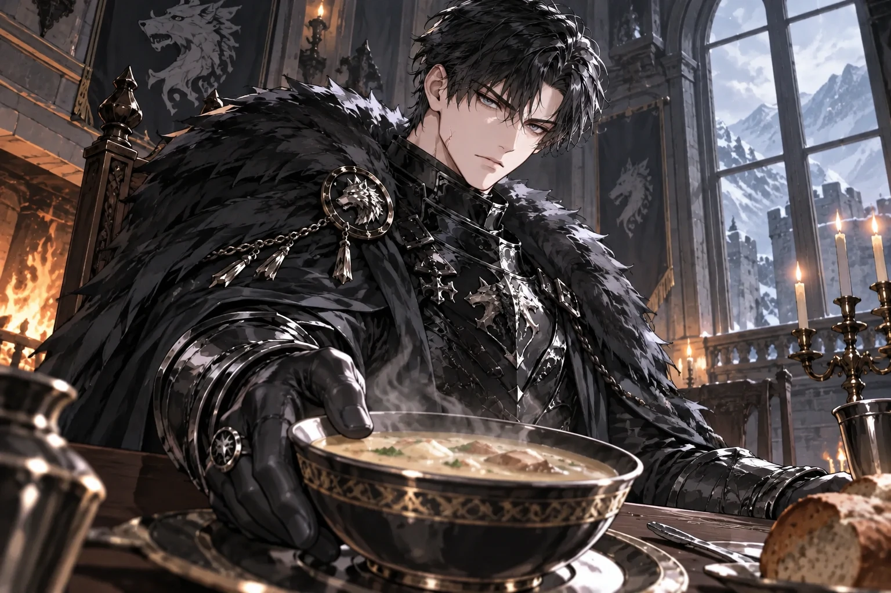
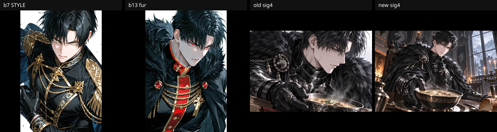
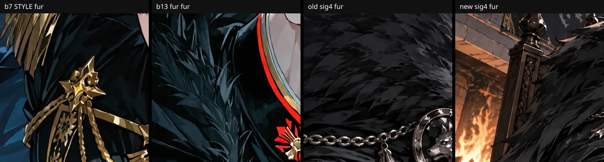
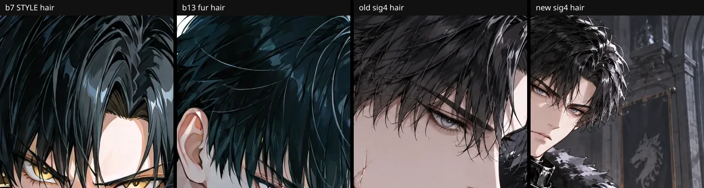
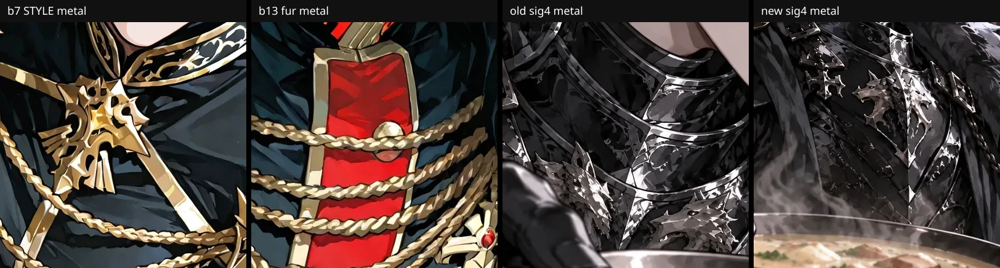
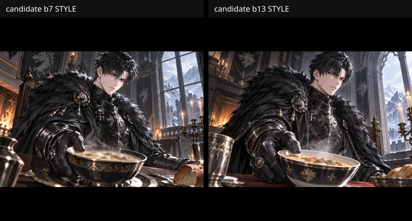
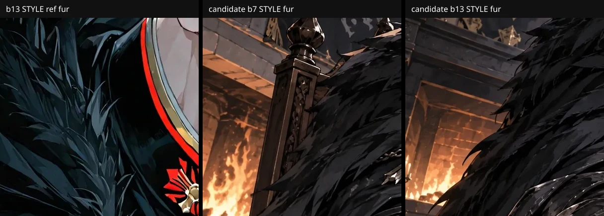
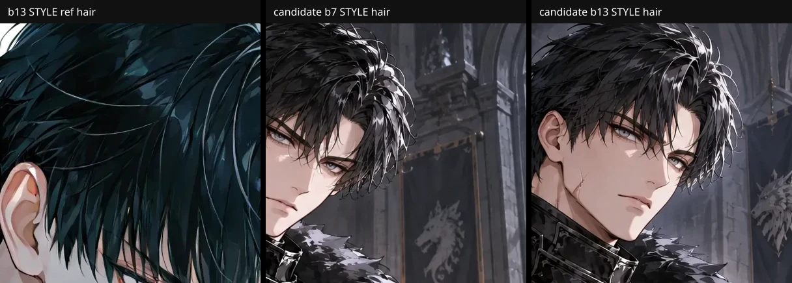
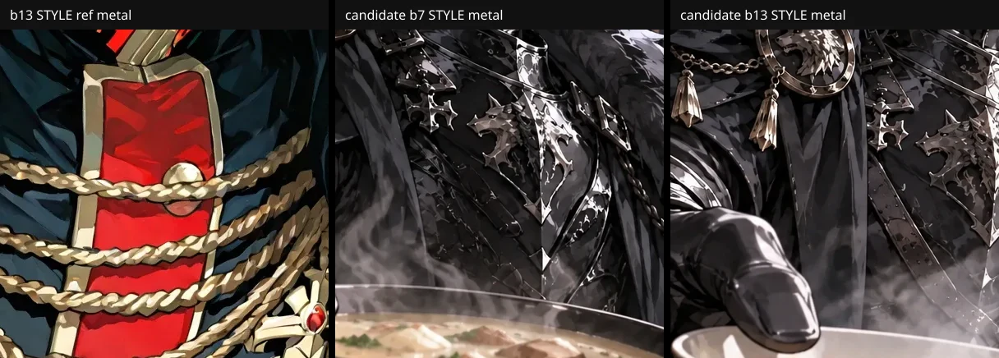

# Wolfgang #51 sig4 "절제된 온기" — 그림체 이탈 원인 확인과 한 장 재생성 요청 (미전송)

상태: **한 장 후보 생성됨 · 운영 미적용**. 승인 r2 본문 / Text Lock / Appearance Lock, #50, 기존 이미지 원본·URL, 로어북·권한·공개 상태는 그대로다. 나머지 13장 재생성, 14개 태그 백필, 운영 URL 교체는 하지 않았다.

## 1. 생성 이력 (프로덕션 read-only, `PRAGMA query_only`)

#51 `characters.assets` 14개 URL은 모두 `pilot-rf-v4-02` 슬롯 파일이다. 서버 volume 파일의 SHA-256, `official_supply_assets.result_url`, `api_cost_ledger.provider_request_id`가 14개 모두 1:1로 연결된다 (rep/sig1~4/emo1~6/scene1~3).

| 항목 | sig4 실제 확인값 | 근거 |
|---|---|---|
| 파일 | `/uploads/official-pilot-rf-v4-02__sig4-a1.webp`, 1536x1024, 246374 B, sha256 `f2906f2f…74f28c` | volume 파일 = DB = `hav.chat` 응답 일치 |
| provider request id | `req_859174a9e8484770a7cf5dc0a54bef5d` | `official_supply_assets` = ledger |
| model | `gpt-image-2.5-sunburst` (요청 = 실제) | ledger `requested_model` / `actual_model`; 운영 `OPENAI_IMAGE_MODEL` 도 동일 |
| 호출 시각 / 비용 | 2026-10-11 11:54:26, 0.045581 USD (provider_reported) | ledger id 2723 |
| 슬롯 시도 | attempts 1, 상태 approved, ledger 행 1개 | |
| size | 1536x1024 | 결과 파일 + 코드 profile |
| 나머지 13장 | 모두 gpt-image-2.5-sunburst, 0.0454~0.0462 USD (rep 0.056) | ledger |

**기록되어 있지 않은 값 (과거 사실로 보고하지 않음)**

- 실제 quality / output_compression: DB·ledger 어디에도 저장되지 않는다. 현재 batch `pilot-romance-fantasy-04-cluster-b` config 는 `quality: medium`, 코드 기본값도 `medium`/88 이지만 이는 "오늘 읽은 설정"이지 당시 요청 증거가 아니다.
- 최종 전송 prompt, 참조 전처리 바이트, fallback(strict safety) 사용 여부: 저장되지 않는다. ledger 에 슬롯당 1행만 있어 두 번째 과금 호출 흔적은 없지만, fallback 미사용의 증명은 아니다.
- 따라서 아래 prompt 는 **재구성**이다: 당시와 동일한 코드(`imagePrompt.ts`/`style.ts`/`shotPlan.ts`/`officialDraftIdentity.ts` 는 2026-10-06 #1415 이후 이 PR 전까지 무변경이며, 2026-10-11 생성 시점의 배포본이 #1415 이후 빌드라는 점은 가정이다)에 프로덕션 DB 의 `pilot-rf-v4-02` 레코드(draft/appearance/asset plan/style seed)를 넣어 `composeOfficialSlotGeneration` 으로 만든 것이다.

재구성된 당시 sig4 요청:

- 참조 순서: Image 1 = `official-pilot-rf-v4-02__rep-a1.webp` (IDENTITY ONLY, sha256 `a66c49d4…3a45f1`), Image 2 = `b7-black-gold-uniform.webp` (STYLE ONLY, sha256 `fc4047ac…d3168`). **b13/b5 는 variation 슬롯에 전송되지 않는다** (rep 슬롯만 b7+b13+b5 3장).
- shot: `profile / high_angle / close_up`, 포즈 family twist, 표정 family alert, 배경 `simple — no competing scene`.
- 슬롯 내용: `Expression`/`Pose` 두 줄만 전달. 슬롯의 `location`("흑철 요새 당직 식당")과 `situation`은 signature 슬롯에서 prompt 에 들어가지 않는다 (`assetPlan.ts` 가 non-scene location 을 "ignored" 경고로 선언). 식사·식당·상대는 prompt 어디에도 없고 "따뜻한 식기를 상대 쪽으로 밀어 둔다" 한 문장뿐이며, 같은 prompt 가 `exactly one foreground person` 을 요구한다.

## 2. 원본과 직접 비교 (원본 크기 + 썸네일)

| 축 | 원본 b7/b13/b5 | 대표(rep) | sig4 |
|---|---|---|---|
| 모피 | 큰 깃털 덩어리 소수, 진한 잉크 외곽선, 청색 광택의 명확한 2~3단 명암 | 원본보다 잔 결이 늘었으나 덩어리 구분은 유지 | 외곽선 없는 중간 회색 면에 작은 뾰족 결이 전면 반복되는 모자이크 질감. 명암 단계가 뭉개져 "자글자글"하게 읽힘 |
| 머리카락 | 큰 덩어리 + 굵은 하이라이트 띠 | 덩어리 유지, 가닥 다소 증가 | 이마·정수리 낱가닥 다수, 하이라이트 분산 |
| 금속 | 금색 면 단위 장식, 반사는 1~2개 면 | 은색 징·체인, 반사 다수 | 흉갑·완갑이 크롬 그라데이션 다중 띠, 늑대 문장·체인·술 장식이 한 화면에 중첩 |
| 피부 | 매끈, 작은 하이라이트 | 유사 | 유사 (이상 없음) |
| 장면 전달 | — | — | 얼굴 옆모습 클로즈업이 화면을 채우고 그릇은 우하단 일부. 건네는 방향·상대·식당이 보이지 않음 |

**수치 지표는 육안 판정을 뒷받침하지 못했다** (추정이 아닌 측정 결과로 기록): 전체 이미지 그래디언트 강선 비율은 b7 10.8%, b13 7.8%, b5 7.2%, rep 8.0%, sig4 6.3%로 sig4 가 오히려 낮다. 모피 구역(400x400)도 sig4 가 b13 보다 낮은 그래디언트(10.5 vs 16.2~23.6)를 보이고, 연결요소 개수·크기도 구분력이 없다. 문제는 "선이 많다"가 아니라 "외곽선 없는 저대비 잔 질감 반복 + 명암 단계 소실"이라는 질적 차이이며, 이 지표들은 그것을 잡지 못한다. 합격 판정은 지표가 아니라 사용자/GPT 육안 비교여야 한다.

참조 전처리·압축은 원인이 아니다: 참조 전처리(`rotate` + `inside 1536` + webp q90, 확대 없음)는 rep 에서 PSNR 46.3 dB, b7 에서 43.4 dB 로 사실상 무손실이며 크기 변경도 없다. 원본 해상도 1:1 크롭에서 블록·링잉 같은 압축 아티팩트는 보이지 않고, 출력은 1536x1024 네이티브 크기라 화면 리사이즈로 생긴 질감도 아니다. 즉 과잉 질감은 **생성 이미지 자체**에 있다.

## 3. 원인

**확인됨 (코드 + 프로덕션 기록으로 재현)**

1. sig4 의 실제 shot 이 클로즈업 옆모습 + 단순 배경이었다. `pilot-rf-v4-02` 키의 FNV 회전이 슬롯 의미와 무관하게 `sig3` 판(`profile/high_angle/close_up/simple`)을 sig4 에 배정했다. 같은 캐릭터의 `pilot-rf-02` 키는 `right_three_quarter/low_angle/knee_or_full/prop/environment` 로 전혀 다른 판이다 (Lucian 만 `officialDraftIdentity.ts` alias 가 있었고 Wolfgang 은 없었다).
2. 슬롯의 장면 정보(`location`/`situation`)는 signature 에서 prompt 에 들어가지 않아 "식사를 권한다"는 pose 한 줄이 클로즈업·단순 배경·단독 인물 규칙에 눌렸다.
3. `style.ts` Cluster B DNA 가 `line density: high`, `costume complexity: high`, `hair: 빽빽한 가닥` 을 prompt 에 그대로 내보낸다. 같은 prompt 의 style-use 문구는 "원본의 detail density 를 따르라"고 하므로 충돌이다. 원본은 큰 면 단위 cel 이다.
4. 스타일 지시 중복: `ROFAN_CLUSTER_B_GRAPHIC_STYLE_DIRECTION` 이 이미 말한 crisp linework/cel/hue separation 을 `imagePrompt.ts` 의 한 줄이 다시 말하고, DNA 가 세 번째로 반복한다.
5. variation 슬롯의 STYLE 참조는 b7 한 장이다. 가는 털·검은 모피 질감의 기준이 되는 b13 은 전송되지 않는다.
6. 의상 canon(Appearance Lock)이 흑철 판금 + 늑대 모피 + 인장 반지 + 열쇠 꾸러미 + 장갑으로 원래 장식 밀도가 높다. 이것은 보존 대상이라 건드리지 않았다.

**아직 추정 (유료 한 장 비교 전에는 확정 불가)**

- 3 의 DNA 문구와 5 의 단일 STYLE 참조 가운데 어느 쪽이 모자이크 모피의 주된 원인인지.
- Image 1 로 들어간 rep(원본보다 이미 모피가 촘촘함)가 모피 렌더링 밀도를 끌고 가는 정도.
- 당시 quality·compression 값과 fallback 사용 여부.
- quality 상향이 그림체를 복구하는지: 가정하지 않는다. 이 PR 은 quality 를 올리지 않는다.

## 4. 이 PR 의 최소 수정 (기존 owner 안에서)

- `officialDraftIdentity.ts`: `pilot-rf-v4-02 → pilot-rf-02` 명시 alias 추가 (두 키가 같은 14슬롯 판을 쓴다). 저장 키, 파일명, URL, 기존 이미지는 그대로.
- `style.ts`: Cluster B DNA 의 `lineDensity`/`costumeComplexity` 를 `high → medium`, `hairRendering` 을 큰 덩어리 + 소수의 굵은 하이라이트 띠로 교체 (문장 추가 없이 값 교체).
- `imagePrompt.ts`: 중복 스타일 문장 1줄 삭제.
- 태그 연결(`types.ts`, `productionAdapters.ts`, `moderation.ts`, `staging.ts`): 기존 vision 분류 결과(`analyzeAssetImage().tag`)를 moderation 기록에 `visionTag` 로 보관한다. **대표 이미지는 계획된 고유 태그를 유지**하고, RP 이미지만 저장된 vision 분류를 쓴다. vision 이 돌지 않았거나 기록 이전 행이면 계획 태그로 fallback 한다. 일반 제작자의 수동 태그 경로(`createCharacterFromForm`/`normalizeCreatorAssetTag`)는 변경 없음. **불합격 이미지에 이름을 붙이는 것으로 품질 문제를 닫지 않는다.** #51 의 기존 14개 태그는 이 PR 이 바꾸지 않는다 (기존 행에는 `visionTag` 가 없다).

## 5. sig4 pose 교체 (reconcile owner 소스)와 한 장 후보

**적용 위치:** `loadApprovedWolfgangV4Source()` 가 읽는 `src/lib/officialSupply/pilot/characters/pilot-rf-02.json` 의 sig4 `pose` 한 필드. 승인 r2 본문·Text Lock 초안(`pilot-rf-02-approved-text-lock-draft.json`)·Appearance Lock·#50·운영 `characters.assets` URL 은 그대로다.

**변경 전 값 (복구용):**
`갑옷을 벗지 않은 채 따뜻한 식기를 상대 쪽으로 밀어 둔다`

**변경 후 값 (이번 승인):**
`갑옷을 벗지 않은 채 식탁에서 장갑 낀 손으로 김 나는 수프 그릇을 카메라 쪽으로 밀어 건넨다. 받는 사람은 그리지 않으며, 얼굴·장갑 낀 손·그릇과 전달 방향이 한눈에 보인다`

**복구 방법:** 위 JSON 의 sig4 `pose` 를 변경 전 한 줄로 되돌린다. 2026-09-27 locked fixture(`pilot-rf-v4-02-locked-2026-09-27.json`)와 승인 r2 persist 소스에는 이전 값을 남겨 두었다.

**운영 DB apply 를 하지 않은 이유:** 기존 `official-supply-reconcile-locked-snapshot` / `OfficialSupplyStore.reconcileLockedSnapshot` 은 `stage=asset_plan_locked` 이고 대표만 생성된 행만 쓴다. 프로덕션 `pilot-rf-v4-02` 는 `staged_private`, 14장 approved, `staged_character_id=51` 이라 inspect/apply 가 `character_stage` 로 STOP 한다. 운영 `asset_plan_json`·Text Lock·이미지 URL 을 우회 갱신하지 않았다.

적용 후 이 PR 의 코드로 합성한 shot: `right_three_quarter / low_angle / knee_or_full`, 포즈 family prop, 배경 `an identifiable environment`.

적용 후 이 PR 의 코드로 합성한 shot: `right_three_quarter / low_angle / knee_or_full`, 포즈 family prop, 배경 `an identifiable environment`. (같은 합성기에 위 pose 와 프로덕션 레코드를 넣은 실제 결과이며, 전체 primary/strict prompt 와 참조 목록은 `assets/wolfgang-sig4-style-fidelity/sig4-regeneration-request.json`. 이 JSON 의 `model_default_when_env_absent` 는 env 가 없을 때의 코드 기본값일 뿐 실제 요청 모델이 아니다.)

| 항목 | 값 |
|---|---|
| 참조 1 (IDENTITY ONLY) | `/uploads/official-pilot-rf-v4-02__rep-a1.webp` — 원본 sha256 `a66c49d4d947209206b70a284c99f2e26ef868934ed5426818042c29ba3a45f1`, 전처리 후(로컬 재현) `88d08019…013fa2` |
| 참조 2 (STYLE ONLY) | `b7-black-gold-uniform.webp` — 원본 sha256 `fc4047ac876152a8668897e6c7e8a03e1b2a0bf975cb1513cedc5839e10d3168`, 전처리 후(로컬 재현) `ba5f3896…065b89` |
| 실패한 sig4 | 참조로 쓰지 않음 (참조 목록에 없음) |
| model | 운영 `OPENAI_IMAGE_MODEL=gpt-image-2.5-sunburst` 로 resolve |
| size / quality / format | 1536x1024 / medium / webp, `output_compression` 88, `background=opaque`, `n=1` (현행과 동일; 올리지 않음) |
| 전송하지 않는 옵션 | `input_fidelity` 등 미지원/미사용 옵션 |
| 공식 지원 확인 | OpenAI image generation guide (2026-10-16 조회): sunburst quality `low/medium/high/xhigh/max/auto`, 권장 크기 `1536x1024`, `output_format=webp` 에 `output_compression`, `background` opaque 지원. `output_compression` 방향(숫자가 품질인지 압축률인지)은 문서 표현이 모호해 이번에 값을 바꾸지 않았다 |
| 예상 비용 | 이미지 약 0.0456 USD (동일 설정 실측 sig4 0.045581, RP 슬롯 범위 0.045446~0.046156) + vision moderation 약 0.0004 USD (실측 평균 0.00038, 최대 0.0008) = **약 0.046 USD (약 63~70 KRW)**. strict fallback 이 한 번 더 호출되는 최악의 경우 약 0.092 USD |
| 예산 | batch/character cap 안 (character 누적 약 0.65 USD / cap 2.5) |

**게이트**: 한 장을 생성해 (1) 그림체(모피 외곽선·덩어리·명암 단계·금속 반사를 b7/b13/b5 와 원본 크기로 비교), (2) 장면 전달(얼굴·장갑 낀 손·그릇·내미는 방향·거리가 한눈에 보임)을 GPT/사용자가 통과시키기 전에는 나머지 13장 재생성, 운영 URL 교체, 태그 갱신을 진행하지 않는다. 통과 못 하면 이 문서 3의 추정 항목(b13 추가 STYLE 참조 등)을 한 번에 하나씩만 바꿔 다시 한 장을 요청한다.

## 6. 한 장 후보 실측 (replacement path, apply 없음)

실행 환경에서 확인한 전송값 (`assets/wolfgang-sig4-style-fidelity/sig4-one-shot-actual.json`). 요청 JSON을 그대로 쓰지 않았다.

| 항목 | 실측 |
|---|---|
| model | `gpt-image-2.5-sunburst` (env resolve = 전송 = 저장) |
| IDENTITY | `/uploads/official-pilot-rf-v4-02__rep-a1.webp` 로컬 접근, 원본 sha256 `a66c49d4…3a45f1`, 전처리 후 `88d08019…013fa2` |
| STYLE | `https://hav.chat/official-supply/style-seeds/.../b7-black-gold-uniform.webp` → 로컬 public 바이트, 원본 `fc4047ac…d3168`, 전처리 후 `ba5f3896…065b89` |
| 실패한 기존 sig4 | 참조 목록에 없음 |
| size / quality / format | 1536x1024 / medium / webp, `output_compression` 88, `background=opaque`, `n=1` |
| fallback | 꺼짐. `callOpenAiImageEdit` primary only |
| draftKey / shot | `pilot-rf-v4-02` alias → `right_three_quarter / low_angle / knee_or_full / prop / environment` |
| pose | 승인 문장(식탁에서 장갑 낀 손으로 김 나는 수프 그릇을 카메라 쪽으로 밀어 건넴) |
| Appearance Lock | `1c3ccd13…24dcc3` (변경 없음) |
| 저장 후보 | `sig4-candidate.webp`, 1536x1024, 273926 B, sha256 `2e1da30e…7cf977` |
| request ID | `req_8c811dd2fbc14e028cc984b3fc981407` |
| 이미지 비용 | 0.045716 USD |
| vision | tag `앉음`, reject 없음, 0.00049153 USD |
| 이번 실행 합 | 0.04620753 USD |
| 직전 드롭 시도 | `req_90653bcd86354c9cb18930290b9a90ab`, 0.045716 USD. provider는 성공했으나 `/tmp` 스크립트가 `sharp`를 못 찾아 바이트를 저장하지 못함. provider 실패 재시도가 아님 |
| 캠페인 합 | **0.09192353 USD** (상한 0.10). 운영 apply 없음 |

### 판정 (테스트 통과 ≠ 이미지 품질 합격)

**그림체 충실도: 불합격 (기존 클로즈업 모자이크 대비 부분 개선).** 새 후보는 전신·식탁 거리라 기존 sig4의 옆얼굴 클로즈업 모자이크는 사라졌다. 그러나 모피는 여전히 b13의 큰 깃털 덩어리+잉크 외곽선이 아니라 잔 결이 반복되는 밀도다. STYLE 참조가 b7(모피 거의 없음) 한 장이라는 기존 가설과 같은 방향이다. 머리카락은 b7/b13의 큰 덩어리+소수 하이라이트에 더 가깝고, 기존 sig4 이마 낱가닥보다는 낫다. 금속은 기존 크롬 다중 띠보다 면이 단순하고 늑대 문장이 읽히지만, b7/b13의 금색 그래픽 실루엣과는 여전히 다르다.

**음식 건네기: 부분 합격.** 얼굴·장갑 낀 손·김 나는 그릇·식탁·환경이 한 프레임에 있고 받는 사람은 없다. 그릇은 카메라 쪽을 향한다. 다만 손은 그릇을 밀어 건네기보다 옆에 올려 둔 포즈에 가깝고, 지정한 “전달 방향이 한눈에 보이는 밀어 건넴”은 약하다. vision 태그 `앉음`은 분류일 뿐 품질 합격을 대신하지 않는다.

한 장 비교가 그림체 불합격이므로 나머지 13장 재생성, 기존 14개 태그 백필, 운영 교체는 열지 않는다.

### 유료 결과 보존 (임시 one-shot harness만, 앱 전역 변경 없음)

b7 첫 시도(`req_90653bcd…`)는 provider 성공 후 `/tmp/sig4-one-shot.ts`가 `sharp` 로딩·출력 경로 검증 없이 inspect 단계에 들어가 바이트를 잃었고, 예산 안이어도 **두 번째 image POST** 가 호출 수 제한 위반이었다. 이번 b13 비교 실행 전 harness 에만 다음을 넣었다 (`/tmp/sig4-one-shot.ts`, 커밋하지 않음).

1. **`assertPaidRunPreflight()`** — 유료 HTTP 전에 workspace `sharp` 로딩과 `ARTIFACT_DIR`·`docs/.../wolfgang-sig4-style-fidelity` 쓰기 가능 여부 검증.
2. **`preserveProviderBytes()`** — OpenAI 성공 직후 원본 webp 바이트를 artifacts·docs 에 `*-raw.webp` 로 저장 (inspect·변환보다 선행).
3. **`readPreservedRaw()` + `completeReplacement`** — runner 가 inspect/storage 이후 실패해도 보존 바이트로 후보를 완료하고 **provider 재호출 금지** (`providerPostsThisRun` 상한 1).

b13 실행: `recoveredFromPreservedRaw=false`, `providerPostsThisRun=1`, raw·후보 sha256 일치 (`18efc7c4…7565bf`).

## 8. b13 STYLE 비교 한 장 (apply 없음)

**게이트:** image POST 최대 1회, vision 검수 1회 의도, **이번 실행 상한 0.06 USD**. 직전 캠페인 누적 **0.09192353 USD** 는 별도 보고만 하며 잔액을 추가 호출 허가로 쓰지 않음. image fallback·재시도 없음 (`fallbackDisabled: true`). **공통 compose STYLE 기본값(b7)은 바꾸지 않음** — harness transport 에서 Image 2 만 b13 URL 로 교체.

실측 (`assets/wolfgang-sig4-style-fidelity/sig4-b13-one-shot-actual.json`):

| 항목 | b7 후보(§6) | b13 STYLE 후보(§8) |
|---|---|---|
| Image 1 IDENTITY | rep, sha `a66c49d4…` / 전처리 `88d08019…` | **동일** |
| Image 2 STYLE | b7 `fc4047ac…` / 전처리 `ba5f3896…` | b13 `f9d01ebc…` / 전처리 **`f13d1f15…`** |
| primaryPrompt sha256 | `2f1ddb3e…61016c` | **동일** |
| model / size / quality | sunburst / 1536×1024 / medium / webp 88 | **동일** |
| pose / shot | 승인 meal-offering / knee_or_full·environment | **동일** |
| provider request | `req_8c811dd2…` | **`req_f87b9300…`** |
| 후보 파일 | `sig4-candidate.webp`, 273926 B, `2e1da30e…` | **`sig4-candidate-b13.webp`**, 267564 B, **`18efc7c4…`** |
| 이미지 비용 | 0.045716 USD | **0.045716 USD** |
| vision | tag `앉음`, 1 attempt, 0.00049153 USD | tag `무표정`; **`analyzeAssetImage` 가 qwen3.8-flash 구조화 실패 후 vl-8b 로 1회 재시도** (앱 owner, harness 미변경) — attempts 2, vision 합 **0.00127499 USD** |
| **이번 실행 합** | (§6) 0.04620753 | **0.04699099 USD** (≤ 0.06) |
| **캠페인 누적** | 0.09192353 | **0.13891452 USD** |

### 판정 기준 (이번 비교)

- **흑철 갑옷·Appearance Lock** 유지. 금색이 아니라는 이유로 감점하지 않음.
- **b13 STYLE seed** 의 모피 덩어리 경계·선명한 외곽선·정돈된 명암과 비교. 갑옷은 **잔 반사·크롬 무늬가 줄었는지** 확인.
- **b7 단일 STYLE 이 주원인**이라 확정하지 않음. 운영 rep(IDENTITY) 질감이 모피 밀도에 기여했을 가능성은 남음.

### 판정 (§8)

**그림체 충실도: 불합격 (b7 STYLE 후보 대비 소폭 차이, b13 seed 기준 미달).** b13 STYLE 로 Image 2 만 바꿔도 모피는 b13 seed 의 **소수 큰 깃털 덩어리 + 진한 잉크 외곽 + 2~3단 cel 명암**에 닿지 않고, b7 후보와 같이 **잔 깃/털 결이 촘촘히 반복**되는 쪽에 가깝다. b13 후보가 외곽선·덩어리 경계가 **약간** 더 읽히는 구간은 있으나 seed 수준의 그래픽 모피는 아니다. 머리카락은 두 후보 모두 큰 덩어리+분산 하이라이트에 가깝고 seed 의 굵은 소수 띠와는 거리가 있다. **흑철 갑옷** 색·실루엣은 Lock 에 맞고 금색 부재는 감점 사유가 아니다. 금속·장식은 b7 후보와 마찬가지로 **흉갑·브로och 에 specular 띠가 여러 겹** 남아 있어 seed 의 정돈된 그래픽 금속·b13 후보 간 **크롬 무늬 감소**는 확인되지 않았다. → **STYLE 참조를 b7→b13 으로만 바꾼 것만으로는 그림체 게이트 통과 불가**; rep IDENTITY·prompt DNA·모델 한계 등 다른 축은 여전히 열려 있다.

**음식 건네기: 부분 합격 (b7 후보와 동급).** 얼굴·장갑·김 나는 그릇·식당 환경·단독 인물은 유지. b13 후보는 손이 그릇 림을 잡아 **카메라 쪽으로 기울이는** 쪽으로 b7 후보(손을 옆에 올려 둔 느낌)보다 전달 방향이 약간 낫다. 그래도 “밀어 건넴”의 힘은 약하고 vision tag `무표정` 은 품질 판정과 무관.

**운영:** 후보 교체·13장 재생성·태그 백필·r2/Lock·공개·유료 RP **진행하지 않음**. 추가 유료 생성 없음.

## 9. 유료 비교 종료: 코드 변경과 이미지 품질 결과의 분리

유료 이미지 비교는 §8 에서 종료한다. b7 STYLE 후보도 b13 STYLE 후보도 운영을 교체하지 않는다. b13 STYLE 은 harness transport 에서만 Image 2 를 바꿨고 공통 STYLE 기본값(b7 compose)에는 반영하지 않았다.

### 9.1 코드 변경 (실제 변경과 검증)

| 변경 | 실제 변경 | 검증 (테스트가 증명하는 범위) |
|---|---|---|
| 태그 저장 연결 | `types.ts` checked moderation 에 `visionTag`, `productionAdapters.ts` 가 `result.tag` 를 `visionTag` 로 전달, `staging.ts` 가 `stagedAssetTag()` 로 저장 | `officialSupply.pipeline.test.ts`: checked 결과의 vision 태그가 비-대표 슬롯 `characters.assets[].tag` 로 저장됨 (sig1 `미소`, emo1 `분노`). 이미지 품질과 무관한 배선 검증이다 |
| 대표 태그 분리 | `moderation.ts` `stagedAssetTag(plannedTag, moderation, kind)`: 대표(`representative`) 는 항상 planned 태그, 그 외 슬롯만 vision 태그 | 같은 파일: vision 이 대표를 `미소` 로 분류해도 대표 태그는 planned 로 유지되고 sig1 `미소` 와 달라 대표 태그가 유일함. `emo2`/`sig2` 는 vision 이 없으면 planned 유지 |
| Wolfgang alias | `officialDraftIdentity.ts` `pilot-rf-v4-02 → pilot-rf-02` (Map 조회; `"constructor"` 같은 프로토타입 키는 그대로 반환) | `officialSupply.officialDraftIdentity.test.ts`, `officialSupply.shotSeedIdentity.test.ts` H/I (두 키가 같은 shot board 를 쓰고 sig4 가 단순 배경 클로즈업이 아님), `...lockedSnapshotReconcileOperator.test.ts` |
| 승인 pose 수정 | `pilot/characters/pilot-rf-02.json` sig4 pose 를 승인 문장(식탁에서 장갑 낀 손으로 김 나는 수프 그릇을 카메라 쪽으로 건넴, 받는 사람 없음)으로 교체 | `officialSupply.pipeline.test.ts`: 새 pose 포함, 옛 `따뜻한 식기를 상대 쪽으로 밀어 둔다` 미포함 |
| DNA 값 수정 | `style.ts` lineDensity/costumeComplexity `high → medium`, hairRendering 문구, `imagePrompt.ts` 한 문장 삭제 | `officialSupply.styleRefs.test.ts`: 값과 문장이 반영됨만 확인. **이 수정이나 STYLE 교체가 원하는 그림체를 복구했다고 주장하지 않는다.** §6/§8 판정은 둘 다 그림체 불합격이다 |

검증 실행 (이 HEAD):

| 명령 | 결과 |
|---|---|
| `git diff --check` | 출력 없음 |
| `npm run lint` | 통과 (`tsc -p tsconfig.app.json`) |
| `npm run typecheck:app` | 통과 |
| `officialSupply/*.test.ts` (regular 정책 포함: `node --conditions=react-server --import tsx --import ./src/lib/test/regularTestEgressPolicy.ts --test`) | 532 pass / 0 fail |

전체 `npm run test:regular` 와 `npm run typecheck` 의 기존 실패는 이 PR 범위 밖이며 이번에 새로 만들지 않았다. 병합은 GPT 코드 최종 검수 후에만 진행한다.

### 9.2 이미지 품질 결과 (코드 변경과 별개)

| 후보 | 그림체 | 음식 건네기 | 운영 |
|---|---|---|---|
| b7 STYLE 후보 (§6) | 불합격 | 부분 합격 | 교체 안 함 |
| b13 STYLE 후보 (§8) | 불합격 | 부분 합격 (손이 그릇을 카메라 쪽으로 기울이는 점은 약간 나음) | 교체 안 함 |

### 9.3 비용과 호출 구분 (추가 유료 호출 없음)

| 실행 | image POST | vision provider 호출 | 비용 |
|---|---|---|---|
| b7 첫 시도 (바이트 유실) | 1 | 0 | 0.045716 |
| b7 재시도 (§6 후보) | 1 | 1 | 0.04620753 (이미지 0.045716 + vision 0.00049153) |
| b13 (§8 후보) | **1** | **2** (qwen3.8-flash 구조화 실패 → vl-8b fallback, 앱 owner `analyzeAssetImage` 동작) | 0.04699099 (이미지 0.045716 + vision 0.00127499) |
| 누적 | | | **0.13891452 USD** (0.09192353 + 0.04699099) |

b13 실행의 image POST 는 1회(`providerPostsThisRun=1`)이고 vision 2회는 이미지 호출이 아니다. 이후 이미지·vision 유료 호출은 하지 않았고 누적 비용은 변하지 않는다.

임시 harness 는 비밀값 없이 검수할 수 있게 `assets/wolfgang-sig4-style-fidelity/harness/` 에 `.ts.txt` 로 복사했다 (컴파일·lint 대상 아님). API key 는 `process.env` 에서만 읽고 어떤 파일에도 쓰지 않는다. 검수 포인트: `assertPaidRunPreflight()` (유료 HTTP 전에 sharp·쓰기 경로 검사), `preserveProviderBytes()` (성공 직후 원본 바이트 저장), `readPreservedRaw()` + `completeReplacement` (사후 단계 실패 시 보존 바이트로 완료, provider 재호출 없음), `providerPostsThisRun` 상한 1, `SIG4_RUN_BUDGET_USD` 상한. 앱 코드에는 넣지 않았다.

## 10. 외부 생성 이미지 한 장 반입

운영 DB·이미지는 바꾸지 않았다. b7/b13 후보는 계속 적용하지 않는다. #51 소유권 이전은 하지 않는다. 이 변경의 검증에서 외부 provider 호출은 0회다 (이미지 POST, vision, 자동 태깅, vision fallback 모두). 누적 유료 비용은 **0.13891452 USD** 그대로다.

### 10.1 격리 실험에서 부적합으로 확인한 우회 (권장 절차 아님)

아래는 기존 에디터 저장을 격리 DB에서 시험한 기록이다. 권장 운영 절차가 아니다. 스크립트와 결과 JSON 은 `assets/wolfgang-sig4-style-fidelity/intake-51/`.

당시 official replacement 는 `staged_private` 를 거부했다. 에디터 `PUT` 은 원고를 다시 쓰고 private media 소유자 검사에서 막혔다. 에디터 `PATCH public_profile` 은 owner 가 site-managed studio 인 동안 403 이었고, owner 를 admin 으로 옮긴 뒤에야 `characters.assets` 한 칸만 바꿨다. 그 경로는 supply `result_url` 을 그대로 두어 다음 replacement 가 `public_asset_map_mismatch` 로 막힌다. 소유권 이전은 교체를 위해 공개 상태나 소유자를 바꾸는 우회이므로 진행하지 않는다.

### 10.2 그 우회의 보존 결과 (참고, `intake-51/B-patch-diff.json`)

| 항목 | 결과 |
|---|---|
| 바뀐 컬럼 | `assets` 만 |
| 바뀐 에셋 | 인덱스 4(sig4) 만. 나머지 13장 url/tag/blur/metadata 동일 (`unchangedAssetCount 13`) |
| 대표 이미지 지정 | 동일 (`beforeRep 0 = afterRep 0`, 객체 동일) |
| 가림(viewerBlur) | sig4 밖 전부 동일 |
| 원고 | `system_prompt`, `greeting`, `world`, `example_dialog`, `appearance_raw`, `appearance_compiled`, `creator_raw_description` 동일 (Lock 포함) |
| 로어북 | 부착 2건, 해시 동일 |
| 권한/가시성 | `creator_id`, `official`, `visibility`, `moderation_status`, nsfw, `participant_min_age`, `adult_status` 동일 |
| supply 테이블 | `official_supply_characters/assets/replacements` 및 `character_id` 연결 테이블 변경 없음 (`linkedTablesChanged:[]`) |
| 저장·재조회 | PATCH 200 후 `GET /api/characters/:id` 로 sig4 URL(`/media/private/…`), 태그, 1536x1024 확인 |
| 가짜 값 | provider request ID 없음, 생성 비용 기록 없음 (업로드·`PATCH` 는 이미지 생성 비용을 만들지 않는다. 자동 분류 vision 호출만 키가 있을 때 별도로 비용이 생긴다) |

그 PATCH 는 supply 행을 갱신하지 않았다. 그래서 권장 경로에서 제외한다.

### 10.3 채택한 경로: 기존 official replacement owner

새 업로더나 생성 시스템을 만들지 않았다. 외부 바이트는 기존 `OfficialAssetStorage` 로 저장하고, 후보 검수는 기존 `reviewReplacement`, 반영은 기존 `applyApprovedOfficialAssetReplacements` 가 한다. 진입 함수는 `registerExternalOfficialAssetReplacement`.

- 후보 행의 `model`, `provider_request_id` 는 null 이고 `spent_usd` 는 0 이다. 가짜 값을 넣지 않는다.
- 게시된 공식 캐릭터 검사는 그대로다. `stage=published` 이고 연결 행이 `official=1`, `visibility=public`, `moderation_status=approved` 일 때만 게시 경로가 열린다. 가시성만 바뀌어도 `character_not_published` 로 거부한다.
- 비공개 staged 는 별도 검사다. `stage=staged_private`, `stagedCharacterId` 가 실제 행과 연결되고, 그 행이 `official=0`, `visibility=private` 일 때만 열린다. 둘 중 하나만 맞으면 `replacement_target_mismatch` 다. 그 외 stage 는 `character_stage` 다.
- 실행자는 그 캐릭터를 관리할 수 있는 공식 관리자다 (`canAdminManageOfficialCharacter`). 권한 밖은 `replacement_forbidden`. site-managed studio 가 소유한 staged 행은 소유권을 옮기지 않아도 관리자가 실행할 수 있다.
- Appearance Lock 과 교체 전 URL(`base_result_url` = 현재 supply URL = 현재 public URL)이 어긋나면 적용하지 않는다.
- 유료 생성(`runOfficialAssetReplacement`)은 여전히 게시된 공식 캐릭터만 허용한다.

한 번의 apply 트랜잭션이 `characters.assets` 대상 칸, `official_supply_assets` 의 URL·`approved_tag`, replacement `status=applied` 를 함께 갱신한다. 승인한 행동·상황 태그는 `normalizeCreatorAssetTag` 로 정규화해 같은 적용에 쓴다. vision 태그(`앉음` 같은 자동 분류)는 이 수동 태그를 덮지 않는다. `stagedAssetTag` 도 수동 태그가 있으면 vision 보다 먼저 쓴다. 대표 슬롯은 교체할 수 없고, 대표 태그는 planned 태그를 유지한다. dry-run 은 같은 쓰기를 한 뒤 롤백한다. 중간 SQL 실패나 교체 전 URL 변경도 트랜잭션이 전부 되돌린다. moderation 이 없거나 `unavailable` 이거나 거절이면 합격으로 보지 않는다.

### 10.4 태그

- 태그는 이미지에서 읽히는 감정·행동·상황이다. 작품 제목 `절제된 온기` 를 선택 태그로 되돌리지 않는다.
- `앉음` 이나 `무표정` 만으로 음식을 건네는 상황이 구별되지 않는다. 테스트가 vision 태그를 `앉음` 으로 넣어도 적용된 태그는 수동 승인 태그다.
- 14개 태그 백필은 하지 않았다.
- 자동 태깅과 vision fallback 은 이 경로를 타지 않는다. 이번 검증의 외부 provider 호출은 0회다.

### 10.5 격리 DB 검증 (`officialSupply.replacement.test.ts`, provider 호출 0)

테스트 moderation·QA 는 게이트용 fixture 다. b7/b13 이미지 품질 승인이 아니며 그 파일을 읽지 않는다.

| 확인 | 결과 |
|---|---|
| `staged_private` sig4 교체 | 대상 칸만 변경. 재조회 시 character URL = supply `result_url`, character 태그 = supply `approved_tag` |
| 다음 슬롯(scene1) replacement | `public_asset_map_mismatch` 없음 |
| 기존 published 교체 | 회귀 통과. 가시성을 private 로 바꾸면 `character_not_published`. 외부 파일도 model/request id null, 비용 0 |
| 권한 | 비관리자, 그리고 site-managed 가 아닌 소유자에게는 `replacement_forbidden`. 파일 저장 전에 거부 |
| 연결 | `stagedCharacterId` null 은 `not_staged`, 없는 id 는 `character_missing`, official/visibility 불일치는 `replacement_target_mismatch` |
| 오래된 후보 | 활성 URL 이 바뀌면 적용 전에 거부되고 공개 URL 은 그대로 |
| moderation | 없음은 `moderation_missing`, `unavailable` 은 검수 거부, hard reject 는 `approved: false` 뒤 apply 거부 |
| 중간 실패 | supply UPDATE 를 중단시키면 character URL·태그·replacement 상태가 적용 전으로 남고, 트리거를 걷어 낸 뒤 같은 후보를 다시 apply 하면 성공 |
| 보존 | 대표 이미지, 나머지 칸, 가림, 원고(`system_prompt`/`greeting`/`world`), Appearance Lock, 로어북 부착, `creator_id`, `official`, `visibility` |
| 유료 생성 | staged_private 후보는 `runOfficialAssetReplacement` 가 `character_stage` 로 거부. transport 호출 0 |

이 파일의 replacement 테스트는 17 pass / 0 fail. `src/lib/officialSupply/*.test.ts` 는 537 pass / 0 fail. `tsc -p tsconfig.app.json` 통과.

### 10.6 외부 파일 한 장의 절차 (운영 적용은 이미지 품질 승인 후)

1. 반입. 공식 관리자 권한으로 `registerExternalOfficialAssetReplacement` 에 외부 파일 바이트와 행동·상황 태그를 넘긴다. 저장은 기존 official asset storage 다. 슬롯 크기가 아니면 파일을 쓰기 전에 거부한다. 소유권과 공개 상태는 바꾸지 않는다.
2. 검수. 기존 replacement moderation 이 `checked` 이고 hard reject 가 아니어야 한다. `pending`/`unavailable`/누락은 합격이 아니다. 이어서 `reviewReplacement` 로 시각 QA 를 기록한다. 이번 PR 의 테스트 검수는 fixture 이며, 실제 이미지 품질 승인을 대신하지 않는다. 운영에서 moderation 을 라이브 vision 으로 실행하면 유료 호출이 되므로, 그 호출은 사용자가 품질 승인과 함께 결정하기 전까지 하지 않는다.
3. dry-run. `applyApprovedOfficialAssetReplacements({ dryRun: true })`. 같은 검사를 통과한 뒤 롤백되므로 URL·태그·상태는 그대로다.
4. apply. dry-run 과 같은 인자에서 `dryRun` 없이 실행한다. 대상 슬롯의 public URL, supply URL, 승인 태그가 한 트랜잭션에서 맞는다.
5. 복구. apply 가 중간에서 실패하거나 교체 전 URL 이 바뀌었으면 트랜잭션이 전부 롤백된다. 재조회로 이전 URL 과 `approved` 후보가 남았는지 확인한 뒤, 조건을 고치고 같은 후보로 다시 apply 한다. 성공한 적용을 자동으로 되돌리는 기능은 없다. 후보 행의 `base_result_url` 이 교체 전 URL 기록이다.

최종 운영 적용은 사용자가 고른 이미지의 품질을 승인한 뒤에만 한다. 공개·알림·유료 RP 는 계속 보류한다.

## 7. 이번 단계에서 하지 않은 것 / 후속

- 운영 이미지·DB 변경, #50 변경, 공개·알림·유료 RP: 없음.
- b13 STYLE 단일 변수 비교(§8)까지 수행; 그림체 불합격으로 **추가 유료 한 장은 열지 않음**.
- 기록 이전 14개 슬롯 vision 백필은 하지 않았다. 외부 파일 반입의 수동 승인 태그만 같은 apply 에 반영한다. 전송 prompt/quality/참조 해시 증거 컬럼은 스키마 변경이므로 별도 승인.
