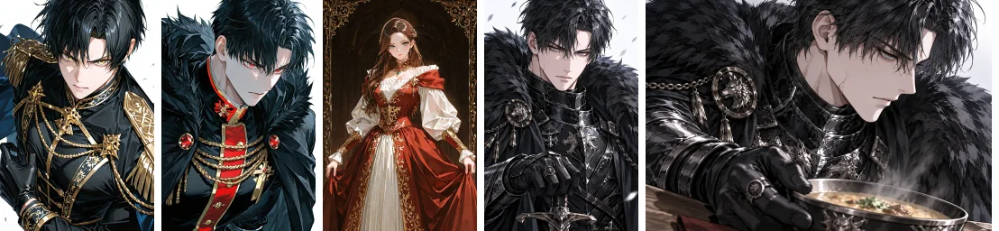
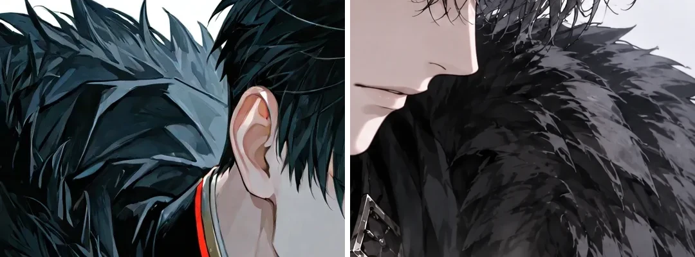

# Wolfgang #51 sig4 "절제된 온기" — 그림체 이탈 원인 확인과 한 장 재생성 요청 (미전송)

상태: **사용자 거절 · 재생성 대상**. 이 문서와 PR은 새 유료 호출, 운영 이미지 교체, DB 쓰기를 하지 않았다.
승인 r2 본문 / Text Lock / Appearance Lock, #50, 기존 이미지 원본·URL, 로어북·권한·공개 상태는 건드리지 않았다.

## 1. 생성 이력 (프로덕션 read-only, `PRAGMA query_only`)

#51 `characters.assets` 14개 URL은 모두 `pilot-rf-v4-02` 슬롯 파일이다. 서버 volume 파일의 SHA-256, `official_supply_assets.result_url`, `api_cost_ledger.provider_request_id`가 14개 모두 1:1로 연결된다 (rep/sig1~4/emo1~6/scene1~3).

| 항목 | sig4 실제 확인값 | 근거 |
|---|---|---|
| 파일 | `/uploads/official-pilot-rf-v4-02__sig4-a1.webp`, 1536x1024, 246374 B, sha256 `f2906f2f…74f28c` | volume 파일 = DB = `hav.chat` 응답 일치 |
| provider request id | `req_859174a9e8484770a7cf5dc0a54bef5d` | `official_supply_assets` = ledger |
| model | `gpt-image-2.5-sunburst` (요청 = 실제) | ledger `requested_model` / `actual_model`; 운영 `OPENAI_IMAGE_MODEL` 도 동일 |
| 호출 시각 / 비용 | 2026-10-11 11:54:26, 0.045581 USD (provider_reported) | ledger id 2723 |
| 슬롯 시도 | attempts 1, 상태 approved, ledger 행 1개 | |
| size | 1536x1024 | 결과 파일 + 코드 profile |
| 나머지 13장 | 모두 gpt-image-2.5-sunburst, 0.0454~0.0462 USD (rep 0.056) | ledger |

**기록되어 있지 않은 값 (과거 사실로 보고하지 않음)**

- 실제 quality / output_compression: DB·ledger 어디에도 저장되지 않는다. 현재 batch `pilot-romance-fantasy-04-cluster-b` config 는 `quality: medium`, 코드 기본값도 `medium`/88 이지만 이는 "오늘 읽은 설정"이지 당시 요청 증거가 아니다.
- 최종 전송 prompt, 참조 전처리 바이트, fallback(strict safety) 사용 여부: 저장되지 않는다. ledger 에 슬롯당 1행만 있어 두 번째 과금 호출 흔적은 없지만, fallback 미사용의 증명은 아니다.
- 따라서 아래 prompt 는 **재구성**이다: 당시와 동일한 코드(`imagePrompt.ts`/`style.ts`/`shotPlan.ts`/`officialDraftIdentity.ts` 는 2026-10-06 #1415 이후 이 PR 전까지 무변경이며, 2026-10-11 생성 시점의 배포본이 #1415 이후 빌드라는 점은 가정이다)에 프로덕션 DB 의 `pilot-rf-v4-02` 레코드(draft/appearance/asset plan/style seed)를 넣어 `composeOfficialSlotGeneration` 으로 만든 것이다.

재구성된 당시 sig4 요청:

- 참조 순서: Image 1 = `official-pilot-rf-v4-02__rep-a1.webp` (IDENTITY ONLY, sha256 `a66c49d4…3a45f1`), Image 2 = `b7-black-gold-uniform.webp` (STYLE ONLY, sha256 `fc4047ac…d3168`). **b13/b5 는 variation 슬롯에 전송되지 않는다** (rep 슬롯만 b7+b13+b5 3장).
- shot: `profile / high_angle / close_up`, 포즈 family twist, 표정 family alert, 배경 `simple — no competing scene`.
- 슬롯 내용: `Expression`/`Pose` 두 줄만 전달. 슬롯의 `location`("흑철 요새 당직 식당")과 `situation`은 signature 슬롯에서 prompt 에 들어가지 않는다 (`assetPlan.ts` 가 non-scene location 을 "ignored" 경고로 선언). 식사·식당·상대는 prompt 어디에도 없고 "따뜻한 식기를 상대 쪽으로 밀어 둔다" 한 문장뿐이며, 같은 prompt 가 `exactly one foreground person` 을 요구한다.

## 2. 원본과 직접 비교 (원본 크기 + 썸네일)

| 축 | 원본 b7/b13/b5 | 대표(rep) | sig4 |
|---|---|---|---|
| 모피 | 큰 깃털 덩어리 소수, 진한 잉크 외곽선, 청색 광택의 명확한 2~3단 명암 | 원본보다 잔 결이 늘었으나 덩어리 구분은 유지 | 외곽선 없는 중간 회색 면에 작은 뾰족 결이 전면 반복되는 모자이크 질감. 명암 단계가 뭉개져 "자글자글"하게 읽힘 |
| 머리카락 | 큰 덩어리 + 굵은 하이라이트 띠 | 덩어리 유지, 가닥 다소 증가 | 이마·정수리 낱가닥 다수, 하이라이트 분산 |
| 금속 | 금색 면 단위 장식, 반사는 1~2개 면 | 은색 징·체인, 반사 다수 | 흉갑·완갑이 크롬 그라데이션 다중 띠, 늑대 문장·체인·술 장식이 한 화면에 중첩 |
| 피부 | 매끈, 작은 하이라이트 | 유사 | 유사 (이상 없음) |
| 장면 전달 | — | — | 얼굴 옆모습 클로즈업이 화면을 채우고 그릇은 우하단 일부. 건네는 방향·상대·식당이 보이지 않음 |

**수치 지표는 육안 판정을 뒷받침하지 못했다** (추정이 아닌 측정 결과로 기록): 전체 이미지 그래디언트 강선 비율은 b7 10.8%, b13 7.8%, b5 7.2%, rep 8.0%, sig4 6.3%로 sig4 가 오히려 낮다. 모피 구역(400x400)도 sig4 가 b13 보다 낮은 그래디언트(10.5 vs 16.2~23.6)를 보이고, 연결요소 개수·크기도 구분력이 없다. 문제는 "선이 많다"가 아니라 "외곽선 없는 저대비 잔 질감 반복 + 명암 단계 소실"이라는 질적 차이이며, 이 지표들은 그것을 잡지 못한다. 합격 판정은 지표가 아니라 사용자/GPT 육안 비교여야 한다.

참조 전처리·압축은 원인이 아니다: 참조 전처리(`rotate` + `inside 1536` + webp q90, 확대 없음)는 rep 에서 PSNR 46.3 dB, b7 에서 43.4 dB 로 사실상 무손실이며 크기 변경도 없다. 원본 해상도 1:1 크롭에서 블록·링잉 같은 압축 아티팩트는 보이지 않고, 출력은 1536x1024 네이티브 크기라 화면 리사이즈로 생긴 질감도 아니다. 즉 과잉 질감은 **생성 이미지 자체**에 있다.

## 3. 원인

**확인됨 (코드 + 프로덕션 기록으로 재현)**

1. sig4 의 실제 shot 이 클로즈업 옆모습 + 단순 배경이었다. `pilot-rf-v4-02` 키의 FNV 회전이 슬롯 의미와 무관하게 `sig3` 판(`profile/high_angle/close_up/simple`)을 sig4 에 배정했다. 같은 캐릭터의 `pilot-rf-02` 키는 `right_three_quarter/low_angle/knee_or_full/prop/environment` 로 전혀 다른 판이다 (Lucian 만 `officialDraftIdentity.ts` alias 가 있었고 Wolfgang 은 없었다).
2. 슬롯의 장면 정보(`location`/`situation`)는 signature 에서 prompt 에 들어가지 않아 "식사를 권한다"는 pose 한 줄이 클로즈업·단순 배경·단독 인물 규칙에 눌렸다.
3. `style.ts` Cluster B DNA 가 `line density: high`, `costume complexity: high`, `hair: 빽빽한 가닥` 을 prompt 에 그대로 내보낸다. 같은 prompt 의 style-use 문구는 "원본의 detail density 를 따르라"고 하므로 충돌이다. 원본은 큰 면 단위 cel 이다.
4. 스타일 지시 중복: `ROFAN_CLUSTER_B_GRAPHIC_STYLE_DIRECTION` 이 이미 말한 crisp linework/cel/hue separation 을 `imagePrompt.ts` 의 한 줄이 다시 말하고, DNA 가 세 번째로 반복한다.
5. variation 슬롯의 STYLE 참조는 b7 한 장이다. 가는 털·검은 모피 질감의 기준이 되는 b13 은 전송되지 않는다.
6. 의상 canon(Appearance Lock)이 흑철 판금 + 늑대 모피 + 인장 반지 + 열쇠 꾸러미 + 장갑으로 원래 장식 밀도가 높다. 이것은 보존 대상이라 건드리지 않았다.

**아직 추정 (유료 한 장 비교 전에는 확정 불가)**

- 3 의 DNA 문구와 5 의 단일 STYLE 참조 가운데 어느 쪽이 모자이크 모피의 주된 원인인지.
- Image 1 로 들어간 rep(원본보다 이미 모피가 촘촘함)가 모피 렌더링 밀도를 끌고 가는 정도.
- 당시 quality·compression 값과 fallback 사용 여부.
- quality 상향이 그림체를 복구하는지: 가정하지 않는다. 이 PR 은 quality 를 올리지 않는다.

## 4. 이 PR 의 최소 수정 (기존 owner 안에서)

- `officialDraftIdentity.ts`: `pilot-rf-v4-02 → pilot-rf-02` 명시 alias 추가 (두 키가 같은 14슬롯 판을 쓴다). 저장 키, 파일명, URL, 기존 이미지는 그대로.
- `style.ts`: Cluster B DNA 의 `lineDensity`/`costumeComplexity` 를 `high → medium`, `hairRendering` 을 큰 덩어리 + 소수의 굵은 하이라이트 띠로 교체 (문장 추가 없이 값 교체).
- `imagePrompt.ts`: 중복 스타일 문장 1줄 삭제.
- 태그 연결(`types.ts`, `productionAdapters.ts`, `moderation.ts`, `staging.ts`): 기존 vision 분류 결과(`analyzeAssetImage().tag`)를 moderation 기록에 `visionTag` 로 보관하고, staging 이 그 분류를 저장한다. vision 이 돌지 않았거나 기록 이전 행이면 계획 태그로 fallback 한다. 일반 제작자의 수동 태그 경로(`createCharacterFromForm`/`normalizeCreatorAssetTag`)는 변경 없음. **불합격 이미지에 이름을 붙이는 것으로 품질 문제를 닫지 않는다.** #51 의 기존 14개 태그는 이 PR 이 바꾸지 않는다 (기존 행에는 `visionTag` 가 없다).

## 5. sig4 한 장 재생성 요청 (준비만 — 전송 안 함)

**필요한 선행 승인: sig4 슬롯 `pose` 교체.** 현재 `pose` 는 "상대 쪽으로 밀어 둔다" 한 줄이라 단독 인물 규칙과 함께 쓰이면 방향이 사라진다. 승인된 art direction("받는 유저는 화면에 없음")과 같은 뜻으로, 한눈에 읽히도록 아래로 교체해야 한다. 이는 asset plan(`official_supply_characters.asset_plan_json`) 변경이므로 기존 reconcile owner(`official-supply-reconcile-locked-snapshot`)를 통한 별도 승인 운영 작업이다. 이 PR 은 `pilot-rf-02.json` 도 DB 도 바꾸지 않았다.

> 갑옷을 벗지 않은 채 식탁 앞쪽의 김 나는 수프 그릇을 장갑 낀 손으로 상대 쪽(카메라 쪽)으로 밀어 건넨다. 상대는 화면에 그리지 않고, 얼굴·장갑 낀 손·그릇이 한 프레임에서 함께 읽히며 그릇은 화면 앞쪽에 크게 놓인다

적용 후 이 PR 의 코드로 합성한 shot: `right_three_quarter / low_angle / knee_or_full`, 포즈 family prop, 배경 `an identifiable environment`. (같은 합성기에 위 pose 와 프로덕션 레코드를 넣은 실제 결과이며, 전체 primary/strict prompt 와 참조 목록은 `assets/wolfgang-sig4-style-fidelity/sig4-regeneration-request.json`. 이 JSON 의 `model_default_when_env_absent` 는 env 가 없을 때의 코드 기본값일 뿐 실제 요청 모델이 아니다.)

| 항목 | 값 |
|---|---|
| 참조 1 (IDENTITY ONLY) | `/uploads/official-pilot-rf-v4-02__rep-a1.webp` — 원본 sha256 `a66c49d4d947209206b70a284c99f2e26ef868934ed5426818042c29ba3a45f1`, 전처리 후(로컬 재현) `88d08019…013fa2` |
| 참조 2 (STYLE ONLY) | `b7-black-gold-uniform.webp` — 원본 sha256 `fc4047ac876152a8668897e6c7e8a03e1b2a0bf975cb1513cedc5839e10d3168`, 전처리 후(로컬 재현) `ba5f3896…065b89` |
| 실패한 sig4 | 참조로 쓰지 않음 (참조 목록에 없음) |
| model | 운영 `OPENAI_IMAGE_MODEL=gpt-image-2.5-sunburst` 로 resolve |
| size / quality / format | 1536x1024 / medium / webp, `output_compression` 88, `background=opaque`, `n=1` (현행과 동일; 올리지 않음) |
| 전송하지 않는 옵션 | `input_fidelity` 등 미지원/미사용 옵션 |
| 공식 지원 확인 | OpenAI image generation guide (2026-10-16 조회): sunburst quality `low/medium/high/xhigh/max/auto`, 권장 크기 `1536x1024`, `output_format=webp` 에 `output_compression`, `background` opaque 지원. `output_compression` 방향(숫자가 품질인지 압축률인지)은 문서 표현이 모호해 이번에 값을 바꾸지 않았다 |
| 예상 비용 | 이미지 약 0.0456 USD (동일 설정 실측 sig4 0.045581, RP 슬롯 범위 0.045446~0.046156) + vision moderation 약 0.0004 USD (실측 평균 0.00038, 최대 0.0008) = **약 0.046 USD (약 63~70 KRW)**. strict fallback 이 한 번 더 호출되는 최악의 경우 약 0.092 USD |
| 예산 | batch/character cap 안 (character 누적 약 0.65 USD / cap 2.5) |

**게이트**: 한 장을 생성해 (1) 그림체(모피 외곽선·덩어리·명암 단계·금속 반사를 b7/b13/b5 와 원본 크기로 비교), (2) 장면 전달(얼굴·장갑 낀 손·그릇·내미는 방향·거리가 한눈에 보임)을 GPT/사용자가 통과시키기 전에는 나머지 13장 재생성, 운영 URL 교체, 태그 갱신을 진행하지 않는다. 통과 못 하면 이 문서 3의 추정 항목(b13 추가 STYLE 참조 등)을 한 번에 하나씩만 바꿔 다시 한 장을 요청한다.

## 6. 이번 단계에서 하지 않은 것 / 후속

- 새 유료 호출, 운영 이미지·DB 변경, #50 변경: 없음.
- 후속(별도): 기록 이전 14개 슬롯의 vision 분류 백필(유료 vision 호출 + DB 쓰기 → 승인 필요), replacement 적용 시 태그 갱신 정책, 전송된 prompt·quality·참조 해시·fallback 사용 여부를 슬롯 기록에 남기는 증거 컬럼(스키마 변경 → 별도 승인).
