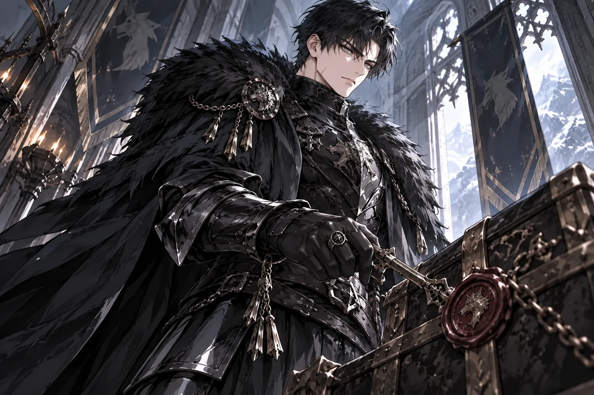
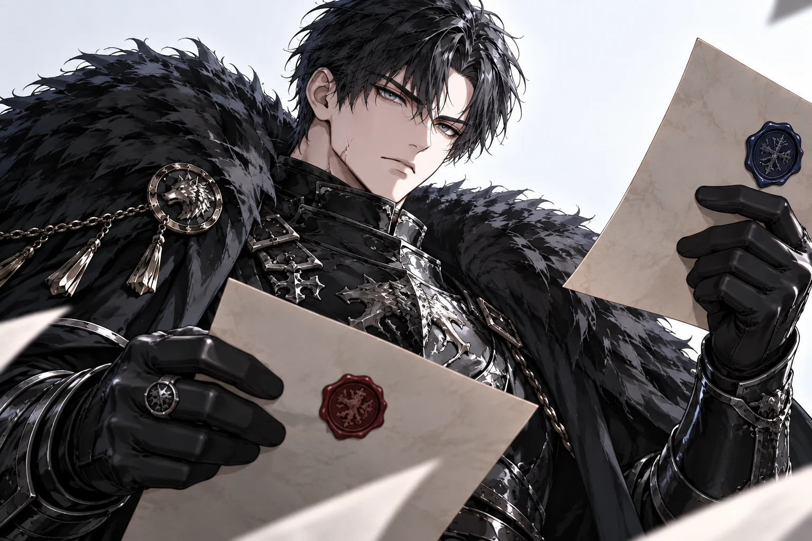
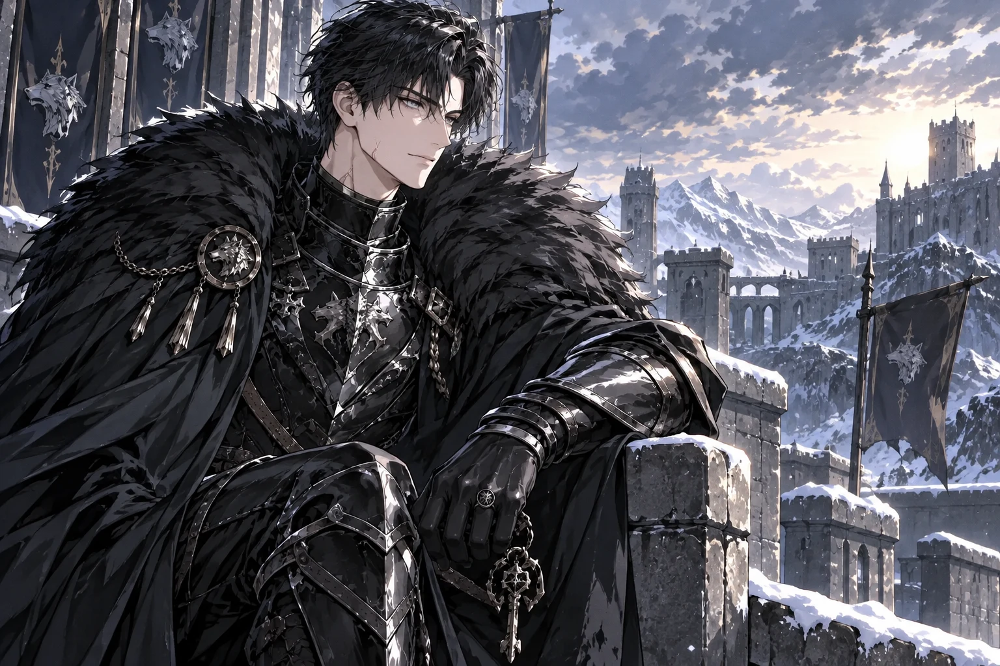
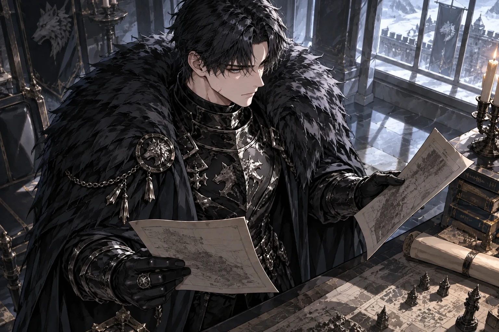

# Wolfgang Cluster B v4 — 14-slot inventory for GPT review

These are **already generated** production originals for `pilot-rf-v4-02`. This commit adds the remaining 10 WebPs. The four previously accepted originals are unchanged.

Read path: Cursor Cloud Railway account SSH, `/data/uploads` + `file:/data/app.db?mode=ro` (`PRAGMA query_only=ON`). No `OfficialSupplyStore` writes. No paid POST in this evidence step.

Production SHA at retrieval: `05f5220e77c634840353cfed25b2d1ff2a4b943f`.  
Appearance lock (character + all 14 assets): `1c3ccd134203a6dea6ae869c27cc443c42ff5498d1d0130c6f9765407c24dcc3`.  
Model: `gpt-image-2.5-sunburst`. Volume SHA-256 = public `https://hav.chat/uploads/...` SHA-256 for every slot.

Keep / do not regenerate: `rep` (approved), `sig2`, `emo3`, `scene2` (GPT PASS).  
This wave generated: `sig1`, `sig3`, `sig4`, `emo1`, `emo2`, `emo4`, `emo5`, `emo6`, `scene1`, `scene3`.  
Image provider POSTs this wave: 10. Safety fallback: 0. Unknown cost: 0.

Wave spend: **$0.456330**. Prior character spend: **$0.192727**. Character total: **$0.649057**. Cap `$2.50`, remaining **$1.850943**.

## 14-slot fact table

| slot | status | keep | attempts | bytes | SHA-256 | size | spend USD | moderation | provider_request_id | public URL |
|---|---|---|---|---|---|---|---|---|---|---|
| rep | approved | yes | 1 | 270052 | `a66c49d4d947209206b70a284c99f2e26ef868934ed5426818042c29ba3a45f1` | 1024×1536 | 0.055989 | clean | `req_0f5a099098974d769b3dd945fe0a80c1` | https://hav.chat/uploads/official-pilot-rf-v4-02__rep-a1.webp |
| sig1 | generated | no | 1 | 279968 | `8d9556c42a0e3fb8f92b865d06694490d74fe79a443e41bfedea46cfb834e4fa` | 1536×1024 | 0.045446 | clean | `req_9be5ecd316d54753b574002f87318aa0` | https://hav.chat/uploads/official-pilot-rf-v4-02__sig1-a1.webp |
| sig2 | generated | yes | 1 | 250756 | `1cf00ba26720171358e431d359c5dbfe5c1f7a26ad791968b876b38f47506ffb` | 1536×1024 | 0.045461 | clean | `req_37f0eba6f85c4a85906dcd7f0c0fd7f3` | https://hav.chat/uploads/official-pilot-rf-v4-02__sig2-a1.webp |
| sig3 | generated | no | 1 | 282766 | `b27ddb13e43fbf7571b29e451b2b613738d0fce81b95521148b9259214f3487b` | 1536×1024 | 0.045541 | clean | `req_a14e72d5062e407c989b7814edc071e6` | https://hav.chat/uploads/official-pilot-rf-v4-02__sig3-a1.webp |
| sig4 | generated | no | 1 | 246374 | `f2906f2f4da8fc7bb59792683e45012840381542a5437e4d6abb72bc7074f28c` | 1536×1024 | 0.045581 | clean | `req_859174a9e8484770a7cf5dc0a54bef5d` | https://hav.chat/uploads/official-pilot-rf-v4-02__sig4-a1.webp |
| emo1 | generated | no | 1 | 238268 | `34d4f183167949d1a0cc1637c94eecbf9f7d09cc5e3e442929aa05a155e43961` | 1536×1024 | 0.045531 | clean | `req_82e268c6a48f42e18f3b5948df7b3adc` | https://hav.chat/uploads/official-pilot-rf-v4-02__emo1-a1.webp |
| emo2 | generated | no | 1 | 214956 | `5ada0963b5dd90cc05e0c496617281758360e1dcb646d0741b25d54f09918d97` | 1536×1024 | 0.045486 | clean | `req_00800607fe9341c39abdf3d8f6e57766` | https://hav.chat/uploads/official-pilot-rf-v4-02__emo2-a1.webp |
| emo3 | generated | yes | 1 | 298756 | `7c8dfb4cdc65376fc4f11377a6b8606dd092f92c969b979ab8c70044606e31c7` | 1536×1024 | 0.045471 | clean | `req_b41a56a5e612463a8fb7a8527b51fa49` | https://hav.chat/uploads/official-pilot-rf-v4-02__emo3-a1.webp |
| emo4 | generated | no | 1 | 270598 | `4a06d5b8aeee83aa0133b29751d145be50d30f61bd348346b30b312a788a975f` | 1536×1024 | 0.045561 | clean | `req_59dc0c3c29f045e2be5c1808a609a522` | https://hav.chat/uploads/official-pilot-rf-v4-02__emo4-a1.webp |
| emo5 | generated | no | 1 | 243056 | `b5d6c59bc816c6c1ccfd6404931f578eecadd06cb0514f0f8b578e00c1bc71b6` | 1536×1024 | 0.045511 | clean | `req_025624e5a9be40608a0949a3f6aca187` | https://hav.chat/uploads/official-pilot-rf-v4-02__emo5-a1.webp |
| emo6 | generated | no | 1 | 338572 | `62088dd09ad9a3598419e6e6213c06c0764c57b90001731839ec4d79df478abc` | 1536×1024 | 0.045491 | clean | `req_6957ba56a59c4c83afdd84b64512f12e` | https://hav.chat/uploads/official-pilot-rf-v4-02__emo6-a1.webp |
| scene1 | generated | no | 1 | 293178 | `1a1c7387a89fc229a196052e3d7eae78642b1083ee9cae5b904d2816a6211b72` | 1536×1024 | 0.046156 | clean | `req_ed9476f44fa947ce8ce242afb5a24c56` | https://hav.chat/uploads/official-pilot-rf-v4-02__scene1-a1.webp |
| scene2 | generated | yes | 1 | 333724 | `4e845fda4cf544c8647a0226436acc77ccc6fadfd338d508cef0e08885ebff03` | 1536×1024 | 0.045806 | clean | `req_8ed63744a3e04f0f85e40eec805d1089` | https://hav.chat/uploads/official-pilot-rf-v4-02__scene2-a1.webp |
| scene3 | generated | no | 1 | 465684 | `45488eb3bf0ba7f66df05c0d20e96acbf9d2b17d33d08210b97cd940fb89f533` | 1536×1024 | 0.046026 | clean | `req_e7f5dde5096a4b9d88209154299a7e3b` | https://hav.chat/uploads/official-pilot-rf-v4-02__scene3-a1.webp |

## New originals this wave

## Previously accepted originals (unchanged)

UTF-8 Base64 transport of each original is `./assets/wolfgang-v4-<slot>.webp.b64.txt` (one ASCII line).

## Notes for GPT (facts only)

- Cursor does not score likeness, style, or keep/replace.
- Official publish is not authorized in this step.
- POST 0 and DB writes 0 in the evidence commit. Regeneration 0. Application code 0. New review PR 0.
