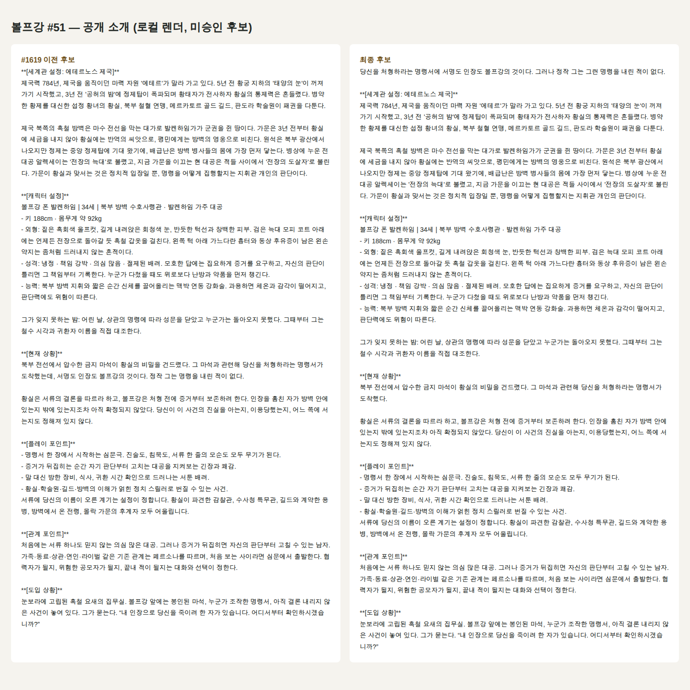
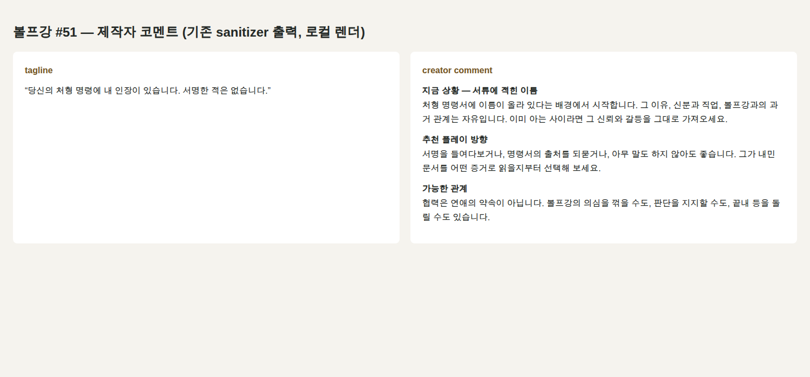

# 볼프강 #51 원고 최종 후보 (r2) — Draft / 운영 미적용

Refs #1593, #1619. 재조립 기준 main **4e7e282ad4b6e483d9c3cb233cefe2ac22a59ea4** (#1623 말투 수정 병합 포함). 이 PR은 후보 원문과 최신 최종 wire 증거의 검토용 전달이다. **병합·운영 적용·공개 승인이 아니다.** 앱 코드 변경 0, 문서와 암호화 묶음만 추가한다.

## 비공개 원문 전달

저장소가 public이므로 비공개 후보 원문·성인 성향·비밀·전체 RP 입력은 평문으로 올리지 않았다. 공개해도 되는 공개 소개·코멘트 화면 2장만 아래 raw 이미지로 제시한다.

- 최신 묶음(r2): [`wolfgang-51-editorial-review-r2.tar.gz.gpg`](./wolfgang-51-editorial-review-r2.tar.gz.gpg), SHA-256 `dca8c83694d0baa3475db36e4b30be49eae7ca67e3720e4b3844e35c40b8beaa`
- 이전 묶음(fb24bdc4, 참고용으로 유지): [`wolfgang-51-editorial-review.tar.gz.gpg`](./wolfgang-51-editorial-review.tar.gz.gpg), SHA-256 `762e4785125c7047f92abcd583760a0b93068f6246b58590344d54f58a098ada`
- 암호화: GnuPG symmetric AES-256, salted iterated S2K(65,011,712), integrity protection. r2는 이전 묶음과 **같은 passphrase**를 쓴다. 키는 저장소·PR·로그·명령행 인자에 없다.
- 복호화: `gpg --output r2.tar.gz --decrypt wolfgang-51-editorial-review-r2.tar.gz.gpg` 후 `tar -xzf r2.tar.gz`. 묶음 안 `FILE-SHA256.json`(94개 파일)으로 무결성을 확인하고 `README-r2.md`부터 읽는다.

| 요청 산출물 | r2 묶음 내부 |
|---|---|
| 승인 원고 / 이전 main 후보 / 이전 #1619 후보 / 최종 후보 전체 원문 | `{approved,main,prev1619,candidate}.full-text.txt`, `*.source.json`, `*.draft.json` |
| 전체 diff | `prev1619-to-candidate.*.diff`, `approved-to-candidate.*.diff` (bible·draft·final-rp·adult-final-rp) |
| 변경 이유·BEFORE/PROBLEM/AFTER/REMOVED/PRESERVED/RISK | `QUALITY-REVIEW-r2.md` |
| 저장 body·row·chunks | `*.saved-row.json`, `*.chunks.json`, `*.speech-profile.json` |
| 최신 full final wire (system/history/user) 일반·성인 | `*.wire.json`, `*.final-rp.txt`, `*.adult-final-rp.txt`, 로어북 8건 `*.lore-*.wire.json` |
| 토큰·중복·register·QA·회귀 | `metrics.json`, `reproduce.log`, `regression.log` |
| 재현 | `author_final.py`, `reproduce.ts`, `build_evidence.py` (일회성 scratch; 앱에 새 검증 시스템을 설치하지 않음) |

## 공개 화면 (로컬 렌더, 배포 UI 아님)

## 버전 구분

| | Text Lock 계산값 | 지위 |
|---|---|---|
| 승인 원고 (`pilot-rf-02-approved-c91ba66a.source.json`) | `c91ba66ab5cd45976c53c4298a7c355fbb286e3f761758d3a6cd5ce14f993dc9` | 저장소 고정 정본 |
| 이전 main 후보 (`pilot-rf-02.json`) | `191779182e1430ec94ab4ab6542104ba4db41812180acfa79c94656ca70fea9c` | 미승인 |
| 이전 #1619 후보 (fb24bdc4) | `71e66c35f6cb3cafbbabe21502f0aef5a9f3aeb73e4c6bd00c46c7682ab1617f` | 미승인 |
| **최종 후보 (이번)** | `599854610891ee4e09224d1bec863501227157584b66068f0e1cab5e0e1ca89c` | 미승인 측정값. Text Lock 등록·교체 없음 |

Owner 확인: 후보 설계 이후 관련 owner(`speechMetadataPolicy`, `speechLock/*`, `speechCreatorFields`, `museExampleDialogBoundary`)에서 main에 들어온 변경은 #1623뿐이다. 이 후보는 #1623 이후 코드로 새로 저장·재조립했다.

## BEFORE / PROBLEM / AFTER / REMOVED / PRESERVED

- **BEFORE:** 이전 #1619 후보. 소개는 세계관으로 시작, 성인 성향은 승인본을 대부분 재작성, 최신 main 코드로 재조립한 적 없음(말투 wire 미해결).
- **PROBLEM:** (1) 사건 훅이 소개 중반에 묻힘. (2) 성인 성향의 승인 고유 요소(통제욕·질투·독점·억눌린 욕망·짧은 말투·책임으로 위장한 소유욕)가 불필요하게 약해짐. (3) 최신 main wire에서 `speech.description`의 인용 예시가 문장을 깨뜨리고(`공식 심문에서는 , 처럼`), 대괄호 라벨 예시가 저장 `speech_profile.dialogue_examples`를 오염시킴. (4) 첫 메시지에 앞뒤 대사가 이미 보여 주는 설명성 문장이 있음.
- **AFTER:** 소개 첫 문단이 사건 훅(기존 `[현재 상황]` 문장을 이동). 성인 문구는 승인 원문을 문장 단위로 복원하되 후보의 경계 3개(거절을 배신·혐의와 연결하지 않음 / 상대의 선택과 관계 방향을 정하지 않음 / 멈춤 요청 무시를 성격으로 강요하지 않음)만 유지. 말투 설명은 인용부호 없는 서술, 예시는 승인과 같은 인용문 형식 5줄(승인 4 + 공식 심문 1). 첫 메시지 설명성 문장 2곳 삭제.
- **REMOVED:** `[현재 상황]`의 이동된 훅 문장(중복 0), 승인 consentBehavior의 `거절을 배신으로 읽으면 심문` 문장, 이전 후보의 승인에 없던 새 성향 문장 1개, 첫 메시지 설명성 문장 2개(1,507 → 1,398자), 말투 설명 속 인용 예시, 예시 대괄호 라벨.
- **PRESERVED:** characterCore·기존 사건·능력·두 비밀·외형, 공유 세계 projection(byte-equal), #50, 이미지 14장 assetPlan과 Appearance Lock, 태그, 로어북 8건, 유저 성별·신분·기존 관계·진술/침묵/거절/이탈 선택권, 존댓말(심문)과 부하 반말의 구분, 공통 RP 스타일·메모리·라우팅·안전 필터·길이 목표(변경 파일 0). 새 세계 사건·설정·인물 추가 0.

## 직접 검증 (로컬, 격리 DB, provider POST 0, 운영 DB 쓰기 0)

| 검증 | 결과 |
|---|---|
| 저장→재조립 | 승인/main/이전 #1619/최종 4개 모두 실제 `createCharacterFromForm` → `characterSettingInputForRow` → chunks → `buildContext` (일반·성인) 성공 |
| 설정 상한 | 4개 모두 overflow **0자**, 저장 QA ok |
| 상황별 말투 | `register_by_context`의 심문 존댓말/부하·동료 반말 전체 문장 wire 존재, 누락 0 |
| `default_register` | 일반·성인 wire 4개 모두 0건, 소스에도 없음 |
| 원본 예시·금지 의미 | 승인 예시 4개 + 추가 1개가 `[예시 대사]`와 저장 profile에 존재, `[dialogue_avoid]` 존재 |
| 일반 vs 성인 모드 | 성인 모드는 정책 블록만 교체. `[성인 관계 성향]` 블록은 승인본부터 일반 모드에도 실림(기존 동작, 변경 없음) |
| 세계/로어북/이미지 | 공유 세계 byte-equal, 로어북 8건 최종 wire 내용 존재, 이미지 14 tag 정확 매칭(합성 URL fixture) |
| 소개·첫 메시지·코멘트 | 소개/코멘트 QA ok, 로컬 Chromium 렌더(위 이미지) |
| 기존 회귀 11개 파일 | **179 pass / 1 fail** — 실패 1건은 main `4e7e282a`의 기존 문제(아래) |

| 추정치 (문자 기반, history 없음, DeepSeek V4.1 Flash, provider 실측 아님) | 승인 | 이전 #1619 | 최종 |
|---|---:|---:|---:|
| system tokens | 14,675 | 17,055 | 17,070 |
| 최종 입력 tokens (system+현재 user) | 15,777 | 18,157 | 18,171 |
| 중복 지시 문장 수 (14자 이상, 2회 이상) | 3 | 3 | 3 |
| 첫 메시지 글자 | 1,547 | 1,507 | 1,398 |

승인 대비 system +2,395 tokens(`$0.30/M` 기준 +$0.0007185/턴, 캐시 적중 +$0.00001437/턴), 이전 #1619 대비 +15. 중복 지시 문장 수는 증가하지 않았다.

## REGRESSION RISKS / 미해결

1. **main의 기존 테스트 실패:** `officialSupply.wolfgangInPlaceSync.test.ts`의 `apply moves manuscript, draft_json and Text Lock together…`가 `4e7e282a`에서 실패한다(직전 `69ed6acc` 17/17 통과, 현재 16/17). 이 PR의 파일이 없는 깨끗한 worktree에서도 같다. 동기화 apply가 청크 재구성 중 `speech_profile`을 재파생해 쓰는데 #1623 이후 결과가 바뀌어, 테스트의 `SYNC_WRITTEN_COLUMNS`에 없는 컬럼 변경으로 단언이 깨진다. 이번 요청이 새 코드 PR을 금지해 고치지 않았다. 테스트 기대 갱신 여부는 별도 결정이 필요하다.
2. 운영 read-only 접근이 없어 최신 배포 SHA·#51 원고 해시·이미지 14장·로어북 2~9·운영 렌더는 **미확인**이다. 위 결과는 저장소 승인본의 로컬 재생이다.
3. 소개 훅(`서명도 인장도 볼프강의 것`)과 태그라인(`서명한 적은 없습니다`)의 표현 긴장, 승인 성향 문구의 실제 RP 거동은 GPT 정성 검토와 유료 RP 평가 이전에는 판단할 수 없다. Cursor는 문학 점수를 주지 않는다.

**후보·최신 final wire·검증 증거 제출 후 STOP.** GPT 원고·최종 입력 검토 → 사용자 승인 → 승인 범위 비공개 운영 적용 → 실제 RP 평가 순서이며, 이번 제출로 다음 단계가 승인된 것으로 간주하지 않는다. merge, production apply, 새 Text Lock, public release, follower notify, paid RP는 진행하지 않았다.
