# Wolfgang #51 — historical vs e22 RP & image review pack

Evidence-only bundle for **GPT and human review**. No runtime code changes.

## What this is

| Chat | Manuscript | Evidence | URL |
|---|---|---|---|
| **803** | Pre-e22 Text Lock `59985461…` | **DB-verified** `messages.content` (2026-10-20) | [chat803-historical-full.md](./chat803-historical-full.md) |
| **804** | Post-e22 Text Lock `e22ba966…` (greeting 1411) | **UI extraction** (2026-10-21) | [chat804-e22-full.md](./chat804-e22-full.md) |

Turn mapping, lengths, SHA-256, and input deltas: [turn-comparison.md](./turn-comparison.md).

Live chat 804: https://hav.chat/chat/51?chat=804

## Comparison conditions (fixed)

- Character **#51**, persona **렌** (fictional user persona name)
- Model **GPT-6.1 Sol** (`gpt-6.1-sol`)
- Adult / handoff **OFF**, safe path
- Four user turns from the 803 scenario (with documented spacing/wording deltas on 804)
- **803** must not be read as post-e22 quality; **804** is not DB-verified in this pack

## RP full text (click to read)

1. [803 historical — all 4 user + 4 assistant turns](./chat803-historical-full.md)
2. [804 e22 — prose + status widget separated per turn](./chat804-e22-full.md)
3. [Turn comparison table](./turn-comparison.md)

804 status widget blocks (현재상황 / 현재목표 / 속마음) are **UI-only** and listed under each turn in `chat804-e22-full.md`, not mixed into narrative prose.

## Registered images (14) — production URLs & SHA-256

Manifest: [images/asset-manifest.json](./images/asset-manifest.json) (all downloads matched expected SHA-256 at pack time).

| Slot | Tag | Production URL | Repo file |
|---|---|---|---|
| rep | 기본 초상 | https://hav.chat/uploads/official-pilot-rf-v4-02__rep-ext-6baa8d35-d1aa-4dfc-bf6e-04ead314cb2e.webp | [rep-기본-초상.webp](./images/rep-기본-초상.webp) |
| sig1 | 지도를 짚음 | https://hav.chat/uploads/official-pilot-rf-v4-02__sig1-ext-6b53d049-b4c8-4457-bedd-72fa17c9b016.webp | [sig1-지도를-짚음.webp](./images/sig1-지도를-짚음.webp) |
| sig2 | 턱을 괴고 생각 | https://hav.chat/uploads/official-pilot-rf-v4-02__sig2-ext-32f097a5-e3f6-4b06-88b7-40c7829c8d41.webp | [sig2-턱을-괴고-생각.webp](./images/sig2-턱을-괴고-생각.webp) |
| sig3 | 열쇠를 확인함 | https://hav.chat/uploads/official-pilot-rf-v4-02__sig3-ext-253da691-52bb-4cf2-a74c-88de990e612c.webp | [sig3-열쇠를-확인함.webp](./images/sig3-열쇠를-확인함.webp) |
| sig4 | 옅은 미소 | https://hav.chat/uploads/official-pilot-rf-v4-02__sig4-ext-2d768d87-88a0-4123-9be6-87a640929378.webp | [sig4-옅은-미소.webp](./images/sig4-옅은-미소.webp) |
| emo1 | 의심 | https://hav.chat/uploads/official-pilot-rf-v4-02__emo1-ext-bc8a6e2d-cc94-4409-a25b-e7e3aa0fbeb8.webp | [emo1-의심.webp](./images/emo1-의심.webp) |
| emo2 | 분노 | https://hav.chat/uploads/official-pilot-rf-v4-02__emo2-ext-b63c5a1c-c0b7-45ad-9d34-85c4a08a8767.webp | [emo2-분노.webp](./images/emo2-분노.webp) |
| emo3 | 진지함 | https://hav.chat/uploads/official-pilot-rf-v4-02__emo3-ext-4cfdc95f-8c6f-48ba-82ea-cb19cb19a491.webp | [emo3-진지함.webp](./images/emo3-진지함.webp) |
| emo4 | 당황 | https://hav.chat/uploads/official-pilot-rf-v4-02__emo4-ext-ec637480-9df5-463a-8923-48880e63d104.webp | [emo4-당황.webp](./images/emo4-당황.webp) |
| emo5 | 편안함 | https://hav.chat/uploads/official-pilot-rf-v4-02__emo5-ext-43e442a4-5dab-47e2-9f70-3f564d2b1bb5.webp | [emo5-편안함.webp](./images/emo5-편안함.webp) |
| emo6 | 안도 | https://hav.chat/uploads/official-pilot-rf-v4-02__emo6-ext-b374c159-8842-4bb3-a4fd-0840e62ec655.webp | [emo6-안도.webp](./images/emo6-안도.webp) |
| scene1 | 문서를 대조함 | https://hav.chat/uploads/official-pilot-rf-v4-02__scene1-ext-fe9d8e81-fc66-42f7-a6c7-7fd24df0dc92.webp | [scene1-문서를-대조함.webp](./images/scene1-문서를-대조함.webp) |
| scene2 | 기록을 맞춤 | https://hav.chat/uploads/official-pilot-rf-v4-02__scene2-ext-6697c6a9-7249-4514-a31c-ca7425107de5.webp | [scene2-기록을-맞춤.webp](./images/scene2-기록을-맞춤.webp) |
| scene3 | 긴장 | https://hav.chat/uploads/official-pilot-rf-v4-02__scene3-ext-6f3ad821-0579-4171-9dfc-de2967c54b4a.webp | [scene3-긴장.webp](./images/scene3-긴장.webp) |

### Gallery preview (representative + sig4 + UI)

**Representative (rep)**

**sig4 — 옅은 미소**

**Other slots (12)**

| sig1 | sig2 | sig3 |
|:---:|:---:|:---:|
| 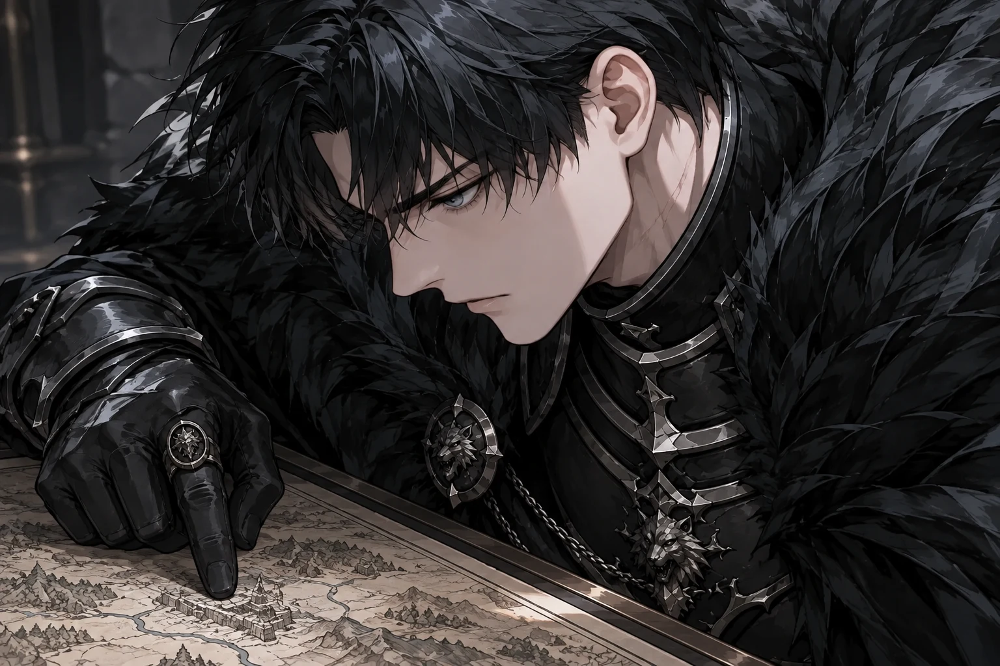 | 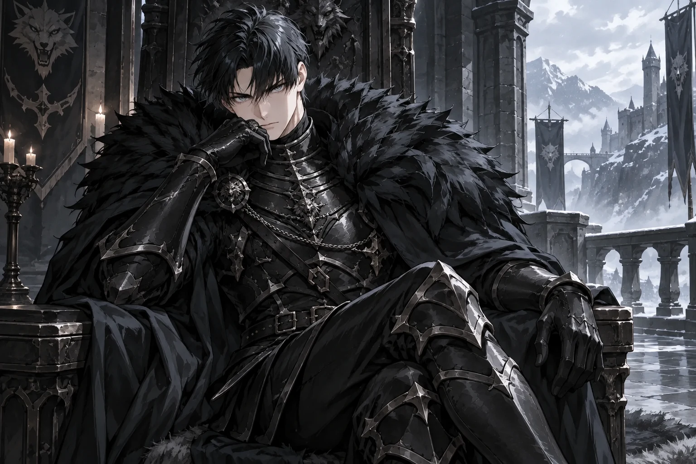 | 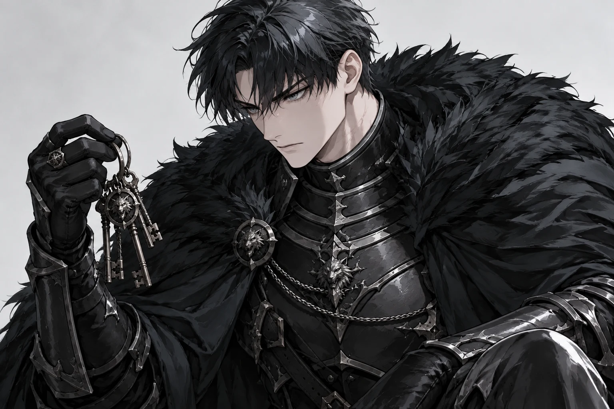 |

| emo1 | emo2 | emo3 |
|:---:|:---:|:---:|
| 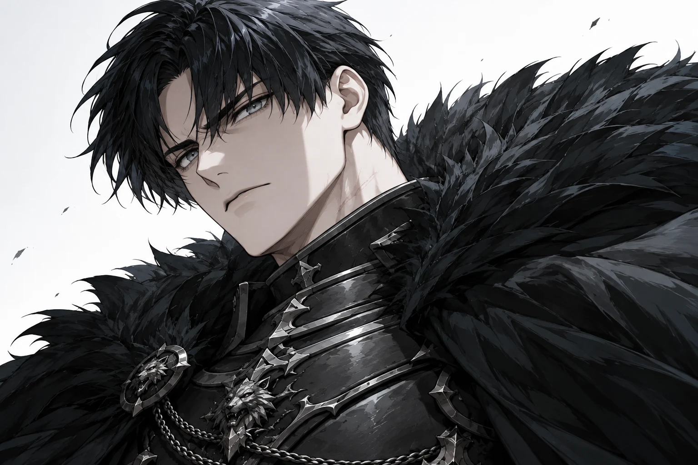 | 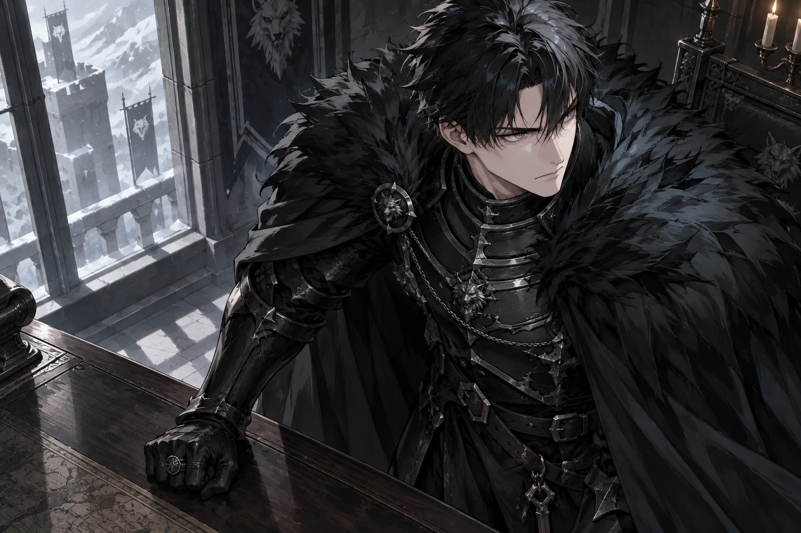 | 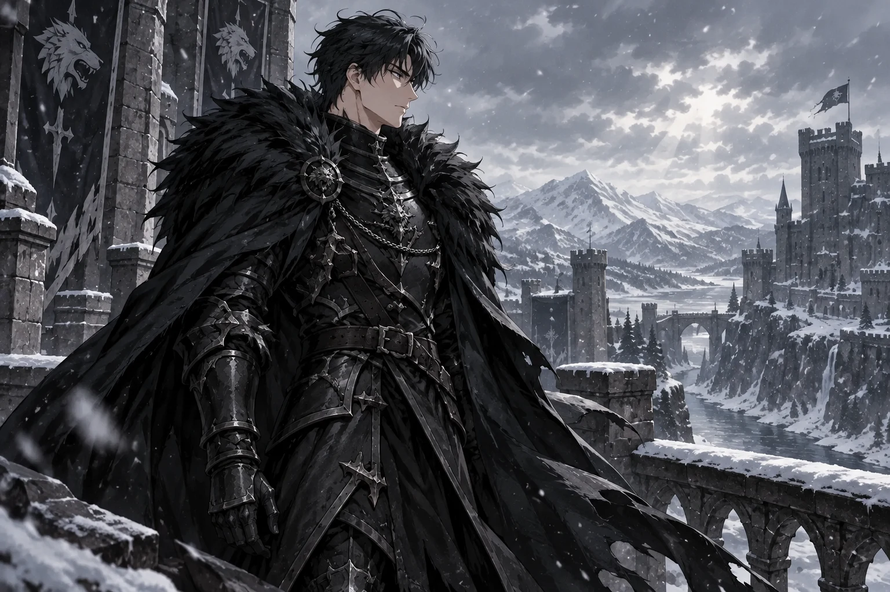 |

| emo4 | emo5 | emo6 |
|:---:|:---:|:---:|
| 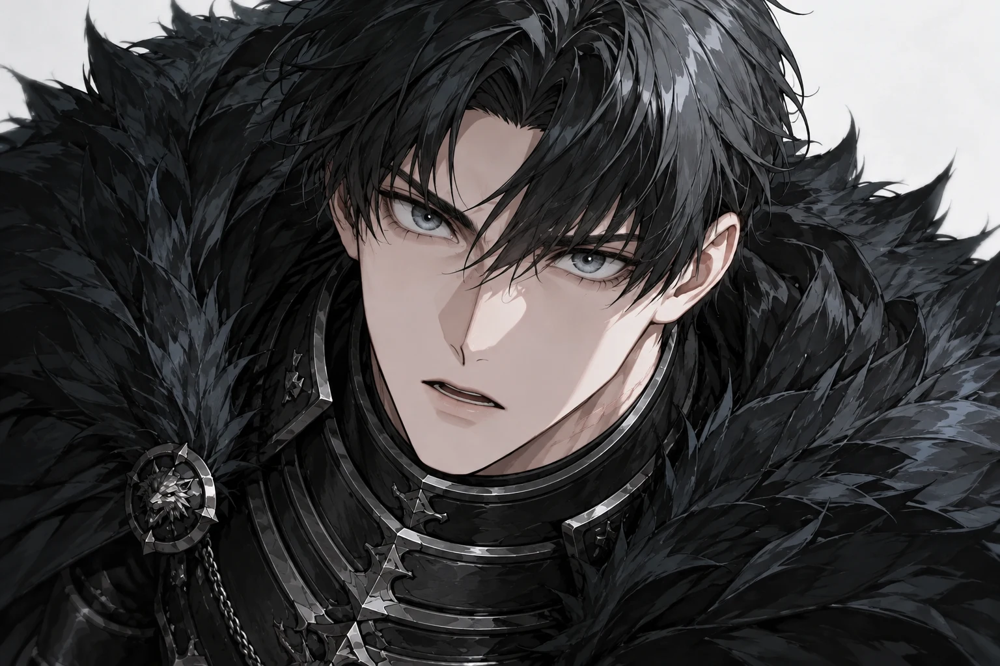 | 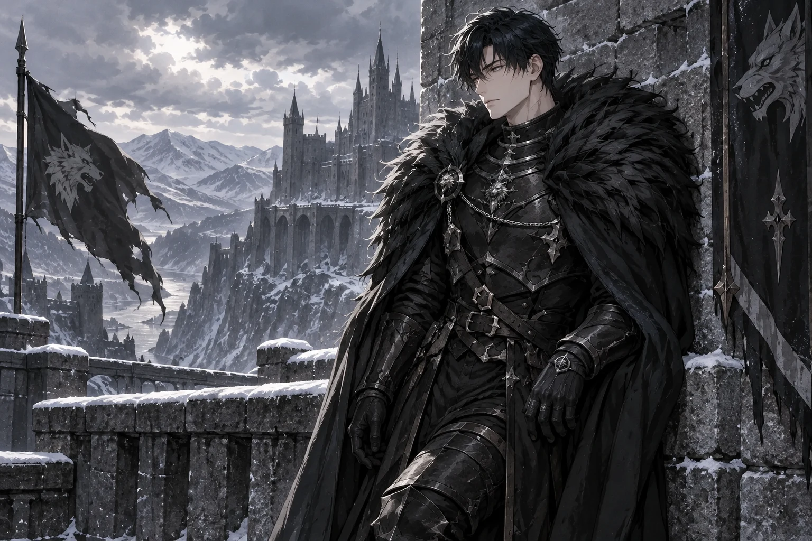 |  |

| scene1 | scene2 | scene3 |
|:---:|:---:|:---:|
|  |  | 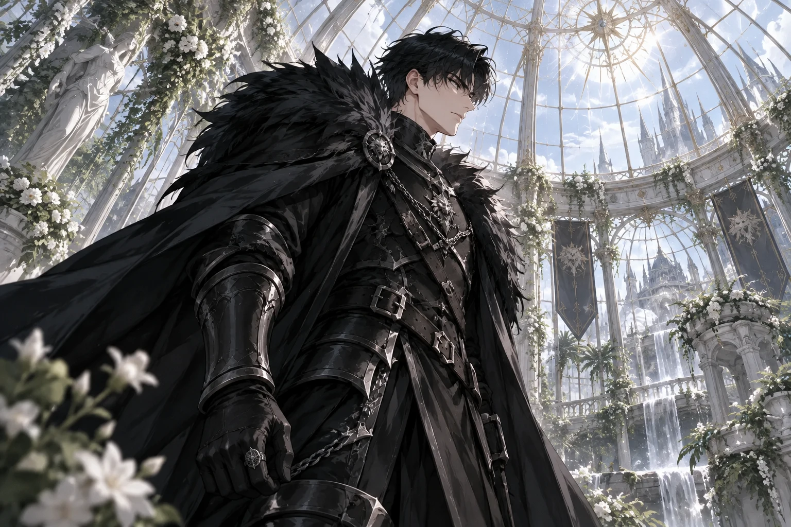 |

**Chat 804 UI (turn 1–4)**

| Turn 1 | Turn 2 |
|:---:|:---:|
| 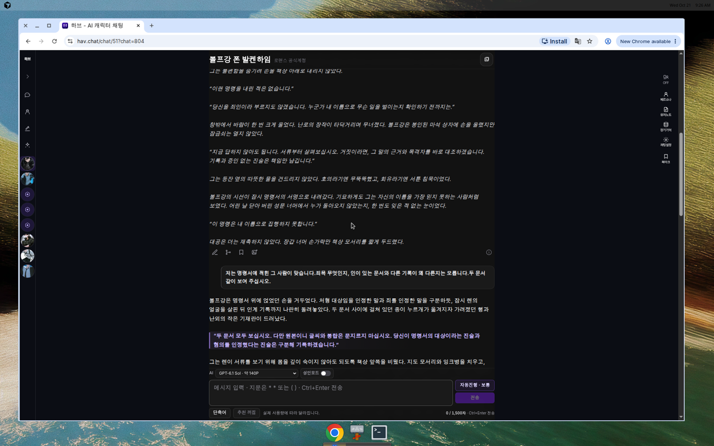 | 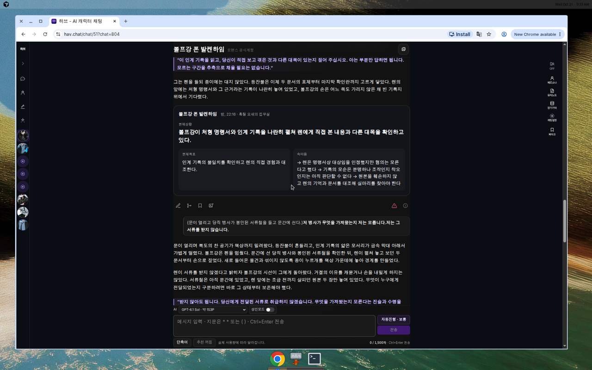 |

| Turn 3 | Turn 4 |
|:---:|:---:|
| 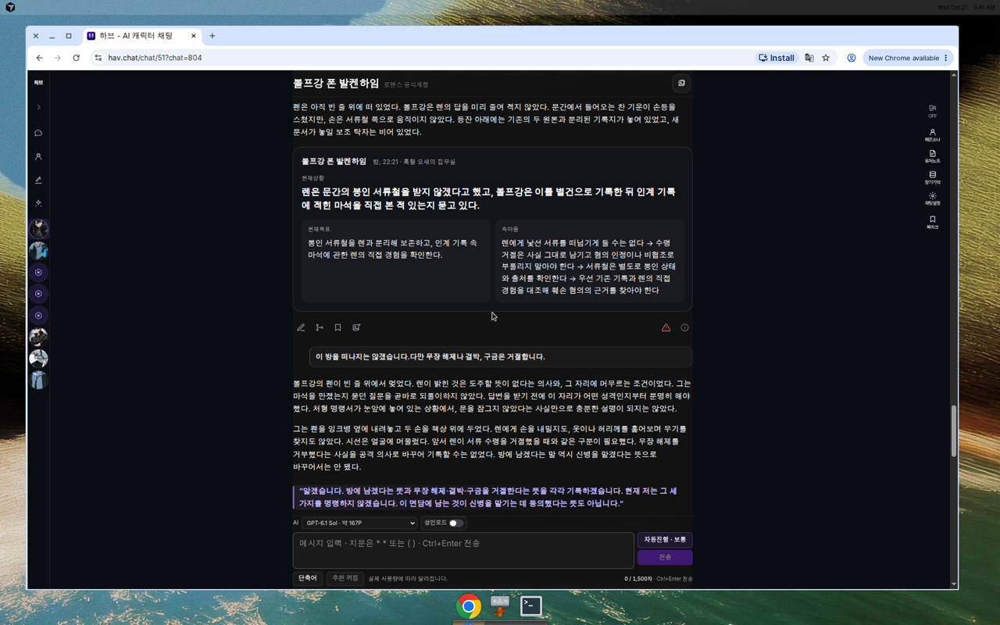 | 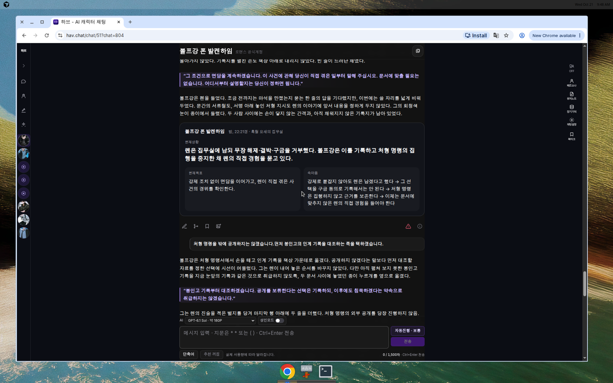 |

## Privacy / redaction review (pre-upload)

Included: fictional RP prose, persona name **렌**, character **볼프강**, public `hav.chat` asset URLs, internal numeric ids (chat 803/804, message ids).

**Excluded / not present:** admin email, session tokens, API keys, system prompts, wire JSON bodies, other users’ chats, persona secret description full text.

UI screenshots may show logged-in chrome; pack uses captures taken for review — **no passwords or tokens** in repo files.

## GPT review checklist (Cursor does not score)

- Korean naturalness
- Wolfgang voice, personality, psychology
- Plot / relationship progression
- Spatial & action consistency
- Repetition / cliché
- Historical (803) vs e22 (804) quality delta
- Representative + 13 slot images: identity / style consistency
- sig4 replacement need (visual only; no auto swap)
- Observed UI image transitions on chat 804 (tags / inline cuts)

## Provenance

- 803: copied from verified export `w51-chat803-rp-transcript-for-gpt.md` (SHA table in `turn-comparison.md`)
- 804: structured from UI extraction `chat804_turns.txt`
- Images: downloaded from production CDN URLs without resize/re-encode (bytes SHA-checked)
